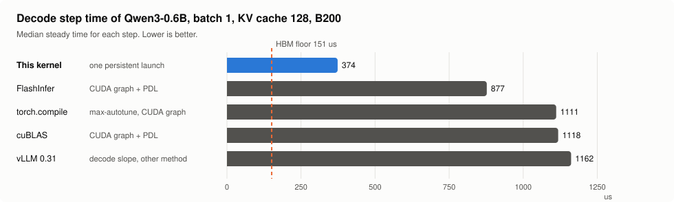
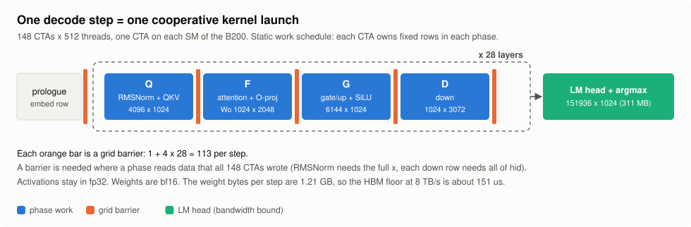
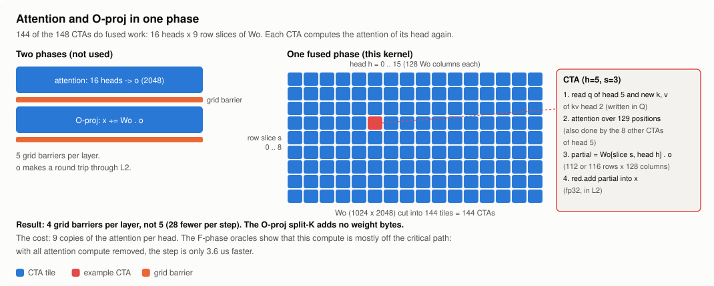
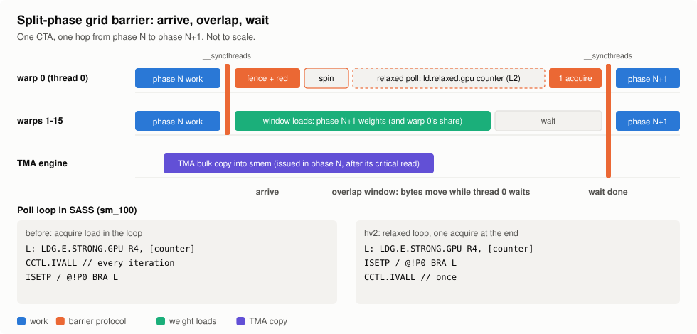
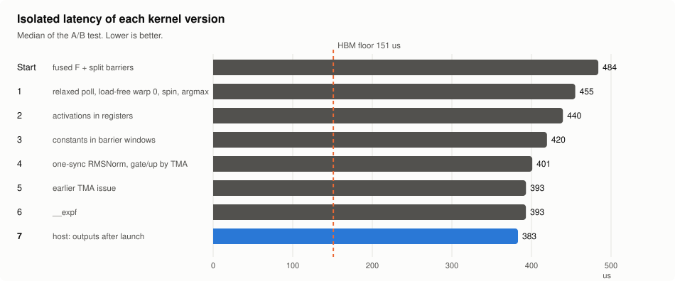
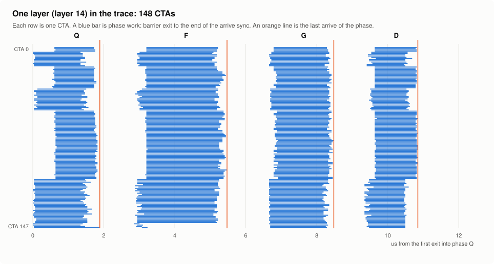
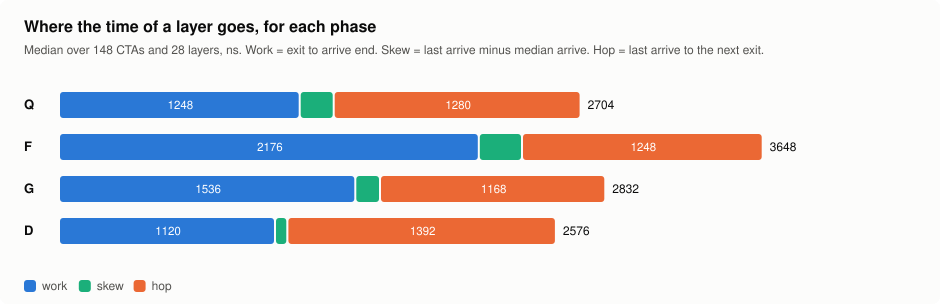

# Qwen3-0.6B decode megakernel

This repository contains one CUDA kernel that does a full decode step of Qwen3-0.6B.
The step has 28 layers, the LM head and the argmax, all in one launch.
The kernel runs on an NVIDIA B200 at batch 1, with a KV cache of 128 tokens.

## Current performance

The kernel does one decode step in 374 us.
This time is 2.3 times shorter than the time of the fastest baseline, FlashInfer with a CUDA graph and PDL.

| System | Setup | Steady time per step (ms) | Isolated latency (ms) | Speedup |
|---|---|---|---|---|
| This kernel | One persistent launch | 0.374 | 0.377 to 0.382 | 1.0 |
| FlashInfer 0.7.0.post1 | BF16 GEMM kernels, CUDA graph, PDL | 0.877 | 0.875 | 2.3 |
| torch.compile | max-autotune, CUDA graph | 1.111 | 1.122 | 3.0 |
| cuBLAS | PyTorch kernels, CUDA graph, PDL | 1.118 | 1.119 | 3.0 |
| vLLM 0.31.0 | Decode slope, mean context 142 (a different method) | 1.162 | Not measured | 3.1 |

- One job measured all the rows except vLLM, on one B200. The SM clock was 1965 MHz. The measured HBM bandwidth was 6569 GB/s.
- The software was driver 580.178.04 and torch 2.13.0.
- The kernel uses 40 % of the HBM bandwidth limit of 8 TB/s. The FlashInfer baseline uses 17 %.
- The vLLM value is the slope of the step time against the number of decode steps. It is not a direct comparison.
- The isolated latency in this table comes from the comparison harness. The A/B tests below use the harness of this repository, which gives 383 us.

<picture>
  <source media="(prefers-color-scheme: dark)" srcset="docs/img/results-dark.svg">
  
</picture>

<picture>
  <source media="(prefers-color-scheme: dark)" srcset="docs/img/overview-dark.svg">
  
</picture>

## Contents

- [Current performance](#current-performance)
- [The kernel in short](#the-kernel-in-short)
- [The main ideas](#the-main-ideas)
- [The measured path](#the-measured-path)
- [A trace of the kernel](#a-trace-of-the-kernel)
- [Current bottlenecks](#current-bottlenecks)
- [Ideas that did not work](#ideas-that-did-not-work)
- [Xtrace: the trace attempt](#xtrace-the-trace-attempt)
- [Reproduce the results](#reproduce-the-results)
- [Measurement method](#measurement-method)
- [Repository layout](#repository-layout)

## The kernel in short

- One persistent cooperative launch does the full step. The grid has one CTA of 512 threads on each SM (148 CTAs on a B200).
- The work schedule is static. Each CTA gets a fixed set of rows and heads for each phase. No CTA takes work from a queue.
- Each layer has four phases: Q, F, G and D. A grid barrier separates two dependent phases.
  - Q: RMSNorm, then the QKV projection (4096 x 1024), RoPE and the q/k norms.
  - F: attention and the O-projection in one phase (refer to the next section).
  - G: RMSNorm, then the gate and up projections (6144 x 1024) and SiLU.
  - D: the down projection (1024 x 3072).
- The step has 113 grid barriers: one after the prologue and four for each layer. The LM head (151936 x 1024) and the argmax come last.
- The weights are bf16. The activations stay in fp32.
- The kernel uses 126 registers for each thread and has no spill.
- The kernel does not change the KV cache. It returns the new K and V rows (`k_write`, `v_write`). The caller can write them into slot 128.

The case is fixed: batch 1, decode at position 128 (129 attended positions).
The kernel does not support other positions.

## The main ideas

The order of this section is the order of the gain, or of how new the idea is.
The fused phase and the split barrier were in the kernel before the first measurement.
Thus we did not measure the gain of each of these two ideas.
For the other ideas, the gain comes from an A/B test of the isolated latency.
A negative gain in microseconds is a decrease of the step time.

### 1. Attention and O-projection in one phase

Usually, attention and the O-projection are two phases with a grid barrier between them.
Attention writes the output of all 16 heads. Then the O-projection reads all of them.

In this kernel, phase F does the two operations. Phase F uses 144 CTAs: 16 q-heads x 9 row slices of `Wo`.
Each CTA owns one q-head and one slice of 112 or 116 rows of `Wo`.

The CTA calculates the softmax of its head over all 129 positions.
Then it multiplies its 128 head outputs by its slice of `Wo`.
It adds the result into the hidden state with `red.global.add` (a split-K sum over the heads).

<picture>
  <source media="(prefers-color-scheme: dark)" srcset="docs/img/fused-attn-oproj-dark.svg">
  
</picture>

Each head does its attention 9 times, one time in each of its 9 CTAs.
This extra work is small. When we removed all the attention work in a test, the step became only 3.6 us faster.

The fused phase removes one grid barrier in each layer, thus 28 barriers in each step.
One grid barrier costs approximately 1.2 us (refer to [A trace of the kernel](#a-trace-of-the-kernel)), thus the estimate of the gain is approximately 34 us.
This value is an estimate from the barrier cost. We did not measure it directly.

### 2. Split-phase grid barriers

A grid barrier has two parts: an arrive and a wait.

- Arrive: the CTA does `__syncthreads`. Then thread 0 does a release add (`red.release.gpu`) on a counter.
- Wait: thread 0 reads the counter until all the CTAs arrived. Then the CTA does `__syncthreads`.

The weights of the next phase do not depend on the result of the current phase.
Thus, the kernel puts the weight loads of the next phase between the arrive and the wait.
The barrier latency and the HBM latency of the weights then occur at the same time.

<picture>
  <source media="(prefers-color-scheme: dark)" srcset="docs/img/split-barrier-dark.svg">
  
</picture>

The kernel uses three paths for these loads:

- Warps 1 to 15 load the weights for their own rows into registers.
- The share of warp 0 goes into a shared-memory stage with `cp.async`.
- The gate/up rows and the down rows of a layer go into dynamic shared memory with TMA bulk copies.

### 3. Warp 0 does not load weights

Thread 0 is in warp 0, and thread 0 reads the barrier counter.
In a previous version, warp 0 also loaded weights between the arrive and the wait.

In this kernel, warp 0 loads no weights between the arrive and the wait.
Warps 1 to 15 load the share of warp 0 into the shared-memory stage.
After the wait, warp 0 copies its share from the stage into its registers.
The gain is -8.0 us and -12.2 us in two A/B tests.

We do not know the mechanism. One possible cause: the acquire fence after the poll no longer waits for the loads of warp 0.

### 4. Relaxed poll and a spin before the poll

Thread 0 reads the barrier counter with `ld.relaxed.gpu`, not with `ld.acquire.gpu`.
After the last read, thread 0 does one `fence.acquire.gpu`.
Thus the acquire cost occurs one time for each barrier, not one time for each read.
The gain is -6.1 us to -6.7 us.

Before the first read, thread 0 waits a fixed number of clock cycles.
The number is different for each barrier (0 to 735 cycles, refer to `SPIN_*` in the kernel).
The gain is -2.2 us and -3.8 us in two A/B tests. We do not know the mechanism.

### 5. Other changes

- Activations in registers: each warp keeps its part of the activation vector in registers during the GEMV. The gain is -15 us to -19 us.
- Constant tables and the first LM-head rows load between arrive and wait. The gain is approximately -21 us.
- RMSNorm with one `__syncthreads`: the kernel scales the row sums after the dot product. The gate/up rows go into shared memory with TMA. The gain is -19 us to -21 us.
- Earlier TMA issue: the kernel starts the gate/up copy after the setup sync of phase F, and the down copy after the norm sync of phase G. The gain is -4 us to -9 us.
- Parallel argmax: each CTA finds its own maximum, then the last CTA to arrive finds the global maximum. The gain is -4.5 us to -6.1 us.
- `__expf` in the softmax. The gain is -2.3 us.
- Host: the output buffers for the next call are allocated after the launch, not before it. The gain is -10.6 us of isolated latency.

## The measured path

Each row is one kernel version. The time is the median isolated latency. Two values are two runs of the same A/B test.

| Version | Isolated latency (us) | Change from the row above | Gain (us) |
|---|---|---|---|
| Start | 484 | Fused phase F and split-phase barriers | - |
| 1 | 455 | Relaxed poll, load-free warp 0, spin before the poll, parallel argmax | -29 |
| 2 | 441 / 438 | Activations in registers | -15 to -19 |
| 3 | 419 / 420 | Constants and the first LM-head rows load in the barrier windows | approximately -21 |
| 4 | 399.5 / 402.4 | RMSNorm with one sync, gate/up by TMA | -19 to -21 |
| 5 | 392.7 / 393.5 | Earlier TMA issue | -4 to -9 |
| 6 | 392 / 394 | `__expf` | -2.3 |
| 7 (this kernel) | 382.9 / 383.2 | Host: output buffers after the launch | -10.6 |

<picture>
  <source media="(prefers-color-scheme: dark)" srcset="docs/img/path-dark.svg">
  
</picture>

## A trace of the kernel

We recorded a trace of the kernel with IKET (`run-iket`, part of the `nvidia-cutlass-dsl` package).
The traced build adds 16 point markers for each warp to the kernel source.
In each phase, the markers are before and after the wait `__syncthreads`, and before and after the arrive `__syncthreads`.
With the markers compiled out, the SASS is the same as the SASS of this kernel.
The time stamps come from `%globaltimer`, with steps of 32 ns.

The trace has all 28 layers, 148 CTAs and 16 warps for each CTA: 1.06 million markers for each launch.
We used the launch with the median time of 20 launches.
That launch takes 378.2 us from the first warp start to the last warp end. The 20 launches take 376.6 us to 380.7 us.

The kernel without markers takes 377 us for each launch (CUDA events, which also include the launch).
Thus the cost of the markers is small. We did not measure it more accurately.

Two checks on the trace:

- No marker after a barrier is earlier than the last marker before the same barrier (530432 checks, 0 failures).
- In each warp, the markers are in the correct order (0 failures). This check does not include the marker before the wait sync. In 70 CTAs, warp 0 records one more of that marker in the prologue, so its layer count is shifted.

<picture>
  <source media="(prefers-color-scheme: dark)" srcset="docs/img/layer-timeline-dark.svg">
  
</picture>

<picture>
  <source media="(prefers-color-scheme: dark)" srcset="docs/img/layer-breakdown-dark.svg">
  
</picture>

The definitions:

- Work: the time from the barrier exit of a CTA to the end of its arrive sync.
- Skew: the arrive time of the last CTA minus the arrive time of the median CTA.
- Hop: the exit time of the median CTA into the next phase minus the arrive time of the last CTA. The hop includes the release fence, the counter add, the poll, the acquire fence and the wait sync.

| Phase | Work (ns) | Skew (ns) | Hop (ns) |
|---|---|---|---|
| Q | 1248 | 176 | 1280 |
| F | 2176 | 224 | 1248 |
| G | 1536 | 128 | 1168 |
| D | 1120 | 64 | 1392 |

A layer takes 11.6 us (median). The step has three parts:

| Part | Time (us) |
|---|---|
| Prologue (to the first exit into phase Q) | 3.2 |
| 28 layers | 324.6 |
| LM head and argmax (from the last arrive of phase D) | 50.4 |

What the trace shows:

1. The skew and the hop take approximately 48 % of each layer. The skew is small: 64 ns to 224 ns for each phase.
2. The hop after phase D is the longest (1.39 us). The hop after phase G is the shortest (1.17 us).
3. A fixed group of 78 of the 148 SMs exits each barrier later than the other SMs.
   The difference is 0.53 us into phase Q, 0.26 us into phases F and D, and 0.13 us into phase G.
   The group is the same in all 28 layers. In 27 of 28 layers, the last CTA to arrive in phase Q is in this group.

Of the 78 late SMs, 38 have an SM id below 74, and 40 have an SM id of 74 or more. Thus a split by SM id does not explain the group.
We do not know the cause.

We used a model to estimate the cost: the late CTAs exit with the early CTAs, and their work stays the same.
In this model, the step is approximately 19 us faster. We did not measure this.

The file `docs/data/iket_trace.json` holds the data of the charts. The script `docs/gen_trace_charts.py` draws them.

## Ideas that did not work

Each result is the change of the isolated latency in an A/B test. A positive value is a slower step.

| Idea | Result |
|---|---|
| Split-K down projection (3 grid barriers in each layer) | +23 us to +53 us |
| A wait for the CTAs of one KV group between phase Q and phase F | +12 us |
| A low-latency hand-off (flag and data in one store) between phase D and phase Q | +1.2 us and +1.6 us |
| LM-head rows into L2 during the last layers | +2.5 us to +6 us |
| A smaller shared-memory carveout (fewer down rows in shared memory) | +9 us to +16 us |
| Thread-block clusters | Not possible: with clusters, only 112 to 120 CTAs fit on the GPU |
| CTA pipelining across phases | Not tested on the GPU: an analysis on paper showed no gain at batch 1 |
| The `tcgen05` tensor-core path for the GEMVs | 666 us against 386 us: each MMA takes approximately 59 cycles, and at batch 1 the MMA count sets the time |

## Reproduce the results

You need an NVIDIA B200 (sm_100), CUDA 13, and Python 3.11 or later.

1. Install the packages:

   ```bash
   pip install -r requirements.txt
   ```

2. Do the correctness check with synthetic weights:

   ```bash
   python run.py check --weights synthetic
   ```

3. Do the correctness check with the Hugging Face weights of `Qwen/Qwen3-0.6B`:

   ```bash
   python run.py check --weights hf
   ```

4. Measure the latency:

   ```bash
   python run.py bench --weights hf
   ```

5. Decode one token from a real prompt:

   ```bash
   python run.py demo
   ```

   The prompt must have at least 128 tokens. The kernel has no attention mask, thus it cannot skip pad tokens.

6. Do the CPU tests. These tests compile the kernel for sm_100 and compare the SASS hash:

   ```bash
   python -m unittest tests.test_cpu
   ```

   The SASS hash in the test is for NVRTC 13.0. A different NVRTC version can give a different hash.

`run.py check` compares the kernel with an FP32 PyTorch reference of the same step:

- `next_token` must be equal.
- The relative L2 error of the logits must be 1e-4 or less.
- `k_write` and `v_write` must be within 2 bf16 ulps of the reference, with a relative L2 error of 1e-2 or less.
  For a value near zero, the unit is the ulp of the RMS of the tensor.
- The kernel must not change its inputs.
- After 200 launches, the outputs must agree with the first outputs: the same `next_token`, logits within a relative L2 error of 1e-5, and K and V within 2 bf16 ulps.

The outputs are not bit-exact from launch to launch.
The O-projection adds the partial sums of the 16 heads with `red.global.add`, and the order of these adds changes.

## Measurement method

- Isolated latency: one launch on an idle GPU between two synchronizations. The time is the median of 200 launches with CUDA events.
- Steady time: a chain of launches. The `next_token` output of one launch is the token input of the next launch. The time is the chain time divided by its length.
- The A/B tests in this file use the isolated latency. Each A/B test runs the two versions in the same job.
- GPU: NVIDIA B200, driver 580.178.04, CUDA 13.0.

## Repository layout

| Path | Contents |
|---|---|
| `csrc/qwen3_step.cu` | The kernel |
| `qwen3mk/kernel.py` | NVRTC compile, module load and cooperative launch |
| `qwen3mk/weights.py` | Hugging Face weights and synthetic weights |
| `qwen3mk/reference.py` | FP32 PyTorch reference of the decode step |
| `qwen3mk/prefill.py` | KV cache of 128 tokens from a real prompt |
| `qwen3mk/bench.py` | Isolated and steady timing |
| `run.py` | Command line: `check`, `bench`, `demo` |
| `tools/sass_hash.py` | SASS hash, registers and spill of the kernel |
| `tools/prune.py` | The script that removed the experiment switches from the source |
| `docs/gen_schematics.py` | The script that draws the diagrams |
| `tools/gwatch_serialize_repro.py` | Repro of the Xtrace serializer failure |
| `docs/gen_trace_charts.py` | The script that draws the trace charts from `docs/data/iket_trace.json` |
| `docs/gen_charts.py` | The script that draws the charts from the measured values |
