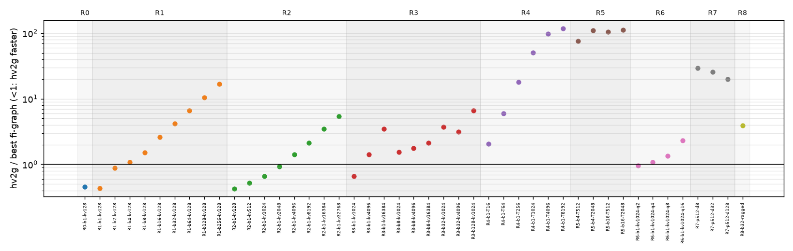
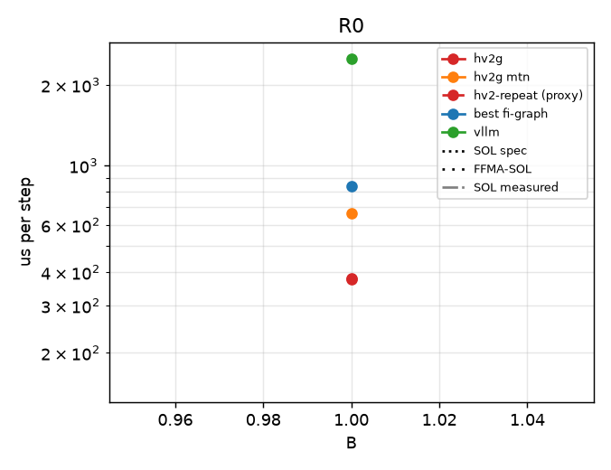
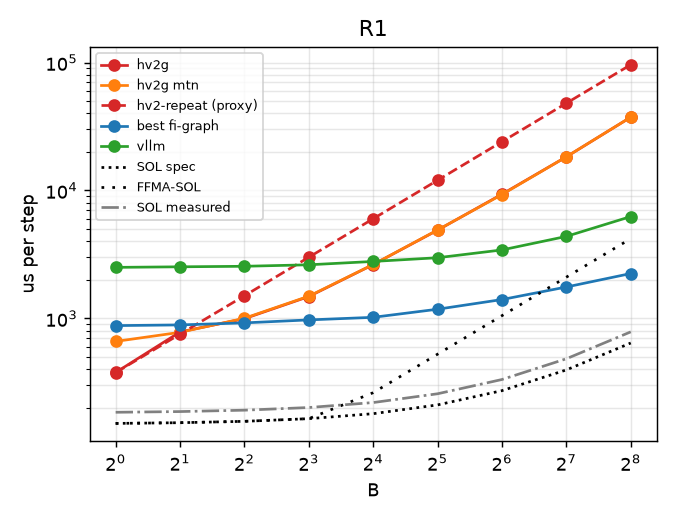
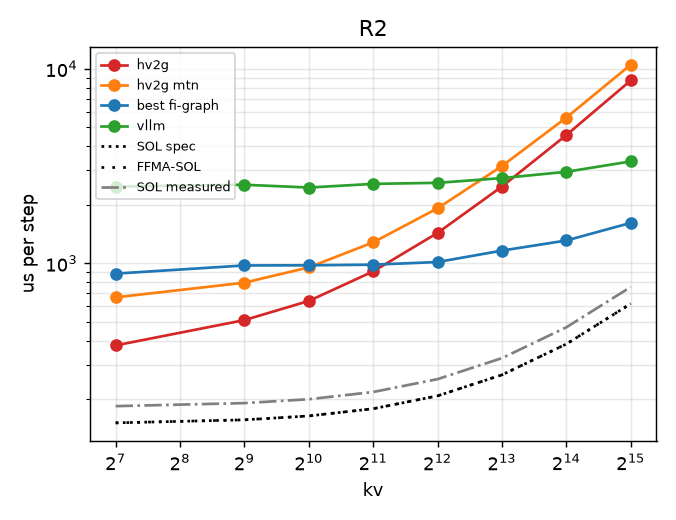
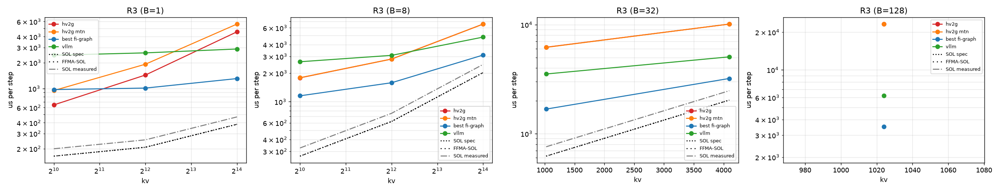
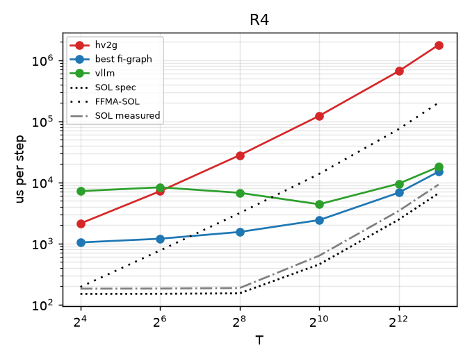
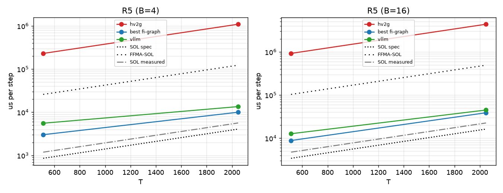
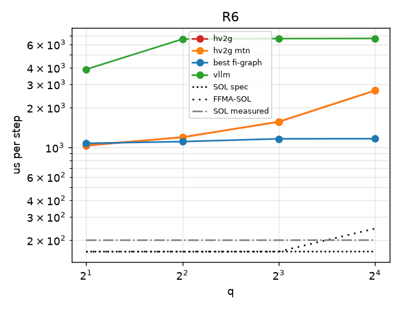
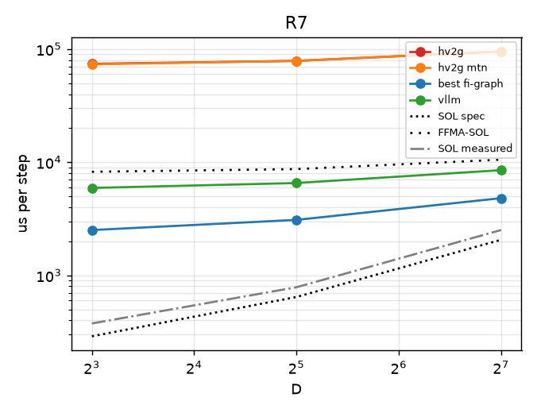
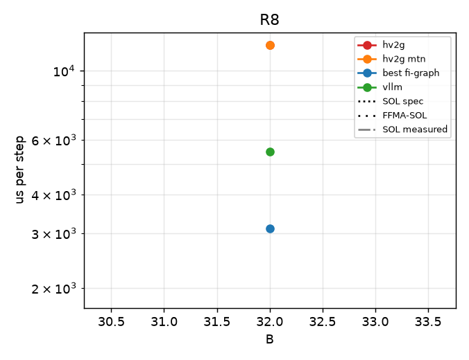

# regimebench report

- Runs: 20261023T061931Z-full-R0R1, 20261023T061931Z-full-R2R8, 20261023T062900Z-full-R3, 20261023T064019Z-full-R6R7, 20261023T064021Z-full-R4R5; slurm jobs: 9471, 9472, 9473, 9476, 9477 (logs under runs/<run>/ and runs/slurm-<job>.log)
- GPU: NVIDIA B200 (148 SMs), driver 580.178.04, host cayenne
- Versions: torch 2.13.0, flashinfer-python 0.7.0.post1, vllm 0.31.0, triton 3.7.1, nvidia-ml-py 13.615.71; git a9e936ffdb (dirty)
- SOL spec: 8.0 TB/s, BF16 dense 2.25 PFLOP/s (datasheet-derived, unverified); measured: copy BW 6546 GB/s median, cuBLAS bf16 1659 TFLOP/s, SM clock at probe 1965 MHz
- All times are microseconds per step (steady = back-to-back launches). hv2-repeat is a timing proxy (N repeated b1 decodes), not a correct forward; shown only in R0/R1, where its b1/kv128 work matches the step (elsewhere it skips KV work and can fall below SOL).
- FFMA-SOL = max(T_bw, flops / (148 SMs x 128 lanes x 2 x probed SM clock)); a ceiling for an FP32-FFMA design like hv2g, not for a tensor-core one (hypothesis-grade model, not a measurement).
- Run 20261023T061931Z-full-R0R1 (slurm job 9471, SM clock at probe 1965 MHz): regimes R0, R1
- Run 20261023T061931Z-full-R2R8 (slurm job 9472, SM clock at probe 1965 MHz): regimes R2, R8
- Run 20261023T062900Z-full-R3 (slurm job 9473, SM clock at probe 1965 MHz): regimes R3
- Run 20261023T064019Z-full-R6R7 (slurm job 9476, SM clock at probe 1965 MHz): regimes R6, R7
- Run 20261023T064021Z-full-R4R5 (slurm job 9477, SM clock at probe 1965 MHz): regimes R4, R5
- Cross-regime comparisons are across jobs (and possibly GPUs); ratios within a point are interleaved in one job and are the reliable comparison.

## Executive summary

| regime | points | hv2g wins | geomean hv2g/best | crossover (best baseline first beats hv2g) | median %SOL hv2g | median %SOL best |
|---|---|---|---|---|---|---|
| R0 | 1 | 1/1 | 0.45 | none | 39.9 | 18.1 |
| R1 | 9 | 2/9 | 2.70 | B=4 | 6.8 | 17.6 |
| R2 | 8 | 4/8 | 1.29 | kv=4096 | 17.1 | 19.3 |
| R3 | 9 | 1/9 | 2.25 | B=1: 4096; B=8: 1024; B=32: 1024; B=128: 1024 | 15.0 | 37.0 |
| R4 | 6 | 0/6 | 22.46 | T=16 | 0.5 | 16.6 |
| R5 | 4 | 0/4 | 99.48 | B=4: 512; B=16: 512 | 0.4 | 39.7 |
| R6 | 4 | 1/4 | 1.34 | q=4 | 12.1 | 14.4 |
| R7 | 3 | 0/3 | 24.58 | D=8 | 0.8 | 20.8 |
| R8 | 1 | 0/1 | 3.89 | B=32 | 15.6 | 60.9 |

## R0

| point | SOL us (bound) | FFMA-SOL us | hv2g us | hv2g mtn us | hv2-repeat us (proxy) | best baseline us (variant) | vllm wall / gpu us | hv2g/best | %SOL hv2g | %FFMA-SOL hv2g | %SOL best |
|---|---|---|---|---|---|---|---|---|---|---|---|
| R0-b1-kv128 | 150.9 (memory) | 150.9 | 378.1 | 665.1 | 376.0 | 834.1 (graph-pdl-best) | 2506.1 / 1823.3 (nopdl) | 0.45 | 39.9 | 39.9 | 18.1 |

## R1

| point | SOL us (bound) | FFMA-SOL us | hv2g us | hv2g mtn us | hv2-repeat us (proxy) | best baseline us (variant) | vllm wall / gpu us | hv2g/best | %SOL hv2g | %FFMA-SOL hv2g | %SOL best |
|---|---|---|---|---|---|---|---|---|---|---|---|
| R1-b1-kv128 | 150.9 (memory) | 150.9 | 377.6 | 660.4 | 376.9 | 877.9 (graph-pdl-best) | 2505.0 / 1831.7 (pdl) | 0.43 | 40.0 | 40.0 | 17.2 |
| R1-b2-kv128 | 152.9 (memory) | 152.9 | 783.3 | 778.1 | 753.7 | 888.9 (graph-pdl-best) | 2530.3 / 1907.7 (pdl) | 0.88 | 19.5 | 19.5 | 17.2 |
| R1-b4-kv128 | 156.7 (memory) | 156.7 | 994.7 | 1002.3 | 1502.5 | 922.2 (graph-pdl-best) | 2554.4 / 1846.7 (pdl) | 1.08 | 15.8 | 15.8 | 17.0 |
| R1-b8-kv128 | 164.4 (memory) | 164.4 | 1481.7 | 1491.4 | 3006.8 | 972.8 (graph-pdl-best) | 2623.8 / 1852.6 (pdl) | 1.52 | 11.1 | 11.1 | 16.9 |
| R1-b16-kv128 | 179.8 (memory) | 262.5 | 2634.8 | 2638.4 | 6011.8 | 1019.2 (graph-pdl-best) | 2786.6 / 1931.3 (nopdl) | 2.59 | 6.8 | 10.0 | 17.6 |
| R1-b32-kv128 | 210.6 (memory) | 525.0 | 4894.0 | 4911.4 | 12020.3 | 1179.3 (graph-pdl-best) | 2979.4 / 1964.8 (nopdl) | 4.15 | 4.3 | 10.7 | 17.9 |
| R1-b64-kv128 | 272.2 (memory) | 1050.1 | 9351.7 | 9292.2 | 24051.0 | 1403.6 (graph-pdl-best) | 3428.6 / 2091.1 (pdl) | 6.66 | 2.9 | 11.2 | 19.4 |
| R1-b128-kv128 | 395.5 (memory) | 2100.2 | 18322.9 | 18340.1 | 48110.9 | 1759.5 (graph-pdl-best) | 4374.7 / 2417.5 (nopdl) | 10.41 | 2.2 | 11.5 | 22.5 |
| R1-b256-kv128 | 641.9 (memory) | 4200.4 | 37403.6 | 37417.2 | 96174.3 | 2242.1 (graph-pdl-best) | 6251.8 / 3039.1 (pdl) | 16.68 | 1.7 | 11.2 | 28.6 |

## R2

| point | SOL us (bound) | FFMA-SOL us | hv2g us | hv2g mtn us | hv2-repeat us (proxy) | best baseline us (variant) | vllm wall / gpu us | hv2g/best | %SOL hv2g | %FFMA-SOL hv2g | %SOL best |
|---|---|---|---|---|---|---|---|---|---|---|---|
| R2-b1-kv128 | 150.9 (memory) | 150.9 | 377.7 | 667.1 | n/a | 883.8 (graph-pdl-best) | 2478.9 / 1819.5 (pdl) | 0.43 | 40.0 | 40.0 | 17.1 |
| R2-b1-kv512 | 156.4 (memory) | 156.4 | 509.7 | 793.9 | n/a | 973.4 (graph-pdl-best) | 2531.3 / 1854.2 (nopdl) | 0.52 | 30.7 | 30.7 | 16.1 |
| R2-b1-kv1024 | 163.8 (memory) | 163.8 | 639.4 | 951.5 | n/a | 975.2 (graph-pdl-best) | 2449.5 / 1857.7 (pdl) | 0.66 | 25.6 | 25.6 | 16.8 |
| R2-b1-kv2048 | 178.5 (memory) | 178.5 | 907.6 | 1280.1 | n/a | 982.5 (graph-pdl-best) | 2557.5 / 1886.8 (pdl) | 0.92 | 19.7 | 19.7 | 18.2 |
| R2-b1-kv4096 | 207.8 (memory) | 207.8 | 1431.2 | 1915.2 | n/a | 1013.8 (graph-pdl-best) | 2589.9 / 1896.0 (nopdl) | 1.41 | 14.5 | 14.5 | 20.5 |
| R2-b1-kv8192 | 266.5 (memory) | 266.5 | 2479.4 | 3160.0 | n/a | 1160.7 (graph-pdl-best) | 2738.6 / 2052.5 (nopdl) | 2.14 | 10.8 | 10.8 | 23.0 |
| R2-b1-kv16384 | 384.0 (memory) | 384.0 | 4560.1 | 5607.6 | n/a | 1308.2 (graph-pdl-best) | 2951.0 / 2263.5 (nopdl) | 3.49 | 8.4 | 8.4 | 29.4 |
| R2-b1-kv32768 | 618.9 (memory) | 618.9 | 8703.6 | 10490.6 | n/a | 1611.7 (graph-pdl-best) | 3337.5 / 2643.5 (pdl) | 5.40 | 7.1 | 7.1 | 38.4 |

## R3

| point | SOL us (bound) | FFMA-SOL us | hv2g us | hv2g mtn us | hv2-repeat us (proxy) | best baseline us (variant) | vllm wall / gpu us | hv2g/best | %SOL hv2g | %FFMA-SOL hv2g | %SOL best |
|---|---|---|---|---|---|---|---|---|---|---|---|
| R3-b1-kv1024 | 163.8 (memory) | 163.8 | 645.1 | 947.6 | n/a | 972.5 (graph-pdl-best) | 2438.8 / 1882.2 (nopdl) | 0.66 | 25.4 | 25.4 | 16.8 |
| R3-b1-kv4096 | 207.8 (memory) | 207.8 | 1435.1 | 1916.8 | n/a | 1012.0 (graph-pdl-best) | 2595.6 / 1911.6 (nopdl) | 1.42 | 14.5 | 14.5 | 20.5 |
| R3-b1-kv16384 | 384.0 (memory) | 384.0 | 4561.1 | 5612.8 | n/a | 1304.9 (graph-pdl-best) | 2879.2 / 2289.7 (nopdl) | 3.50 | 8.4 | 8.4 | 29.4 |
| R3-b8-kv1024 | 267.2 (memory) | 267.2 | 1784.6 | 1790.2 | n/a | 1154.2 (graph-pdl-best) | 2636.5 / 2011.3 (nopdl) | 1.55 | 15.0 | 15.0 | 23.1 |
| R3-b8-kv4096 | 619.5 (memory) | 619.5 | 2814.4 | 2813.6 | n/a | 1584.3 (graph-pdl-best) | 3078.7 / 2426.9 (pdl) | 1.78 | 22.0 | 22.0 | 39.1 |
| R3-b8-kv16384 | 2028.8 (memory) | 2028.8 | 6578.3 | 6569.3 | n/a | 3102.3 (graph-pdl-best) | 4794.7 / 3986.7 (nopdl) | 2.12 | 30.8 | 30.8 | 65.4 |
| R3-b32-kv1024 | 621.7 (memory) | 621.7 | 6204.0 | 6187.0 | n/a | 1679.8 (graph-pdl-best) | 3525.4 / 2490.7 (pdl) | 3.69 | 10.0 | 10.0 | 37.0 |
| R3-b32-kv4096 | 2031.0 (memory) | 2031.0 | 10118.1 | 10126.4 | n/a | 3207.2 (graph-pdl-best) | 5064.6 / 4015.6 (nopdl) | 3.15 | 20.1 | 20.1 | 63.3 |
| R3-b128-kv1024 | 2039.6 (memory) | 2453.5 | 23214.3 | 23248.6 | n/a | 3518.7 (graph-pdl-best) | 6206.0 / 4230.9 (pdl) | 6.60 | 8.8 | 10.6 | 58.0 |

## R4

| point | SOL us (bound) | FFMA-SOL us | hv2g us | hv2g mtn us | hv2-repeat us (proxy) | best baseline us (variant) | vllm wall / gpu us | hv2g/best | %SOL hv2g | %FFMA-SOL hv2g | %SOL best |
|---|---|---|---|---|---|---|---|---|---|---|---|
| R4-b1-T16 | 149.3 (memory) | 193.9 | 2124.3 | - | n/a | 1040.1 (graph-pdl-best) | 7186.5 / 6915.3 (pdl) | 2.04 | 7.0 | 9.1 | 14.4 |
| R4-b1-T64 | 150.0 (memory) | 767.8 | 7154.2 | - | n/a | 1195.7 (graph-pdl-best) | 8288.5 / 7916.3 (pdl) | 5.98 | 2.1 | 10.7 | 12.5 |
| R4-b1-T256 | 152.8 (memory) | 3134.2 | 27736.9 | - | n/a | 1542.2 (graph-pdl-best) | 6738.7 / 6470.3 (pdl) | 17.98 | 0.6 | 11.3 | 9.9 |
| R4-b1-T1024 | 454.5 (compute) | 13735.8 | 122221.0 | - | n/a | 2413.5 (graph-nopdl-best) | 4377.8 / 3973.0 (pdl) | 50.64 | 0.4 | 11.2 | 18.8 |
| R4-b1-T4096 | 2459.0 (compute) | 74314.4 | 659280.1 | - | n/a | 6780.3 (graph-nopdl-cublas) | 9524.3 / 8657.8 (pdl) | 97.23 | 0.4 | 11.3 | 36.3 |
| R4-b1-T8192 | 6628.2 (compute) | 200314.2 | 1768641.9 | - | n/a | 14919.0 (graph-pdl-best) | 17926.4 / 17010.5 (pdl) | 118.55 | 0.4 | 11.3 | 44.4 |

## R5

| point | SOL us (bound) | FFMA-SOL us | hv2g us | hv2g mtn us | hv2-repeat us (proxy) | best baseline us (variant) | vllm wall / gpu us | hv2g/best | %SOL hv2g | %FFMA-SOL hv2g | %SOL best |
|---|---|---|---|---|---|---|---|---|---|---|---|
| R5-b4-T512 | 855.8 (compute) | 25864.7 | 230127.5 | - | n/a | 3016.0 (graph-nopdl-best) | 5554.4 / 4536.6 (pdl) | 76.30 | 0.4 | 11.2 | 28.4 |
| R5-b4-T2048 | 4063.1 (compute) | 122792.3 | 1092980.0 | - | n/a | 9989.1 (graph-pdl-best) | 13494.3 / 12351.9 (pdl) | 109.42 | 0.4 | 11.2 | 40.7 |
| R5-b16-T512 | 3423.3 (compute) | 103458.8 | 921797.5 | - | n/a | 8841.3 (graph-pdl-best) | 12694.1 / 11434.6 (pdl) | 104.26 | 0.4 | 11.2 | 38.7 |
| R5-b16-T2048 | 16252.2 (compute) | 491169.1 | 4368126.0 | - | n/a | 38829.3 (graph-pdl-best) | 44965.1 / 43087.0 (pdl) | 112.50 | 0.4 | 11.2 | 41.9 |

## R6

| point | SOL us (bound) | FFMA-SOL us | hv2g us | hv2g mtn us | hv2-repeat us (proxy) | best baseline us (variant) | vllm wall / gpu us | hv2g/best | %SOL hv2g | %FFMA-SOL hv2g | %SOL best |
|---|---|---|---|---|---|---|---|---|---|---|---|
| R6-b1-kv1024-q2 | 163.8 (memory) | 163.8 | 1032.6 | 1041.7 | n/a | 1074.8 (graph-pdl-best) | 3882.2 / 3656.4 (pdl) | 0.96 | 15.9 | 15.9 | 15.2 |
| R6-b1-kv1024-q4 | 163.8 (memory) | 163.8 | 1194.9 | 1190.6 | n/a | 1107.0 (graph-pdl-best) | 6568.4 / 6333.0 (pdl) | 1.08 | 13.7 | 13.7 | 14.8 |
| R6-b1-kv1024-q8 | 163.9 (memory) | 163.9 | 1560.3 | 1566.1 | n/a | 1162.2 (graph-pdl-best) | 6624.1 / 6388.3 (pdl) | 1.34 | 10.5 | 10.5 | 14.1 |
| R6-b1-kv1024-q16 | 164.0 (memory) | 244.4 | 2686.7 | 2687.8 | n/a | 1164.4 (graph-pdl-best) | 6639.7 / 6413.3 (pdl) | 2.31 | 6.1 | 9.1 | 14.1 |

## R7

| point | SOL us (bound) | FFMA-SOL us | hv2g us | hv2g mtn us | hv2-repeat us (proxy) | best baseline us (variant) | vllm wall / gpu us | hv2g/best | %SOL hv2g | %FFMA-SOL hv2g | %SOL best |
|---|---|---|---|---|---|---|---|---|---|---|---|
| R7-p512-d8 | 289.3 (memory) | 8234.8 | 74158.4 | 73538.2 | n/a | 2514.4 (graph-nopdl-best) | 5926.6 / 5187.4 (pdl) | 29.49 | 0.4 | 11.1 | 11.5 |
| R7-p512-d32 | 643.8 (memory) | 8694.9 | 78679.6 | 78631.2 | n/a | 3093.0 (graph-nopdl-cublas) | 6548.8 / 5447.5 (pdl) | 25.44 | 0.8 | 11.1 | 20.8 |
| R7-p512-d128 | 2061.7 (memory) | 10535.0 | 95297.0 | 95442.7 | n/a | 4812.1 (graph-nopdl-cublas) | 8509.5 / 6085.9 (pdl) | 19.80 | 2.2 | 11.1 | 42.8 |

## R8

| point | SOL us (bound) | FFMA-SOL us | hv2g us | hv2g mtn us | hv2-repeat us (proxy) | best baseline us (variant) | vllm wall / gpu us | hv2g/best | %SOL hv2g | %FFMA-SOL hv2g | %SOL best |
|---|---|---|---|---|---|---|---|---|---|---|---|
| R8-b32-ragged | 1893.3 (memory) | 1893.3 | 12097.8 | 12082.6 | n/a | 3110.1 (graph-pdl-best) | 5486.0 / 4526.7 (nopdl) | 3.89 | 15.6 | 15.6 | 60.9 |

## Winner variants and backends

| point | best fi-graph variant | attn backend | gemm | PDL cover | best vllm variant |
|---|---|---|---|---|---|
| R0-b1-kv128 | graph-pdl-best | decode/cute-dsl/tc=True | {'qkv': 'cute-dsl', 'o': 'cute-dsl', 'gu': 'cute-dsl', 'down': 'cute-dsl', 'lm_head': 'cute-dsl'} | 254/312 | nopdl |
| R1-b1-kv128 | graph-pdl-best | decode/cute-dsl/tc=True | {'qkv': 'cute-dsl', 'o': 'cute-dsl', 'gu': 'cute-dsl', 'down': 'cute-dsl', 'lm_head': 'cute-dsl'} | 254/312 | pdl |
| R1-b2-kv128 | graph-pdl-best | decode/cute-dsl/tc=True | {'qkv': 'cute-dsl', 'o': 'cute-dsl', 'gu': 'cute-dsl', 'down': 'cute-dsl', 'lm_head': 'cute-dsl'} | 254/312 | pdl |
| R1-b4-kv128 | graph-pdl-best | decode/cute-dsl/tc=True | {'qkv': 'cute-dsl', 'o': 'cute-dsl', 'gu': 'cute-dsl', 'down': 'cute-dsl', 'lm_head': 'cute-dsl'} | 254/312 | pdl |
| R1-b8-kv128 | graph-pdl-best | decode/cute-dsl/tc=True | {'qkv': 'cute-dsl', 'o': 'tinygemm', 'gu': 'cute-dsl', 'down': 'tinygemm', 'lm_head': 'cute-dsl'} | 254/312 | pdl |
| R1-b16-kv128 | graph-pdl-best | decode/cute-dsl/tc=True | {'qkv': 'cute-dsl', 'o': 'cute-dsl', 'gu': 'cute-dsl', 'down': 'cute-dsl', 'lm_head': 'cute-dsl'} | 254/312 | nopdl |
| R1-b32-kv128 | graph-pdl-best | decode/trtllm-direct | {'qkv': 'cute-dsl', 'o': 'cute-dsl', 'gu': 'cublas', 'down': 'cute-dsl', 'lm_head': 'cudnn'} | 225/312 | nopdl |
| R1-b64-kv128 | graph-pdl-best | decode/trtllm-direct | {'qkv': 'cute-dsl', 'o': 'tgv', 'gu': 'cudnn', 'down': 'tgv', 'lm_head': 'cublas'} | 197/312 | pdl |
| R1-b128-kv128 | graph-pdl-best | decode/trtllm-direct | {'qkv': 'cublas', 'o': 'cudnn', 'gu': 'cublas', 'down': 'cublas', 'lm_head': 'cute-dsl'} | 141/312 | nopdl |
| R1-b256-kv128 | graph-pdl-best | decode/fa2/tc=False | {'qkv': 'cudnn', 'o': 'cublas', 'gu': 'cublas', 'down': 'cublas', 'lm_head': 'cudnn'} | 141/312 | pdl |
| R2-b1-kv128 | graph-pdl-best | decode/cute-dsl/tc=True | {'qkv': 'cute-dsl', 'o': 'cute-dsl', 'gu': 'cute-dsl', 'down': 'cute-dsl', 'lm_head': 'cute-dsl'} | 254/312 | pdl |
| R2-b1-kv512 | graph-pdl-best | decode/trtllm-gen/tc=True | {'qkv': 'cute-dsl', 'o': 'cute-dsl', 'gu': 'cute-dsl', 'down': 'cute-dsl', 'lm_head': 'cute-dsl'} | 254/312 | nopdl |
| R2-b1-kv1024 | graph-pdl-best | decode/trtllm-direct | {'qkv': 'cute-dsl', 'o': 'cute-dsl', 'gu': 'cute-dsl', 'down': 'cute-dsl', 'lm_head': 'cute-dsl'} | 254/312 | pdl |
| R2-b1-kv2048 | graph-pdl-best | decode/trtllm-gen/tc=True | {'qkv': 'cute-dsl', 'o': 'cute-dsl', 'gu': 'cute-dsl', 'down': 'cute-dsl', 'lm_head': 'cute-dsl'} | 254/312 | pdl |
| R2-b1-kv4096 | graph-pdl-best | decode/trtllm-direct | {'qkv': 'cute-dsl', 'o': 'cute-dsl', 'gu': 'cute-dsl', 'down': 'cute-dsl', 'lm_head': 'cute-dsl'} | 254/312 | nopdl |
| R2-b1-kv8192 | graph-pdl-best | decode/cute-dsl/tc=True | {'qkv': 'cute-dsl', 'o': 'cute-dsl', 'gu': 'cute-dsl', 'down': 'cute-dsl', 'lm_head': 'cute-dsl'} | 254/312 | nopdl |
| R2-b1-kv16384 | graph-pdl-best | decode/cute-dsl/tc=True | {'qkv': 'cute-dsl', 'o': 'cute-dsl', 'gu': 'cute-dsl', 'down': 'cute-dsl', 'lm_head': 'cute-dsl'} | 254/312 | nopdl |
| R2-b1-kv32768 | graph-pdl-best | decode/cute-dsl/tc=True | {'qkv': 'cute-dsl', 'o': 'cute-dsl', 'gu': 'cute-dsl', 'down': 'cute-dsl', 'lm_head': 'cute-dsl'} | 254/312 | pdl |
| R3-b1-kv1024 | graph-pdl-best | decode/trtllm-direct | {'qkv': 'cute-dsl', 'o': 'cute-dsl', 'gu': 'cute-dsl', 'down': 'cute-dsl', 'lm_head': 'cute-dsl'} | 254/312 | nopdl |
| R3-b1-kv4096 | graph-pdl-best | decode/trtllm-direct | {'qkv': 'cute-dsl', 'o': 'cute-dsl', 'gu': 'cute-dsl', 'down': 'cute-dsl', 'lm_head': 'cute-dsl'} | 254/312 | nopdl |
| R3-b1-kv16384 | graph-pdl-best | decode/trtllm-direct | {'qkv': 'cute-dsl', 'o': 'cute-dsl', 'gu': 'cute-dsl', 'down': 'cute-dsl', 'lm_head': 'cute-dsl'} | 254/312 | nopdl |
| R3-b8-kv1024 | graph-pdl-best | decode/cute-dsl/tc=True | {'qkv': 'cute-dsl', 'o': 'tinygemm', 'gu': 'cute-dsl', 'down': 'tinygemm', 'lm_head': 'cute-dsl'} | 254/312 | nopdl |
| R3-b8-kv4096 | graph-pdl-best | decode/trtllm-gen/tc=True | {'qkv': 'cute-dsl', 'o': 'tinygemm', 'gu': 'cute-dsl', 'down': 'tinygemm', 'lm_head': 'cute-dsl'} | 254/312 | pdl |
| R3-b8-kv16384 | graph-pdl-best | decode/trtllm-gen/tc=True | {'qkv': 'cute-dsl', 'o': 'tinygemm', 'gu': 'cute-dsl', 'down': 'tinygemm', 'lm_head': 'cute-dsl'} | 254/312 | nopdl |
| R3-b32-kv1024 | graph-pdl-best | decode/cute-dsl/tc=True | {'qkv': 'cute-dsl', 'o': 'cute-dsl', 'gu': 'cudnn', 'down': 'cute-dsl', 'lm_head': 'cudnn'} | 225/312 | pdl |
| R3-b32-kv4096 | graph-pdl-best | decode/cute-dsl/tc=True | {'qkv': 'cute-dsl', 'o': 'cute-dsl', 'gu': 'cudnn', 'down': 'cute-dsl', 'lm_head': 'cudnn'} | 225/312 | nopdl |
| R3-b128-kv1024 | graph-pdl-best | decode/cute-dsl/tc=True | {'qkv': 'cute-dsl', 'o': 'cudnn', 'gu': 'cublas', 'down': 'cublas', 'lm_head': 'cudnn'} | 141/312 | pdl |
| R4-b1-T16 | graph-pdl-best | prefill/fa2 | {'qkv': 'cute-dsl', 'o': 'cute-dsl', 'gu': 'cute-dsl', 'down': 'cute-dsl', 'lm_head': 'cute-dsl'} | 254/313 | pdl |
| R4-b1-T64 | graph-pdl-best | prefill/cudnn-direct | {'qkv': 'cublas', 'o': 'tgv', 'gu': 'cublas', 'down': 'tgv', 'lm_head': 'cute-dsl'} | 198/313 | pdl |
| R4-b1-T256 | graph-pdl-best | prefill/trtllm-direct | {'qkv': 'cublas', 'o': 'cudnn', 'gu': 'cublas', 'down': 'cudnn', 'lm_head': 'cute-dsl'} | 142/313 | pdl |
| R4-b1-T1024 | graph-nopdl-best | prefill/trtllm-gen | {'qkv': 'cublas', 'o': 'cublas', 'gu': 'cublas', 'down': 'cublas', 'lm_head': 'cute-dsl'} | 0/313 | pdl |
| R4-b1-T4096 | graph-nopdl-cublas | prefill/trtllm-direct | {'qkv': 'cublas', 'o': 'cublas', 'gu': 'cublas', 'down': 'cublas', 'lm_head': 'cublas'} | 0/313 | pdl |
| R4-b1-T8192 | graph-pdl-best | prefill/trtllm-direct | {'qkv': 'cute-dsl', 'o': 'cute-dsl', 'gu': 'cute-dsl', 'down': 'cute-dsl', 'lm_head': 'cute-dsl'} | 142/313 | pdl |
| R5-b4-T512 | graph-nopdl-best | prefill/trtllm-direct | {'qkv': 'cublas', 'o': 'cublas', 'gu': 'cublas', 'down': 'cublas', 'lm_head': 'cute-dsl'} | 0/313 | pdl |
| R5-b4-T2048 | graph-pdl-best | prefill/trtllm-gen | {'qkv': 'cute-dsl', 'o': 'cute-dsl', 'gu': 'cute-dsl', 'down': 'cute-dsl', 'lm_head': 'cute-dsl'} | 142/313 | pdl |
| R5-b16-T512 | graph-pdl-best | prefill/trtllm-gen | {'qkv': 'cute-dsl', 'o': 'cute-dsl', 'gu': 'cute-dsl', 'down': 'cute-dsl', 'lm_head': 'cute-dsl'} | 142/313 | pdl |
| R5-b16-T2048 | graph-pdl-best | prefill/trtllm-direct | {'qkv': 'cublas', 'o': 'cute-dsl', 'gu': 'cute-dsl', 'down': 'cudnn', 'lm_head': 'cute-dsl'} | 142/313 | pdl |
| R6-b1-kv1024-q2 | graph-pdl-best | prefill/fa2 | {'qkv': 'cute-dsl', 'o': 'cute-dsl', 'gu': 'cute-dsl', 'down': 'cute-dsl', 'lm_head': 'cute-dsl'} | 254/313 | pdl |
| R6-b1-kv1024-q4 | graph-pdl-best | prefill/fa2 | {'qkv': 'cute-dsl', 'o': 'cute-dsl', 'gu': 'cute-dsl', 'down': 'cute-dsl', 'lm_head': 'cute-dsl'} | 254/313 | pdl |
| R6-b1-kv1024-q8 | graph-pdl-best | prefill/fa2 | {'qkv': 'cute-dsl', 'o': 'tinygemm', 'gu': 'tgv', 'down': 'tinygemm', 'lm_head': 'cute-dsl'} | 254/313 | pdl |
| R6-b1-kv1024-q16 | graph-pdl-best | prefill/fa2 | {'qkv': 'cute-dsl', 'o': 'cute-dsl', 'gu': 'cute-dsl', 'down': 'cute-dsl', 'lm_head': 'cute-dsl'} | 254/313 | pdl |
| R7-p512-d8 | graph-nopdl-best | prefill/trtllm-gen | {'qkv': 'cublas', 'o': 'cudnn', 'gu': 'cublas', 'down': 'cute-dsl', 'lm_head': 'cublas'} | 0/313 | pdl |
| R7-p512-d32 | graph-nopdl-cublas | split[prefill/trtllm-gen+decode/trtllm-direct] | {'qkv': 'cublas', 'o': 'cublas', 'gu': 'cublas', 'down': 'cublas', 'lm_head': 'cublas'} | 0/313 | pdl |
| R7-p512-d128 | graph-nopdl-cublas | split[prefill/trtllm-gen+decode/trtllm-direct] | {'qkv': 'cublas', 'o': 'cublas', 'gu': 'cublas', 'down': 'cublas', 'lm_head': 'cublas'} | 0/313 | pdl |
| R8-b32-ragged | graph-pdl-best | decode/cute-dsl/tc=True | {'qkv': 'cute-dsl', 'o': 'cute-dsl', 'gu': 'cudnn', 'down': 'cute-dsl', 'lm_head': 'cublas'} | 225/312 | nopdl |

## Accuracy (FP32 oracle band, pass = rel-L2 <= 2x BF16 reference's own)

| point | arm:variant | seeds | worst x band (logits/k/v) | next_token match | verdict |
|---|---|---|---|---|---|
| R0-b1-kv128 | fi-graph:eager-pdl-best | 3 | 0.96/0.85/0.85 | 1.00 | pass |
| R0-b1-kv128 | fi-graph:graph-nopdl-best | 3 | 0.96/0.85/0.85 | 1.00 | pass |
| R0-b1-kv128 | fi-graph:graph-nopdl-cublas | 3 | 0.90/0.82/0.82 | 1.00 | pass |
| R0-b1-kv128 | fi-graph:graph-pdl-best | 3 | 0.96/0.85/0.85 | 1.00 | pass |
| R0-b1-kv128 | fi-graph:graph-pdl-cublas | 3 | 0.90/0.82/0.82 | 1.00 | pass |
| R0-b1-kv128 | hv2g:auto | 3 | 0.00/0.06/0.06 | 1.00 | pass |
| R0-b1-kv128 | hv2g:mtn | 3 | 0.18/0.18/0.18 | 1.00 | pass |
| R1-b64-kv128 | fi-graph:graph-nopdl-best | 3 | 0.80/0.78/0.78 | 0.89 | pass |
| R1-b64-kv128 | fi-graph:graph-nopdl-cublas | 3 | 0.80/0.78/0.78 | 0.89 | pass |
| R1-b64-kv128 | fi-graph:graph-pdl-best | 3 | 0.80/0.78/0.78 | 0.89 | pass |
| R1-b64-kv128 | fi-graph:graph-pdl-cublas | 3 | 0.80/0.78/0.78 | 0.89 | pass |
| R1-b64-kv128 | hv2g:auto | 3 | 0.18/0.19/0.19 | 0.98 | pass |
| R1-b64-kv128 | hv2g:mtn | 3 | 0.18/0.19/0.19 | 0.98 | pass |
| R1-b8-kv128 | fi-graph:graph-nopdl-best | 3 | 0.82/0.81/0.81 | 1.00 | pass |
| R1-b8-kv128 | fi-graph:graph-nopdl-cublas | 3 | 0.80/0.80/0.80 | 1.00 | pass |
| R1-b8-kv128 | fi-graph:graph-pdl-best | 3 | 0.82/0.81/0.81 | 1.00 | pass |
| R1-b8-kv128 | fi-graph:graph-pdl-cublas | 3 | 0.80/0.80/0.80 | 1.00 | pass |
| R1-b8-kv128 | hv2g:auto | 3 | 0.20/0.20/0.20 | 0.88 | pass |
| R1-b8-kv128 | hv2g:mtn | 3 | 0.20/0.20/0.20 | 0.88 | pass |
| R2-b1-kv1024 | fi-graph:graph-nopdl-best | 3 | 0.78/0.77/0.77 | 1.00 | pass |
| R2-b1-kv1024 | fi-graph:graph-nopdl-cublas | 3 | 0.80/0.80/0.79 | 1.00 | pass |
| R2-b1-kv1024 | fi-graph:graph-pdl-best | 3 | 0.78/0.77/0.77 | 1.00 | pass |
| R2-b1-kv1024 | fi-graph:graph-pdl-cublas | 3 | 0.80/0.80/0.79 | 1.00 | pass |
| R2-b1-kv1024 | hv2g:auto | 3 | 0.00/0.07/0.07 | 1.00 | pass |
| R2-b1-kv1024 | hv2g:mtn | 3 | 0.07/0.10/0.10 | 1.00 | pass |
| R2-b1-kv8192 | fi-graph:graph-nopdl-best | 3 | 0.85/0.81/0.82 | 1.00 | pass |
| R2-b1-kv8192 | fi-graph:graph-nopdl-cublas | 3 | 0.91/0.89/0.90 | 1.00 | pass |
| R2-b1-kv8192 | fi-graph:graph-pdl-best | 3 | 0.85/0.81/0.82 | 1.00 | pass |
| R2-b1-kv8192 | fi-graph:graph-pdl-cublas | 3 | 0.91/0.89/0.90 | 1.00 | pass |
| R2-b1-kv8192 | hv2g:auto | 3 | 0.00/0.07/0.07 | 1.00 | pass |
| R2-b1-kv8192 | hv2g:mtn | 3 | 0.01/0.07/0.07 | 1.00 | pass |
| R3-b8-kv4096 | fi-graph:graph-nopdl-best | 3 | 0.85/0.83/0.84 | 0.88 | pass |
| R3-b8-kv4096 | fi-graph:graph-nopdl-cublas | 3 | 0.85/0.83/0.84 | 0.75 | pass |
| R3-b8-kv4096 | fi-graph:graph-pdl-best | 3 | 0.85/0.83/0.84 | 0.88 | pass |
| R3-b8-kv4096 | fi-graph:graph-pdl-cublas | 3 | 0.85/0.83/0.84 | 0.75 | pass |
| R3-b8-kv4096 | hv2g:auto | 3 | 0.02/0.07/0.07 | 1.00 | pass |
| R3-b8-kv4096 | hv2g:mtn | 3 | 0.02/0.07/0.07 | 1.00 | pass |
| R4-b1-T16 | fi-graph:graph-nopdl-best | 3 | 0.88/0.82/0.83 | 1.00 | pass |
| R4-b1-T16 | fi-graph:graph-nopdl-cublas | 3 | 0.89/0.86/0.86 | 1.00 | pass |
| R4-b1-T16 | fi-graph:graph-pdl-best | 3 | 0.88/0.82/0.83 | 1.00 | pass |
| R4-b1-T16 | fi-graph:graph-pdl-cublas | 3 | 0.89/0.86/0.86 | 1.00 | pass |
| R4-b1-T16 | hv2g:auto | 3 | 0.27/0.29/0.29 | 1.00 | pass |
| R4-b1-T256 | fi-graph:graph-nopdl-best | 3 | 0.86/0.78/0.78 | 0.00 | pass |
| R4-b1-T256 | fi-graph:graph-nopdl-cublas | 3 | 0.86/0.78/0.78 | 0.00 | pass |
| R4-b1-T256 | fi-graph:graph-pdl-best | 3 | 0.86/0.78/0.78 | 0.00 | pass |
| R4-b1-T256 | fi-graph:graph-pdl-cublas | 3 | 0.86/0.78/0.78 | 0.00 | pass |
| R4-b1-T256 | hv2g:auto | 3 | 0.27/0.26/0.26 | 1.00 | pass |
| R5-b4-T512 | fi-graph:graph-nopdl-best | 3 | 0.82/0.78/0.78 | 0.75 | pass |
| R5-b4-T512 | fi-graph:graph-nopdl-cublas | 3 | 0.82/0.78/0.78 | 0.75 | pass |
| R5-b4-T512 | fi-graph:graph-pdl-best | 3 | 0.82/0.78/0.78 | 0.75 | pass |
| R5-b4-T512 | fi-graph:graph-pdl-cublas | 3 | 0.82/0.78/0.78 | 0.75 | pass |
| R5-b4-T512 | hv2g:auto | 3 | 0.22/0.25/0.26 | 1.00 | pass |
| R6-b1-kv1024-q16 | fi-graph:graph-nopdl-best | 3 | 1.01/0.80/0.80 | 1.00 | pass |
| R6-b1-kv1024-q16 | fi-graph:graph-nopdl-cublas | 3 | 1.02/0.79/0.79 | 0.00 | pass |
| R6-b1-kv1024-q16 | fi-graph:graph-pdl-best | 3 | 1.01/0.80/0.80 | 1.00 | pass |
| R6-b1-kv1024-q16 | fi-graph:graph-pdl-cublas | 3 | 1.02/0.79/0.79 | 0.00 | pass |
| R6-b1-kv1024-q16 | hv2g:auto | 3 | 0.16/0.12/0.12 | 1.00 | pass |
| R6-b1-kv1024-q16 | hv2g:mtn | 3 | 0.16/0.12/0.12 | 1.00 | pass |
| R6-b1-kv1024-q4 | fi-graph:graph-nopdl-best | 3 | 0.93/0.83/0.83 | 1.00 | pass |
| R6-b1-kv1024-q4 | fi-graph:graph-nopdl-cublas | 3 | 0.89/0.81/0.81 | 1.00 | pass |
| R6-b1-kv1024-q4 | fi-graph:graph-pdl-best | 3 | 0.93/0.83/0.83 | 1.00 | pass |
| R6-b1-kv1024-q4 | fi-graph:graph-pdl-cublas | 3 | 0.89/0.81/0.81 | 1.00 | pass |
| R6-b1-kv1024-q4 | hv2g:auto | 3 | 0.15/0.12/0.12 | 1.00 | pass |
| R6-b1-kv1024-q4 | hv2g:mtn | 3 | 0.15/0.12/0.12 | 1.00 | pass |
| R7-p512-d8 | fi-graph:graph-nopdl-best | 3 | 0.85/0.74/0.74 | 0.67 | pass |
| R7-p512-d8 | fi-graph:graph-nopdl-cublas | 3 | 0.85/0.74/0.74 | 0.67 | pass |
| R7-p512-d8 | fi-graph:graph-pdl-best | 3 | 0.85/0.74/0.74 | 0.67 | pass |
| R7-p512-d8 | fi-graph:graph-pdl-cublas | 3 | 0.85/0.74/0.74 | 0.67 | pass |
| R7-p512-d8 | hv2g:auto | 3 | 0.11/0.20/0.20 | 1.00 | pass |
| R7-p512-d8 | hv2g:mtn | 3 | 0.11/0.20/0.20 | 1.00 | pass |
| R8-b32-ragged | fi-graph:graph-nopdl-best | 3 | 0.85/0.83/0.83 | 0.91 | pass |
| R8-b32-ragged | fi-graph:graph-nopdl-cublas | 3 | 0.84/0.83/0.83 | 0.88 | pass |
| R8-b32-ragged | fi-graph:graph-pdl-best | 3 | 0.85/0.83/0.83 | 0.91 | pass |
| R8-b32-ragged | fi-graph:graph-pdl-cublas | 3 | 0.84/0.83/0.83 | 0.88 | pass |
| R8-b32-ragged | hv2g:auto | 3 | 0.05/0.08/0.09 | 1.00 | pass |
| R8-b32-ragged | hv2g:mtn | 3 | 0.05/0.08/0.09 | 1.00 | pass |

## Skips and errors

- SKIP hv2-repeat:direct @ R0-b1-kv128: accuracy skipped: proxy arm
- SKIP hv2-repeat:graph @ R0-b1-kv128: accuracy skipped: proxy arm
- SKIP fi-graph:eager-pdl-best @ R1-b1-kv128: eager variant is only measured at R0
- SKIP fi-graph:eager-pdl-best @ R1-b2-kv128: eager variant is only measured at R0
- SKIP fi-graph:eager-pdl-best @ R1-b4-kv128: eager variant is only measured at R0
- SKIP fi-graph:eager-pdl-best @ R1-b8-kv128: eager variant is only measured at R0
- SKIP hv2-repeat:direct @ R1-b8-kv128: accuracy skipped: proxy arm
- SKIP hv2-repeat:graph @ R1-b8-kv128: accuracy skipped: proxy arm
- SKIP fi-graph:eager-pdl-best @ R1-b16-kv128: eager variant is only measured at R0
- SKIP fi-graph:eager-pdl-best @ R1-b32-kv128: eager variant is only measured at R0
- SKIP fi-graph:eager-pdl-best @ R1-b64-kv128: eager variant is only measured at R0
- SKIP hv2-repeat:direct @ R1-b64-kv128: accuracy skipped: proxy arm
- SKIP hv2-repeat:graph @ R1-b64-kv128: accuracy skipped: proxy arm
- SKIP fi-graph:eager-pdl-best @ R1-b128-kv128: eager variant is only measured at R0
- SKIP fi-graph:eager-pdl-best @ R1-b256-kv128: eager variant is only measured at R0
- SKIP fi-graph:eager-pdl-best @ R2-b1-kv128: eager variant is only measured at R0
- SKIP fi-graph:eager-pdl-best @ R2-b1-kv512: eager variant is only measured at R0
- SKIP fi-graph:eager-pdl-best @ R2-b1-kv1024: eager variant is only measured at R0
- SKIP hv2-repeat:direct @ R2-b1-kv1024: accuracy skipped: proxy arm
- SKIP hv2-repeat:graph @ R2-b1-kv1024: accuracy skipped: proxy arm
- SKIP fi-graph:eager-pdl-best @ R2-b1-kv2048: eager variant is only measured at R0
- SKIP fi-graph:eager-pdl-best @ R2-b1-kv4096: eager variant is only measured at R0
- SKIP fi-graph:eager-pdl-best @ R2-b1-kv8192: eager variant is only measured at R0
- SKIP hv2-repeat:direct @ R2-b1-kv8192: accuracy skipped: proxy arm
- SKIP hv2-repeat:graph @ R2-b1-kv8192: accuracy skipped: proxy arm
- SKIP fi-graph:eager-pdl-best @ R2-b1-kv16384: eager variant is only measured at R0
- SKIP fi-graph:eager-pdl-best @ R2-b1-kv32768: eager variant is only measured at R0
- SKIP fi-graph:eager-pdl-best @ R8-b32-ragged: eager variant is only measured at R0
- SKIP hv2-repeat:direct @ R8-b32-ragged: accuracy skipped: proxy arm
- SKIP hv2-repeat:graph @ R8-b32-ragged: accuracy skipped: proxy arm
- SKIP fi-graph:eager-pdl-best @ R3-b1-kv1024: eager variant is only measured at R0
- SKIP fi-graph:eager-pdl-best @ R3-b1-kv4096: eager variant is only measured at R0
- SKIP fi-graph:eager-pdl-best @ R3-b1-kv16384: eager variant is only measured at R0
- SKIP fi-graph:eager-pdl-best @ R3-b8-kv1024: eager variant is only measured at R0
- SKIP fi-graph:eager-pdl-best @ R3-b8-kv4096: eager variant is only measured at R0
- SKIP hv2-repeat:graph @ R3-b8-kv4096: accuracy skipped: proxy arm
- SKIP hv2-repeat:direct @ R3-b8-kv4096: accuracy skipped: proxy arm
- SKIP fi-graph:eager-pdl-best @ R3-b8-kv16384: eager variant is only measured at R0
- SKIP fi-graph:eager-pdl-best @ R3-b32-kv1024: eager variant is only measured at R0
- SKIP fi-graph:eager-pdl-best @ R3-b32-kv4096: eager variant is only measured at R0
- SKIP fi-graph:eager-pdl-best @ R3-b128-kv1024: eager variant is only measured at R0
- SKIP fi-graph:eager-pdl-best @ R6-b1-kv1024-q2: eager variant is only measured at R0
- SKIP fi-graph:eager-pdl-best @ R6-b1-kv1024-q4: eager variant is only measured at R0
- SKIP hv2-repeat:graph @ R6-b1-kv1024-q4: accuracy skipped: proxy arm
- SKIP fi-graph:eager-pdl-best @ R6-b1-kv1024-q8: eager variant is only measured at R0
- SKIP fi-graph:eager-pdl-best @ R6-b1-kv1024-q16: eager variant is only measured at R0
- SKIP hv2-repeat:graph @ R6-b1-kv1024-q16: accuracy skipped: proxy arm
- SKIP fi-graph:eager-pdl-best @ R7-p512-d8: eager variant is only measured at R0
- SKIP hv2-repeat:graph @ R7-p512-d8: accuracy skipped: proxy arm
- SKIP fi-graph:eager-pdl-best @ R7-p512-d32: eager variant is only measured at R0
- SKIP fi-graph:eager-pdl-best @ R7-p512-d128: eager variant is only measured at R0
- SKIP fi-graph:eager-pdl-best @ R4-b1-T16: eager variant is only measured at R0
- SKIP hv2-repeat:graph @ R4-b1-T16: accuracy skipped: proxy arm
- SKIP fi-graph:eager-pdl-best @ R4-b1-T64: eager variant is only measured at R0
- SKIP fi-graph:eager-pdl-best @ R4-b1-T256: eager variant is only measured at R0
- SKIP hv2-repeat:graph @ R4-b1-T256: accuracy skipped: proxy arm
- SKIP fi-graph:eager-pdl-best @ R4-b1-T1024: eager variant is only measured at R0
- SKIP fi-graph:eager-pdl-best @ R4-b1-T4096: eager variant is only measured at R0
- SKIP fi-graph:eager-pdl-best @ R4-b1-T8192: eager variant is only measured at R0
- SKIP fi-graph:eager-pdl-best @ R5-b4-T512: eager variant is only measured at R0
- SKIP hv2-repeat:graph @ R5-b4-T512: accuracy skipped: proxy arm
- SKIP fi-graph:eager-pdl-best @ R5-b4-T2048: eager variant is only measured at R0
- SKIP fi-graph:eager-pdl-best @ R5-b16-T512: eager variant is only measured at R0
- SKIP fi-graph:eager-pdl-best @ R5-b16-T2048: eager variant is only measured at R0
- SKIP hv2-repeat:graph @ R5-b16-T2048: proxy needs 32768 launches per step (> 8192)
