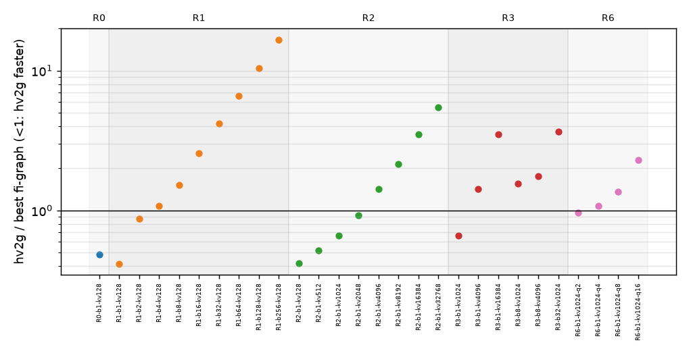
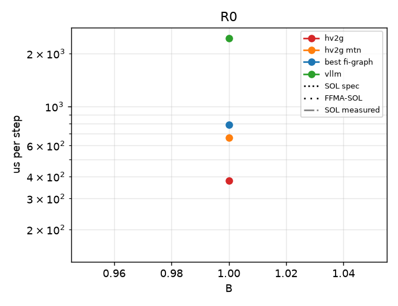
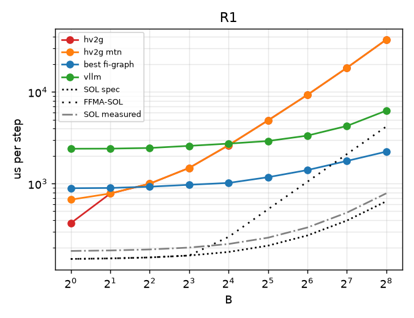
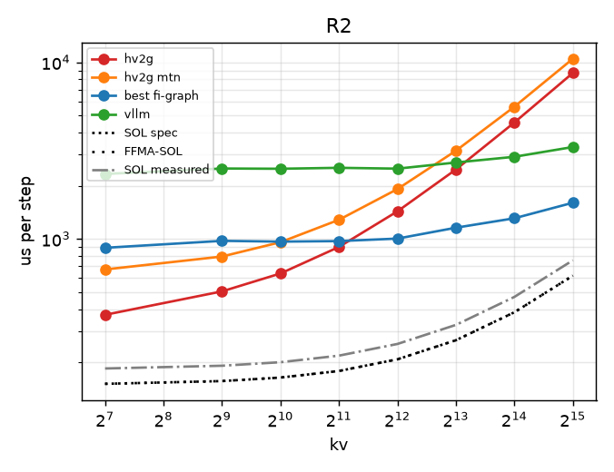
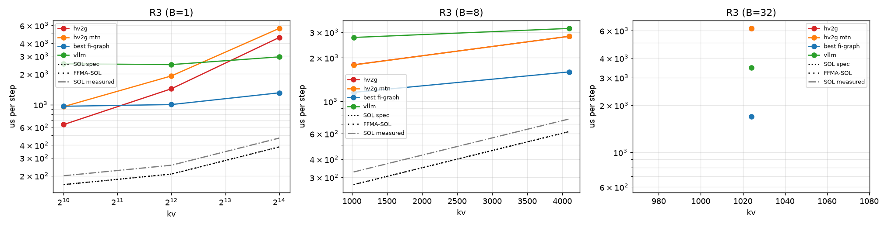
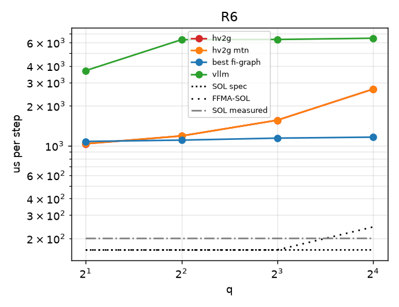

# regimebench report

- Runs: 20261023T175548Z-mk-p0; slurm jobs: 9562 (logs under runs/<run>/ and runs/slurm-<job>.log)
- GPU: NVIDIA B200 (148 SMs), driver 580.178.04, host cayenne
- Versions: torch 2.13.0, flashinfer-python 0.7.0.post1, vllm 0.31.0, triton 3.7.1, nvidia-ml-py 13.615.71; git bad611fb38
- SOL spec: 8.0 TB/s, BF16 dense 2.25 PFLOP/s (datasheet-derived, unverified); measured: copy BW 6549 GB/s median, cuBLAS bf16 1661 TFLOP/s, SM clock at probe 1965 MHz
- All times are microseconds per step (steady = back-to-back launches). hv2-repeat is a timing proxy (N repeated b1 decodes), not a correct forward; shown only in R0/R1, where its b1/kv128 work matches the step (elsewhere it skips KV work and can fall below SOL).
- FFMA-SOL = max(T_bw, flops / (148 SMs x 128 lanes x 2 x probed SM clock)); a ceiling for an FP32-FFMA design like hv2g, not for a tensor-core one (hypothesis-grade model, not a measurement).
- Run 20261023T175548Z-mk-p0 (slurm job 9562, SM clock at probe 1965 MHz): regimes R0, R1, R2, R3, R6
- Cross-regime comparisons are across jobs (and possibly GPUs); ratios within a point are interleaved in one job and are the reliable comparison.

## Executive summary

| regime | points | hv2g wins | geomean hv2g/best | crossover (best baseline first beats hv2g) | median %SOL hv2g | median %SOL best |
|---|---|---|---|---|---|---|
| R0 | 1 | 1/1 | 0.48 | none | 39.7 | 19.2 |
| R1 | 9 | 2/9 | 2.69 | B=4 | 6.9 | 17.7 |
| R2 | 8 | 4/8 | 1.29 | kv=4096 | 17.2 | 19.5 |
| R3 | 6 | 1/6 | 1.79 | B=1: 4096; B=8: 1024; B=32: 1024 | 14.7 | 26.3 |
| R6 | 4 | 1/4 | 1.34 | q=4 | 12.2 | 14.6 |

## R0

| point | SOL us (bound) | FFMA-SOL us | hv2g us | hv2g mtn us | hv2-repeat us (proxy) | best baseline us (variant) | vllm wall / gpu us | hv2g/best | %SOL hv2g | %FFMA-SOL hv2g | %SOL best |
|---|---|---|---|---|---|---|---|---|---|---|---|
| R0-b1-kv128 | 150.9 (memory) | 150.9 | 379.9 | 666.8 | - | 786.9 (graph-pdl-best) | 2443.2 / 1808.4 (nopdl) | 0.48 | 39.7 | 39.7 | 19.2 |

## R1

| point | SOL us (bound) | FFMA-SOL us | hv2g us | hv2g mtn us | hv2-repeat us (proxy) | best baseline us (variant) | vllm wall / gpu us | hv2g/best | %SOL hv2g | %FFMA-SOL hv2g | %SOL best |
|---|---|---|---|---|---|---|---|---|---|---|---|
| R1-b1-kv128 | 150.9 (memory) | 150.9 | 371.0 | 669.2 | - | 891.9 (graph-pdl-best) | 2404.9 / 1830.9 (pdl) | 0.42 | 40.7 | 40.7 | 16.9 |
| R1-b2-kv128 | 152.9 (memory) | 152.9 | 780.0 | 781.4 | - | 897.6 (graph-pdl-best) | 2410.8 / 1818.9 (nopdl) | 0.87 | 19.6 | 19.6 | 17.0 |
| R1-b4-kv128 | 156.7 (memory) | 156.7 | 998.8 | 1000.9 | - | 926.8 (graph-pdl-best) | 2451.4 / 1817.6 (nopdl) | 1.08 | 15.7 | 15.7 | 16.9 |
| R1-b8-kv128 | 164.4 (memory) | 164.4 | 1485.6 | 1481.5 | - | 972.1 (graph-pdl-best) | 2584.5 / 1843.2 (pdl) | 1.53 | 11.1 | 11.1 | 16.9 |
| R1-b16-kv128 | 179.8 (memory) | 262.5 | 2619.8 | 2634.5 | - | 1018.7 (graph-pdl-best) | 2734.3 / 1887.4 (nopdl) | 2.57 | 6.9 | 10.0 | 17.7 |
| R1-b32-kv128 | 210.6 (memory) | 525.0 | 4905.4 | 4881.4 | - | 1175.9 (graph-pdl-best) | 2917.9 / 1951.2 (pdl) | 4.17 | 4.3 | 10.7 | 17.9 |
| R1-b64-kv128 | 272.2 (memory) | 1050.1 | 9310.8 | 9328.9 | - | 1407.1 (graph-pdl-best) | 3343.1 / 2059.8 (pdl) | 6.62 | 2.9 | 11.3 | 19.3 |
| R1-b128-kv128 | 395.5 (memory) | 2100.2 | 18354.0 | 18370.1 | - | 1768.7 (graph-pdl-cublas) | 4259.8 / 2382.3 (nopdl) | 10.38 | 2.2 | 11.4 | 22.4 |
| R1-b256-kv128 | 641.9 (memory) | 4200.4 | 37268.5 | 37319.9 | - | 2235.3 (graph-pdl-best) | 6263.2 / 3007.9 (pdl) | 16.67 | 1.7 | 11.3 | 28.7 |

## R2

| point | SOL us (bound) | FFMA-SOL us | hv2g us | hv2g mtn us | hv2-repeat us (proxy) | best baseline us (variant) | vllm wall / gpu us | hv2g/best | %SOL hv2g | %FFMA-SOL hv2g | %SOL best |
|---|---|---|---|---|---|---|---|---|---|---|---|
| R2-b1-kv128 | 150.9 (memory) | 150.9 | 371.3 | 670.7 | n/a | 889.7 (graph-pdl-best) | 2331.0 / 1812.0 (pdl) | 0.42 | 40.7 | 40.7 | 17.0 |
| R2-b1-kv512 | 156.4 (memory) | 156.4 | 504.0 | 794.2 | n/a | 974.3 (graph-pdl-best) | 2502.7 / 1861.2 (nopdl) | 0.52 | 31.0 | 31.0 | 16.1 |
| R2-b1-kv1024 | 163.8 (memory) | 163.8 | 636.7 | 957.5 | n/a | 964.5 (graph-pdl-best) | 2495.1 / 1862.0 (nopdl) | 0.66 | 25.7 | 25.7 | 17.0 |
| R2-b1-kv2048 | 178.5 (memory) | 178.5 | 899.9 | 1282.3 | n/a | 971.1 (graph-pdl-best) | 2525.7 / 1891.8 (nopdl) | 0.93 | 19.8 | 19.8 | 18.4 |
| R2-b1-kv4096 | 207.8 (memory) | 207.8 | 1431.8 | 1914.3 | n/a | 1003.5 (graph-pdl-best) | 2498.7 / 1924.8 (pdl) | 1.43 | 14.5 | 14.5 | 20.7 |
| R2-b1-kv8192 | 266.5 (memory) | 266.5 | 2471.9 | 3157.1 | n/a | 1156.6 (graph-pdl-best) | 2706.8 / 2072.3 (nopdl) | 2.14 | 10.8 | 10.8 | 23.0 |
| R2-b1-kv16384 | 384.0 (memory) | 384.0 | 4563.6 | 5607.3 | n/a | 1308.2 (graph-pdl-best) | 2916.5 / 2284.6 (nopdl) | 3.49 | 8.4 | 8.4 | 29.4 |
| R2-b1-kv32768 | 618.9 (memory) | 618.9 | 8706.4 | 10478.1 | n/a | 1601.8 (graph-pdl-best) | 3313.3 / 2663.4 (nopdl) | 5.44 | 7.1 | 7.1 | 38.6 |

## R3

| point | SOL us (bound) | FFMA-SOL us | hv2g us | hv2g mtn us | hv2-repeat us (proxy) | best baseline us (variant) | vllm wall / gpu us | hv2g/best | %SOL hv2g | %FFMA-SOL hv2g | %SOL best |
|---|---|---|---|---|---|---|---|---|---|---|---|
| R3-b1-kv1024 | 163.8 (memory) | 163.8 | 637.0 | 956.1 | n/a | 963.4 (graph-pdl-best) | 2516.6 / 1866.9 (nopdl) | 0.66 | 25.7 | 25.7 | 17.0 |
| R3-b1-kv4096 | 207.8 (memory) | 207.8 | 1432.0 | 1914.1 | n/a | 1001.6 (graph-pdl-best) | 2474.0 / 1912.5 (nopdl) | 1.43 | 14.5 | 14.5 | 20.7 |
| R3-b1-kv16384 | 384.0 (memory) | 384.0 | 4564.1 | 5604.3 | n/a | 1305.8 (graph-pdl-best) | 2944.5 / 2291.0 (nopdl) | 3.50 | 8.4 | 8.4 | 29.4 |
| R3-b8-kv1024 | 267.2 (memory) | 267.2 | 1787.9 | 1783.0 | n/a | 1154.8 (graph-pdl-best) | 2759.4 / 2002.3 (pdl) | 1.55 | 14.9 | 14.9 | 23.1 |
| R3-b8-kv4096 | 619.5 (memory) | 619.5 | 2809.1 | 2813.0 | n/a | 1597.5 (graph-pdl-best) | 3184.7 / 2457.7 (nopdl) | 1.76 | 22.1 | 22.1 | 38.8 |
| R3-b32-kv1024 | 621.7 (memory) | 621.7 | 6193.5 | 6186.5 | n/a | 1694.4 (graph-pdl-best) | 3481.8 / 2484.8 (pdl) | 3.66 | 10.0 | 10.0 | 36.7 |

## R6

| point | SOL us (bound) | FFMA-SOL us | hv2g us | hv2g mtn us | hv2-repeat us (proxy) | best baseline us (variant) | vllm wall / gpu us | hv2g/best | %SOL hv2g | %FFMA-SOL hv2g | %SOL best |
|---|---|---|---|---|---|---|---|---|---|---|---|
| R6-b1-kv1024-q2 | 163.8 (memory) | 163.8 | 1035.2 | 1037.2 | n/a | 1078.5 (graph-pdl-best) | 3687.5 / 3458.6 (nopdl) | 0.96 | 15.8 | 15.8 | 15.2 |
| R6-b1-kv1024-q4 | 163.8 (memory) | 163.8 | 1186.5 | 1186.8 | n/a | 1103.3 (graph-pdl-best) | 6312.0 / 6091.3 (pdl) | 1.08 | 13.8 | 13.8 | 14.8 |
| R6-b1-kv1024-q8 | 163.9 (memory) | 163.9 | 1559.7 | 1559.4 | n/a | 1142.1 (graph-pdl-best) | 6333.1 / 6105.0 (nopdl) | 1.37 | 10.5 | 10.5 | 14.3 |
| R6-b1-kv1024-q16 | 164.0 (memory) | 244.4 | 2674.6 | 2674.6 | n/a | 1161.7 (graph-pdl-best) | 6472.6 / 6247.1 (nopdl) | 2.30 | 6.1 | 9.1 | 14.1 |

## Winner variants and backends

| point | best fi-graph variant | attn backend | gemm | PDL cover | best vllm variant |
|---|---|---|---|---|---|
| R0-b1-kv128 | graph-pdl-best | decode/cute-dsl/tc=True | {'qkv': 'cute-dsl', 'o': 'cute-dsl', 'gu': 'cute-dsl', 'down': 'cute-dsl', 'lm_head': 'cute-dsl'} | 254/312 | nopdl |
| R1-b1-kv128 | graph-pdl-best | decode/cute-dsl/tc=True | {'qkv': 'cute-dsl', 'o': 'cute-dsl', 'gu': 'cute-dsl', 'down': 'cute-dsl', 'lm_head': 'cute-dsl'} | 254/312 | pdl |
| R1-b2-kv128 | graph-pdl-best | decode/cute-dsl/tc=True | {'qkv': 'cute-dsl', 'o': 'cute-dsl', 'gu': 'cute-dsl', 'down': 'cute-dsl', 'lm_head': 'cute-dsl'} | 254/312 | nopdl |
| R1-b4-kv128 | graph-pdl-best | decode/cute-dsl/tc=True | {'qkv': 'cute-dsl', 'o': 'cute-dsl', 'gu': 'cute-dsl', 'down': 'cute-dsl', 'lm_head': 'cute-dsl'} | 254/312 | nopdl |
| R1-b8-kv128 | graph-pdl-best | decode/cute-dsl/tc=True | {'qkv': 'cute-dsl', 'o': 'tinygemm', 'gu': 'cute-dsl', 'down': 'tinygemm', 'lm_head': 'cute-dsl'} | 254/312 | pdl |
| R1-b16-kv128 | graph-pdl-best | decode/cute-dsl/tc=True | {'qkv': 'cute-dsl', 'o': 'cute-dsl', 'gu': 'cute-dsl', 'down': 'cute-dsl', 'lm_head': 'cute-dsl'} | 254/312 | nopdl |
| R1-b32-kv128 | graph-pdl-best | decode/trtllm-direct | {'qkv': 'cute-dsl', 'o': 'cute-dsl', 'gu': 'cudnn', 'down': 'cute-dsl', 'lm_head': 'cudnn'} | 225/312 | pdl |
| R1-b64-kv128 | graph-pdl-best | decode/trtllm-gen/tc=True | {'qkv': 'cute-dsl', 'o': 'tgv', 'gu': 'cute-dsl', 'down': 'tgv', 'lm_head': 'cute-dsl'} | 197/312 | pdl |
| R1-b128-kv128 | graph-pdl-cublas | decode/trtllm-gen/tc=True | {'qkv': 'cublas', 'o': 'cublas', 'gu': 'cublas', 'down': 'cublas', 'lm_head': 'cublas'} | 141/312 | nopdl |
| R1-b256-kv128 | graph-pdl-best | decode/auto/tc=False | {'qkv': 'cublas', 'o': 'cublas', 'gu': 'cute-dsl', 'down': 'cublas', 'lm_head': 'cute-dsl'} | 141/312 | pdl |
| R2-b1-kv128 | graph-pdl-best | decode/cute-dsl/tc=True | {'qkv': 'cute-dsl', 'o': 'cute-dsl', 'gu': 'cute-dsl', 'down': 'cute-dsl', 'lm_head': 'cute-dsl'} | 254/312 | pdl |
| R2-b1-kv512 | graph-pdl-best | decode/trtllm-gen/tc=True | {'qkv': 'cute-dsl', 'o': 'cute-dsl', 'gu': 'cute-dsl', 'down': 'cute-dsl', 'lm_head': 'cute-dsl'} | 254/312 | nopdl |
| R2-b1-kv1024 | graph-pdl-best | decode/trtllm-gen/tc=True | {'qkv': 'cute-dsl', 'o': 'cute-dsl', 'gu': 'cute-dsl', 'down': 'cute-dsl', 'lm_head': 'cute-dsl'} | 254/312 | nopdl |
| R2-b1-kv2048 | graph-pdl-best | decode/trtllm-gen/tc=True | {'qkv': 'cute-dsl', 'o': 'cute-dsl', 'gu': 'cute-dsl', 'down': 'cute-dsl', 'lm_head': 'cute-dsl'} | 254/312 | nopdl |
| R2-b1-kv4096 | graph-pdl-best | decode/trtllm-direct | {'qkv': 'cute-dsl', 'o': 'cute-dsl', 'gu': 'cute-dsl', 'down': 'cute-dsl', 'lm_head': 'cute-dsl'} | 254/312 | pdl |
| R2-b1-kv8192 | graph-pdl-best | decode/cute-dsl/tc=True | {'qkv': 'cute-dsl', 'o': 'cute-dsl', 'gu': 'cute-dsl', 'down': 'cute-dsl', 'lm_head': 'cute-dsl'} | 254/312 | nopdl |
| R2-b1-kv16384 | graph-pdl-best | decode/cute-dsl/tc=True | {'qkv': 'cute-dsl', 'o': 'cute-dsl', 'gu': 'cute-dsl', 'down': 'cute-dsl', 'lm_head': 'cute-dsl'} | 254/312 | nopdl |
| R2-b1-kv32768 | graph-pdl-best | decode/cute-dsl/tc=True | {'qkv': 'cute-dsl', 'o': 'cute-dsl', 'gu': 'cute-dsl', 'down': 'cute-dsl', 'lm_head': 'cute-dsl'} | 254/312 | nopdl |
| R3-b1-kv1024 | graph-pdl-best | decode/trtllm-gen/tc=True | {'qkv': 'cute-dsl', 'o': 'cute-dsl', 'gu': 'cute-dsl', 'down': 'cute-dsl', 'lm_head': 'cute-dsl'} | 254/312 | nopdl |
| R3-b1-kv4096 | graph-pdl-best | decode/trtllm-direct | {'qkv': 'cute-dsl', 'o': 'cute-dsl', 'gu': 'cute-dsl', 'down': 'cute-dsl', 'lm_head': 'cute-dsl'} | 254/312 | nopdl |
| R3-b1-kv16384 | graph-pdl-best | decode/cute-dsl/tc=True | {'qkv': 'cute-dsl', 'o': 'cute-dsl', 'gu': 'cute-dsl', 'down': 'cute-dsl', 'lm_head': 'cute-dsl'} | 254/312 | nopdl |
| R3-b8-kv1024 | graph-pdl-best | decode/cute-dsl/tc=True | {'qkv': 'cute-dsl', 'o': 'tinygemm', 'gu': 'cute-dsl', 'down': 'tinygemm', 'lm_head': 'cute-dsl'} | 254/312 | pdl |
| R3-b8-kv4096 | graph-pdl-best | decode/trtllm-direct | {'qkv': 'cute-dsl', 'o': 'tinygemm', 'gu': 'cute-dsl', 'down': 'tinygemm', 'lm_head': 'cute-dsl'} | 254/312 | nopdl |
| R3-b32-kv1024 | graph-pdl-best | decode/cute-dsl/tc=True | {'qkv': 'cute-dsl', 'o': 'cute-dsl', 'gu': 'cudnn', 'down': 'cute-dsl', 'lm_head': 'cudnn'} | 225/312 | pdl |
| R6-b1-kv1024-q2 | graph-pdl-best | prefill/fa2 | {'qkv': 'cute-dsl', 'o': 'cute-dsl', 'gu': 'cute-dsl', 'down': 'cute-dsl', 'lm_head': 'cute-dsl'} | 254/313 | nopdl |
| R6-b1-kv1024-q4 | graph-pdl-best | prefill/fa2 | {'qkv': 'cute-dsl', 'o': 'cute-dsl', 'gu': 'cute-dsl', 'down': 'cute-dsl', 'lm_head': 'cute-dsl'} | 254/313 | pdl |
| R6-b1-kv1024-q8 | graph-pdl-best | prefill/fa2 | {'qkv': 'cute-dsl', 'o': 'tinygemm', 'gu': 'cute-dsl', 'down': 'tinygemm', 'lm_head': 'cute-dsl'} | 254/313 | nopdl |
| R6-b1-kv1024-q16 | graph-pdl-best | prefill/fa2 | {'qkv': 'cute-dsl', 'o': 'cute-dsl', 'gu': 'cute-dsl', 'down': 'cute-dsl', 'lm_head': 'cute-dsl'} | 254/313 | nopdl |

## Accuracy (FP32 oracle band, pass = rel-L2 <= 2x BF16 reference's own)

| point | arm:variant | seeds | worst x band (logits/k/v) | next_token match | verdict |
|---|---|---|---|---|---|
| R0-b1-kv128 | fi-graph:eager-pdl-best | 3 | 0.96/0.85/0.85 | 1.00 | pass |
| R0-b1-kv128 | fi-graph:graph-nopdl-best | 3 | 0.96/0.85/0.85 | 1.00 | pass |
| R0-b1-kv128 | fi-graph:graph-nopdl-cublas | 3 | 0.90/0.82/0.82 | 1.00 | pass |
| R0-b1-kv128 | fi-graph:graph-pdl-best | 3 | 0.96/0.85/0.85 | 1.00 | pass |
| R0-b1-kv128 | fi-graph:graph-pdl-cublas | 3 | 0.90/0.82/0.82 | 1.00 | pass |
| R0-b1-kv128 | hv2g:auto | 3 | 0.00/0.06/0.06 | 1.00 | pass |
| R0-b1-kv128 | hv2g:mtn | 3 | 0.18/0.18/0.18 | 1.00 | pass |
| R1-b64-kv128 | fi-graph:graph-nopdl-best | 3 | 0.80/0.78/0.78 | 0.89 | pass |
| R1-b64-kv128 | fi-graph:graph-nopdl-cublas | 3 | 0.80/0.78/0.78 | 0.89 | pass |
| R1-b64-kv128 | fi-graph:graph-pdl-best | 3 | 0.80/0.78/0.78 | 0.89 | pass |
| R1-b64-kv128 | fi-graph:graph-pdl-cublas | 3 | 0.80/0.78/0.78 | 0.89 | pass |
| R1-b64-kv128 | hv2g:auto | 3 | 0.18/0.19/0.19 | 0.98 | pass |
| R1-b64-kv128 | hv2g:mtn | 3 | 0.18/0.19/0.19 | 0.98 | pass |
| R1-b8-kv128 | fi-graph:graph-nopdl-best | 3 | 0.82/0.81/0.81 | 1.00 | pass |
| R1-b8-kv128 | fi-graph:graph-nopdl-cublas | 3 | 0.80/0.80/0.80 | 1.00 | pass |
| R1-b8-kv128 | fi-graph:graph-pdl-best | 3 | 0.82/0.81/0.81 | 1.00 | pass |
| R1-b8-kv128 | fi-graph:graph-pdl-cublas | 3 | 0.80/0.80/0.80 | 1.00 | pass |
| R1-b8-kv128 | hv2g:auto | 3 | 0.20/0.20/0.20 | 0.88 | pass |
| R1-b8-kv128 | hv2g:mtn | 3 | 0.20/0.20/0.20 | 0.88 | pass |
| R2-b1-kv1024 | fi-graph:graph-nopdl-best | 3 | 0.78/0.77/0.77 | 1.00 | pass |
| R2-b1-kv1024 | fi-graph:graph-nopdl-cublas | 3 | 0.80/0.80/0.79 | 1.00 | pass |
| R2-b1-kv1024 | fi-graph:graph-pdl-best | 3 | 0.78/0.77/0.77 | 1.00 | pass |
| R2-b1-kv1024 | fi-graph:graph-pdl-cublas | 3 | 0.80/0.80/0.79 | 1.00 | pass |
| R2-b1-kv1024 | hv2g:auto | 3 | 0.00/0.07/0.07 | 1.00 | pass |
| R2-b1-kv1024 | hv2g:mtn | 3 | 0.07/0.10/0.10 | 1.00 | pass |
| R2-b1-kv8192 | fi-graph:graph-nopdl-best | 3 | 0.85/0.81/0.82 | 1.00 | pass |
| R2-b1-kv8192 | fi-graph:graph-nopdl-cublas | 3 | 0.91/0.89/0.90 | 1.00 | pass |
| R2-b1-kv8192 | fi-graph:graph-pdl-best | 3 | 0.85/0.81/0.82 | 1.00 | pass |
| R2-b1-kv8192 | fi-graph:graph-pdl-cublas | 3 | 0.91/0.89/0.90 | 1.00 | pass |
| R2-b1-kv8192 | hv2g:auto | 3 | 0.00/0.07/0.07 | 1.00 | pass |
| R2-b1-kv8192 | hv2g:mtn | 3 | 0.01/0.07/0.07 | 1.00 | pass |
| R3-b8-kv4096 | fi-graph:graph-nopdl-best | 3 | 0.85/0.83/0.84 | 0.88 | pass |
| R3-b8-kv4096 | fi-graph:graph-nopdl-cublas | 3 | 0.85/0.83/0.84 | 0.75 | pass |
| R3-b8-kv4096 | fi-graph:graph-pdl-best | 3 | 0.85/0.83/0.84 | 0.88 | pass |
| R3-b8-kv4096 | fi-graph:graph-pdl-cublas | 3 | 0.85/0.83/0.84 | 0.75 | pass |
| R3-b8-kv4096 | hv2g:auto | 3 | 0.02/0.07/0.07 | 1.00 | pass |
| R3-b8-kv4096 | hv2g:mtn | 3 | 0.02/0.07/0.07 | 1.00 | pass |
| R6-b1-kv1024-q16 | fi-graph:graph-nopdl-best | 3 | 1.01/0.80/0.80 | 1.00 | pass |
| R6-b1-kv1024-q16 | fi-graph:graph-nopdl-cublas | 3 | 1.02/0.79/0.79 | 0.00 | pass |
| R6-b1-kv1024-q16 | fi-graph:graph-pdl-best | 3 | 1.01/0.80/0.80 | 1.00 | pass |
| R6-b1-kv1024-q16 | fi-graph:graph-pdl-cublas | 3 | 1.02/0.79/0.79 | 0.00 | pass |
| R6-b1-kv1024-q16 | hv2g:auto | 3 | 0.16/0.12/0.12 | 1.00 | pass |
| R6-b1-kv1024-q16 | hv2g:mtn | 3 | 0.16/0.12/0.12 | 1.00 | pass |
| R6-b1-kv1024-q4 | fi-graph:graph-nopdl-best | 3 | 0.93/0.83/0.83 | 1.00 | pass |
| R6-b1-kv1024-q4 | fi-graph:graph-nopdl-cublas | 3 | 0.89/0.81/0.81 | 1.00 | pass |
| R6-b1-kv1024-q4 | fi-graph:graph-pdl-best | 3 | 0.93/0.83/0.83 | 1.00 | pass |
| R6-b1-kv1024-q4 | fi-graph:graph-pdl-cublas | 3 | 0.89/0.81/0.81 | 1.00 | pass |
| R6-b1-kv1024-q4 | hv2g:auto | 3 | 0.15/0.12/0.12 | 1.00 | pass |
| R6-b1-kv1024-q4 | hv2g:mtn | 3 | 0.15/0.12/0.12 | 1.00 | pass |

## Skips and errors

- SKIP fi-graph:eager-pdl-best @ R1-b1-kv128: eager variant is only measured at R0
- SKIP fi-graph:eager-pdl-best @ R1-b2-kv128: eager variant is only measured at R0
- SKIP fi-graph:eager-pdl-best @ R1-b4-kv128: eager variant is only measured at R0
- SKIP fi-graph:eager-pdl-best @ R1-b8-kv128: eager variant is only measured at R0
- SKIP fi-graph:eager-pdl-best @ R1-b16-kv128: eager variant is only measured at R0
- SKIP fi-graph:eager-pdl-best @ R1-b32-kv128: eager variant is only measured at R0
- SKIP fi-graph:eager-pdl-best @ R1-b64-kv128: eager variant is only measured at R0
- SKIP fi-graph:eager-pdl-best @ R1-b128-kv128: eager variant is only measured at R0
- SKIP fi-graph:eager-pdl-best @ R1-b256-kv128: eager variant is only measured at R0
- SKIP fi-graph:eager-pdl-best @ R2-b1-kv128: eager variant is only measured at R0
- SKIP fi-graph:eager-pdl-best @ R2-b1-kv512: eager variant is only measured at R0
- SKIP fi-graph:eager-pdl-best @ R2-b1-kv1024: eager variant is only measured at R0
- SKIP fi-graph:eager-pdl-best @ R2-b1-kv2048: eager variant is only measured at R0
- SKIP fi-graph:eager-pdl-best @ R2-b1-kv4096: eager variant is only measured at R0
- SKIP fi-graph:eager-pdl-best @ R2-b1-kv8192: eager variant is only measured at R0
- SKIP fi-graph:eager-pdl-best @ R2-b1-kv16384: eager variant is only measured at R0
- SKIP fi-graph:eager-pdl-best @ R2-b1-kv32768: eager variant is only measured at R0
- SKIP fi-graph:eager-pdl-best @ R3-b1-kv1024: eager variant is only measured at R0
- SKIP fi-graph:eager-pdl-best @ R3-b1-kv4096: eager variant is only measured at R0
- SKIP fi-graph:eager-pdl-best @ R3-b1-kv16384: eager variant is only measured at R0
- SKIP fi-graph:eager-pdl-best @ R3-b8-kv1024: eager variant is only measured at R0
- SKIP fi-graph:eager-pdl-best @ R3-b8-kv4096: eager variant is only measured at R0
- SKIP fi-graph:eager-pdl-best @ R3-b32-kv1024: eager variant is only measured at R0
- SKIP fi-graph:eager-pdl-best @ R6-b1-kv1024-q2: eager variant is only measured at R0
- SKIP fi-graph:eager-pdl-best @ R6-b1-kv1024-q4: eager variant is only measured at R0
- SKIP fi-graph:eager-pdl-best @ R6-b1-kv1024-q8: eager variant is only measured at R0
- SKIP fi-graph:eager-pdl-best @ R6-b1-kv1024-q16: eager variant is only measured at R0
