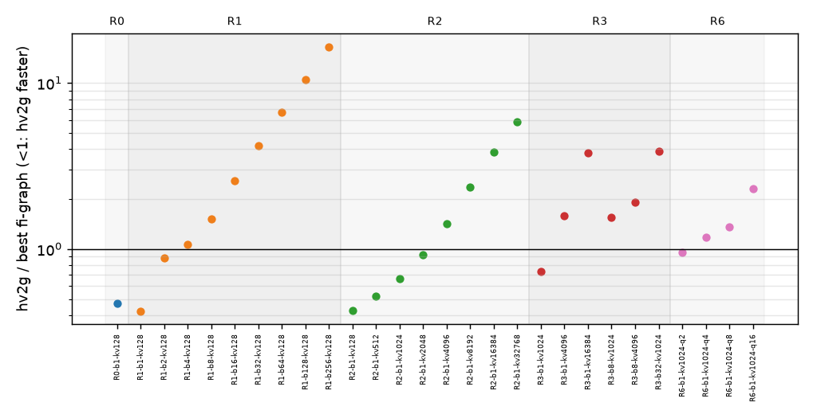
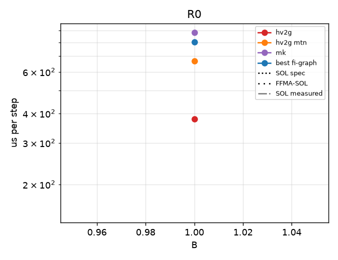
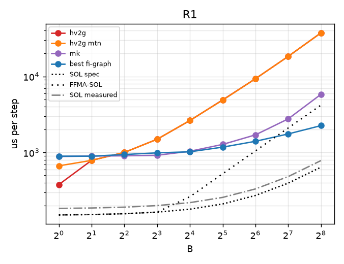
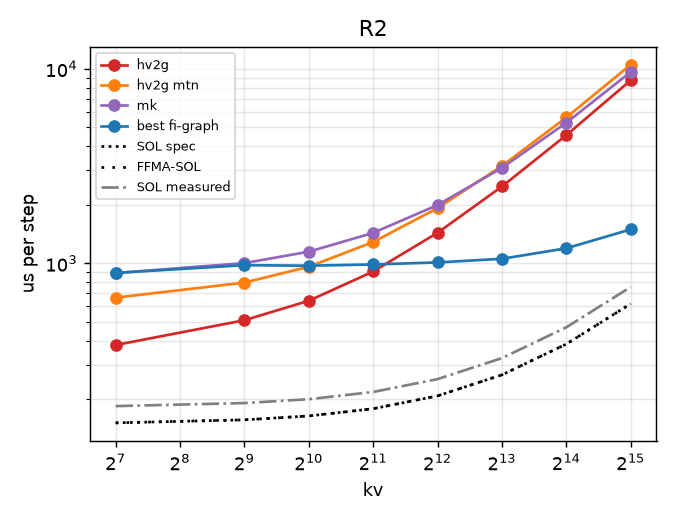
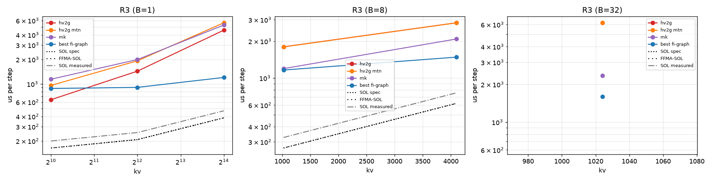
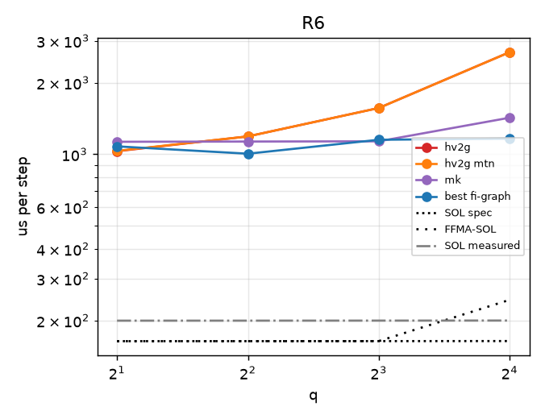

# regimebench report

- Runs: 20261023T183703Z-mk-v0; slurm jobs: 9578 (logs under runs/<run>/ and runs/slurm-<job>.log)
- GPU: NVIDIA B200 (148 SMs), driver 580.178.04, host cayenne
- Versions: torch 2.13.0, flashinfer-python 0.7.0.post1, vllm 0.31.0, triton 3.7.1, nvidia-ml-py 13.615.71; git 2839ced207
- SOL spec: 8.0 TB/s, BF16 dense 2.25 PFLOP/s (datasheet-derived, unverified); measured: copy BW 6560 GB/s median, cuBLAS bf16 1650 TFLOP/s, SM clock at probe 1965 MHz
- All times are microseconds per step (steady = back-to-back launches). hv2-repeat is a timing proxy (N repeated b1 decodes), not a correct forward; shown only in R0/R1, where its b1/kv128 work matches the step (elsewhere it skips KV work and can fall below SOL).
- FFMA-SOL = max(T_bw, flops / (148 SMs x 128 lanes x 2 x probed SM clock)); a ceiling for an FP32-FFMA design like hv2g, not for a tensor-core one (hypothesis-grade model, not a measurement).
- Run 20261023T183703Z-mk-v0 (slurm job 9578, SM clock at probe 1965 MHz): regimes R0, R1, R2, R3, R6
- Cross-regime comparisons are across jobs (and possibly GPUs); ratios within a point are interleaved in one job and are the reliable comparison.

## Executive summary

| regime | points | hv2g wins | geomean hv2g/best | crossover (best baseline first beats hv2g) | median %SOL hv2g | median %SOL best |
|---|---|---|---|---|---|---|
| R0 | 1 | 1/1 | 0.47 | none | 39.9 | 18.8 |
| R1 | 9 | 2/9 | 2.69 | B=4 | 6.8 | 17.6 |
| R2 | 8 | 4/8 | 1.33 | kv=4096 | 17.1 | 19.3 |
| R3 | 6 | 1/6 | 1.92 | B=1: 4096; B=8: 1024; B=32: 1024 | 14.7 | 27.5 |
| R6 | 4 | 1/4 | 1.37 | q=4 | 12.1 | 14.7 |

## Megakernel arms vs best baseline

| point | SOL us | best baseline us | vllm us | hv2g us | mk us | hv2g/best | mk/best |
|---|---|---|---|---|---|---|---|
| R0-b1-kv128 | 150.9 | 804.2 | - | 378.5 | 881.5 | 0.47 | 1.10 |
| R1-b1-kv128 | 150.9 | 894.9 | - | 378.8 | 884.8 | 0.42 | 0.99 |
| R1-b2-kv128 | 152.9 | 894.5 | - | 789.3 | 898.2 | 0.88 | 1.00 |
| R1-b4-kv128 | 156.7 | 940.4 | - | 1002.7 | 904.8 | 1.07 | 0.96 |
| R1-b8-kv128 | 164.4 | 989.3 | - | 1494.0 | 919.6 | 1.51 | 0.93 |
| R1-b16-kv128 | 179.8 | 1021.3 | - | 2629.9 | 1038.3 | 2.58 | 1.02 |
| R1-b32-kv128 | 210.6 | 1176.2 | - | 4917.3 | 1277.2 | 4.18 | 1.09 |
| R1-b64-kv128 | 272.2 | 1403.2 | - | 9327.7 | 1705.3 | 6.65 | 1.22 |
| R1-b128-kv128 | 395.5 | 1753.9 | - | 18359.9 | 2767.0 | 10.47 | 1.58 |
| R1-b256-kv128 | 641.9 | 2256.1 | - | 37391.3 | 5820.8 | 16.57 | 2.58 |
| R2-b1-kv128 | 150.9 | 891.6 | - | 379.6 | 889.6 | 0.43 | 1.00 |
| R2-b1-kv512 | 156.4 | 977.0 | - | 508.9 | 1001.6 | 0.52 | 1.03 |
| R2-b1-kv1024 | 163.8 | 970.9 | - | 641.1 | 1146.1 | 0.66 | 1.18 |
| R2-b1-kv2048 | 178.5 | 985.3 | - | 906.6 | 1432.6 | 0.92 | 1.45 |
| R2-b1-kv4096 | 207.8 | 1009.6 | - | 1434.5 | 1992.6 | 1.42 | 1.97 |
| R2-b1-kv8192 | 266.5 | 1053.8 | - | 2481.3 | 3093.7 | 2.35 | 2.94 |
| R2-b1-kv16384 | 384.0 | 1193.3 | - | 4559.2 | 5281.2 | 3.82 | 4.43 |
| R2-b1-kv32768 | 618.9 | 1493.1 | - | 8729.6 | 9637.0 | 5.85 | 6.45 |
| R3-b1-kv1024 | 163.8 | 878.8 | - | 641.5 | 1143.2 | 0.73 | 1.30 |
| R3-b1-kv4096 | 207.8 | 907.7 | - | 1435.1 | 1990.2 | 1.58 | 2.19 |
| R3-b1-kv16384 | 384.0 | 1201.0 | - | 4567.5 | 5281.2 | 3.80 | 4.40 |
| R3-b8-kv1024 | 267.2 | 1161.2 | - | 1799.4 | 1193.3 | 1.55 | 1.03 |
| R3-b8-kv4096 | 619.5 | 1480.9 | - | 2829.2 | 2083.7 | 1.91 | 1.41 |
| R3-b32-kv1024 | 621.7 | 1597.6 | - | 6193.0 | 2341.6 | 3.88 | 1.47 |
| R6-b1-kv1024-q2 | 163.8 | 1079.9 | - | 1030.5 | 1128.9 | 0.95 | 1.05 |
| R6-b1-kv1024-q4 | 163.8 | 1005.7 | - | 1189.2 | 1131.5 | 1.18 | 1.13 |
| R6-b1-kv1024-q8 | 163.9 | 1151.2 | - | 1565.6 | 1134.0 | 1.36 | 0.99 |
| R6-b1-kv1024-q16 | 164.0 | 1163.8 | - | 2688.2 | 1425.2 | 2.31 | 1.22 |

## R0

| point | SOL us (bound) | FFMA-SOL us | hv2g us | hv2g mtn us | hv2-repeat us (proxy) | best baseline us (variant) | vllm wall / gpu us | hv2g/best | %SOL hv2g | %FFMA-SOL hv2g | %SOL best |
|---|---|---|---|---|---|---|---|---|---|---|---|
| R0-b1-kv128 | 150.9 (memory) | 150.9 | 378.5 | 666.0 | - | 804.2 (graph-pdl-best) | - | 0.47 | 39.9 | 39.9 | 18.8 |

## R1

| point | SOL us (bound) | FFMA-SOL us | hv2g us | hv2g mtn us | hv2-repeat us (proxy) | best baseline us (variant) | vllm wall / gpu us | hv2g/best | %SOL hv2g | %FFMA-SOL hv2g | %SOL best |
|---|---|---|---|---|---|---|---|---|---|---|---|
| R1-b1-kv128 | 150.9 (memory) | 150.9 | 378.8 | 668.0 | - | 894.9 (graph-pdl-best) | - | 0.42 | 39.8 | 39.8 | 16.9 |
| R1-b2-kv128 | 152.9 (memory) | 152.9 | 789.3 | 787.4 | - | 894.5 (graph-pdl-best) | - | 0.88 | 19.4 | 19.4 | 17.1 |
| R1-b4-kv128 | 156.7 (memory) | 156.7 | 1002.7 | 1001.9 | - | 940.4 (graph-pdl-best) | - | 1.07 | 15.6 | 15.6 | 16.7 |
| R1-b8-kv128 | 164.4 (memory) | 164.4 | 1494.0 | 1492.9 | - | 989.3 (graph-pdl-best) | - | 1.51 | 11.0 | 11.0 | 16.6 |
| R1-b16-kv128 | 179.8 (memory) | 262.5 | 2629.9 | 2642.7 | - | 1021.3 (graph-pdl-best) | - | 2.58 | 6.8 | 10.0 | 17.6 |
| R1-b32-kv128 | 210.6 (memory) | 525.0 | 4917.3 | 4880.1 | - | 1176.2 (graph-pdl-best) | - | 4.18 | 4.3 | 10.7 | 17.9 |
| R1-b64-kv128 | 272.2 (memory) | 1050.1 | 9327.7 | 9325.2 | - | 1403.2 (graph-pdl-best) | - | 6.65 | 2.9 | 11.3 | 19.4 |
| R1-b128-kv128 | 395.5 (memory) | 2100.2 | 18359.9 | 18343.4 | - | 1753.9 (graph-pdl-cublas) | - | 10.47 | 2.2 | 11.4 | 22.5 |
| R1-b256-kv128 | 641.9 (memory) | 4200.4 | 37391.3 | 37330.2 | - | 2256.1 (graph-pdl-best) | - | 16.57 | 1.7 | 11.2 | 28.5 |

## R2

| point | SOL us (bound) | FFMA-SOL us | hv2g us | hv2g mtn us | hv2-repeat us (proxy) | best baseline us (variant) | vllm wall / gpu us | hv2g/best | %SOL hv2g | %FFMA-SOL hv2g | %SOL best |
|---|---|---|---|---|---|---|---|---|---|---|---|
| R2-b1-kv128 | 150.9 (memory) | 150.9 | 379.6 | 665.3 | n/a | 891.6 (graph-pdl-best) | - | 0.43 | 39.8 | 39.8 | 16.9 |
| R2-b1-kv512 | 156.4 (memory) | 156.4 | 508.9 | 794.9 | n/a | 977.0 (graph-pdl-best) | - | 0.52 | 30.7 | 30.7 | 16.0 |
| R2-b1-kv1024 | 163.8 (memory) | 163.8 | 641.1 | 959.4 | n/a | 970.9 (graph-pdl-best) | - | 0.66 | 25.5 | 25.5 | 16.9 |
| R2-b1-kv2048 | 178.5 (memory) | 178.5 | 906.6 | 1286.1 | n/a | 985.3 (graph-pdl-best) | - | 0.92 | 19.7 | 19.7 | 18.1 |
| R2-b1-kv4096 | 207.8 (memory) | 207.8 | 1434.5 | 1919.7 | n/a | 1009.6 (graph-pdl-best) | - | 1.42 | 14.5 | 14.5 | 20.6 |
| R2-b1-kv8192 | 266.5 (memory) | 266.5 | 2481.3 | 3166.1 | n/a | 1053.8 (graph-pdl-best) | - | 2.35 | 10.7 | 10.7 | 25.3 |
| R2-b1-kv16384 | 384.0 (memory) | 384.0 | 4559.2 | 5623.1 | n/a | 1193.3 (graph-pdl-best) | - | 3.82 | 8.4 | 8.4 | 32.2 |
| R2-b1-kv32768 | 618.9 (memory) | 618.9 | 8729.6 | 10498.8 | n/a | 1493.1 (graph-pdl-best) | - | 5.85 | 7.1 | 7.1 | 41.4 |

## R3

| point | SOL us (bound) | FFMA-SOL us | hv2g us | hv2g mtn us | hv2-repeat us (proxy) | best baseline us (variant) | vllm wall / gpu us | hv2g/best | %SOL hv2g | %FFMA-SOL hv2g | %SOL best |
|---|---|---|---|---|---|---|---|---|---|---|---|
| R3-b1-kv1024 | 163.8 (memory) | 163.8 | 641.5 | 959.8 | n/a | 878.8 (graph-pdl-best) | - | 0.73 | 25.5 | 25.5 | 18.6 |
| R3-b1-kv4096 | 207.8 (memory) | 207.8 | 1435.1 | 1922.0 | n/a | 907.7 (graph-pdl-best) | - | 1.58 | 14.5 | 14.5 | 22.9 |
| R3-b1-kv16384 | 384.0 (memory) | 384.0 | 4567.5 | 5621.6 | n/a | 1201.0 (graph-pdl-best) | - | 3.80 | 8.4 | 8.4 | 32.0 |
| R3-b8-kv1024 | 267.2 (memory) | 267.2 | 1799.4 | 1794.9 | n/a | 1161.2 (graph-pdl-best) | - | 1.55 | 14.8 | 14.8 | 23.0 |
| R3-b8-kv4096 | 619.5 (memory) | 619.5 | 2829.2 | 2824.7 | n/a | 1480.9 (graph-pdl-best) | - | 1.91 | 21.9 | 21.9 | 41.8 |
| R3-b32-kv1024 | 621.7 (memory) | 621.7 | 6193.0 | 6188.6 | n/a | 1597.6 (graph-pdl-best) | - | 3.88 | 10.0 | 10.0 | 38.9 |

## R6

| point | SOL us (bound) | FFMA-SOL us | hv2g us | hv2g mtn us | hv2-repeat us (proxy) | best baseline us (variant) | vllm wall / gpu us | hv2g/best | %SOL hv2g | %FFMA-SOL hv2g | %SOL best |
|---|---|---|---|---|---|---|---|---|---|---|---|
| R6-b1-kv1024-q2 | 163.8 (memory) | 163.8 | 1030.5 | 1033.5 | n/a | 1079.9 (graph-pdl-best) | - | 0.95 | 15.9 | 15.9 | 15.2 |
| R6-b1-kv1024-q4 | 163.8 (memory) | 163.8 | 1189.2 | 1189.3 | n/a | 1005.7 (graph-pdl-best) | - | 1.18 | 13.8 | 13.8 | 16.3 |
| R6-b1-kv1024-q8 | 163.9 (memory) | 163.9 | 1565.6 | 1565.4 | n/a | 1151.2 (graph-pdl-best) | - | 1.36 | 10.5 | 10.5 | 14.2 |
| R6-b1-kv1024-q16 | 164.0 (memory) | 244.4 | 2688.2 | 2687.4 | n/a | 1163.8 (graph-pdl-best) | - | 2.31 | 6.1 | 9.1 | 14.1 |

## Winner variants and backends

| point | best fi-graph variant | attn backend | gemm | PDL cover | best vllm variant |
|---|---|---|---|---|---|
| R0-b1-kv128 | graph-pdl-best | decode/cute-dsl/tc=True | {'qkv': 'cute-dsl', 'o': 'cute-dsl', 'gu': 'cute-dsl', 'down': 'cute-dsl', 'lm_head': 'cute-dsl'} | 254/312 | - |
| R1-b1-kv128 | graph-pdl-best | decode/cute-dsl/tc=True | {'qkv': 'cute-dsl', 'o': 'cute-dsl', 'gu': 'cute-dsl', 'down': 'cute-dsl', 'lm_head': 'cute-dsl'} | 254/312 | - |
| R1-b2-kv128 | graph-pdl-best | decode/cute-dsl/tc=True | {'qkv': 'cute-dsl', 'o': 'cute-dsl', 'gu': 'cute-dsl', 'down': 'cute-dsl', 'lm_head': 'cute-dsl'} | 254/312 | - |
| R1-b4-kv128 | graph-pdl-best | decode/cute-dsl/tc=True | {'qkv': 'cute-dsl', 'o': 'cute-dsl', 'gu': 'cute-dsl', 'down': 'cute-dsl', 'lm_head': 'cute-dsl'} | 254/312 | - |
| R1-b8-kv128 | graph-pdl-best | decode/cute-dsl/tc=True | {'qkv': 'cute-dsl', 'o': 'tinygemm', 'gu': 'cute-dsl', 'down': 'tinygemm', 'lm_head': 'cute-dsl'} | 254/312 | - |
| R1-b16-kv128 | graph-pdl-best | decode/cute-dsl/tc=True | {'qkv': 'cute-dsl', 'o': 'cute-dsl', 'gu': 'cute-dsl', 'down': 'cute-dsl', 'lm_head': 'cute-dsl'} | 254/312 | - |
| R1-b32-kv128 | graph-pdl-best | decode/trtllm-gen/tc=True | {'qkv': 'cute-dsl', 'o': 'cute-dsl', 'gu': 'cudnn', 'down': 'cute-dsl', 'lm_head': 'cudnn'} | 225/312 | - |
| R1-b64-kv128 | graph-pdl-best | decode/trtllm-gen/tc=True | {'qkv': 'cublas', 'o': 'tgv', 'gu': 'cublas', 'down': 'tgv', 'lm_head': 'cudnn'} | 197/312 | - |
| R1-b128-kv128 | graph-pdl-cublas | decode/trtllm-direct | {'qkv': 'cublas', 'o': 'cublas', 'gu': 'cublas', 'down': 'cublas', 'lm_head': 'cublas'} | 141/312 | - |
| R1-b256-kv128 | graph-pdl-best | decode/auto/tc=False | {'qkv': 'cute-dsl', 'o': 'cublas', 'gu': 'cute-dsl', 'down': 'cublas', 'lm_head': 'cute-dsl'} | 141/312 | - |
| R2-b1-kv128 | graph-pdl-best | decode/cute-dsl/tc=True | {'qkv': 'cute-dsl', 'o': 'cute-dsl', 'gu': 'cute-dsl', 'down': 'cute-dsl', 'lm_head': 'cute-dsl'} | 254/312 | - |
| R2-b1-kv512 | graph-pdl-best | decode/trtllm-direct | {'qkv': 'cute-dsl', 'o': 'cute-dsl', 'gu': 'cute-dsl', 'down': 'cute-dsl', 'lm_head': 'cute-dsl'} | 254/312 | - |
| R2-b1-kv1024 | graph-pdl-best | decode/trtllm-gen/tc=True | {'qkv': 'cute-dsl', 'o': 'cute-dsl', 'gu': 'cute-dsl', 'down': 'cute-dsl', 'lm_head': 'cute-dsl'} | 254/312 | - |
| R2-b1-kv2048 | graph-pdl-best | decode/trtllm-gen/tc=True | {'qkv': 'cute-dsl', 'o': 'cute-dsl', 'gu': 'cute-dsl', 'down': 'cute-dsl', 'lm_head': 'cute-dsl'} | 254/312 | - |
| R2-b1-kv4096 | graph-pdl-best | decode/trtllm-gen/tc=True | {'qkv': 'cute-dsl', 'o': 'cute-dsl', 'gu': 'cute-dsl', 'down': 'cute-dsl', 'lm_head': 'cute-dsl'} | 254/312 | - |
| R2-b1-kv8192 | graph-pdl-best | decode/trtllm-gen/tc=True | {'qkv': 'cute-dsl', 'o': 'cute-dsl', 'gu': 'cute-dsl', 'down': 'cute-dsl', 'lm_head': 'cute-dsl'} | 254/312 | - |
| R2-b1-kv16384 | graph-pdl-best | decode/trtllm-direct | {'qkv': 'cute-dsl', 'o': 'cute-dsl', 'gu': 'cute-dsl', 'down': 'cute-dsl', 'lm_head': 'cute-dsl'} | 254/312 | - |
| R2-b1-kv32768 | graph-pdl-best | decode/cute-dsl/tc=True | {'qkv': 'cute-dsl', 'o': 'cute-dsl', 'gu': 'cute-dsl', 'down': 'cute-dsl', 'lm_head': 'cute-dsl'} | 254/312 | - |
| R3-b1-kv1024 | graph-pdl-best | decode/trtllm-gen/tc=True | {'qkv': 'cute-dsl', 'o': 'cute-dsl', 'gu': 'cute-dsl', 'down': 'cute-dsl', 'lm_head': 'cute-dsl'} | 254/312 | - |
| R3-b1-kv4096 | graph-pdl-best | decode/trtllm-gen/tc=True | {'qkv': 'cute-dsl', 'o': 'cute-dsl', 'gu': 'cute-dsl', 'down': 'cute-dsl', 'lm_head': 'cute-dsl'} | 254/312 | - |
| R3-b1-kv16384 | graph-pdl-best | decode/trtllm-gen/tc=True | {'qkv': 'cute-dsl', 'o': 'cute-dsl', 'gu': 'cute-dsl', 'down': 'cute-dsl', 'lm_head': 'cute-dsl'} | 254/312 | - |
| R3-b8-kv1024 | graph-pdl-best | decode/cute-dsl/tc=True | {'qkv': 'cute-dsl', 'o': 'tinygemm', 'gu': 'cute-dsl', 'down': 'tinygemm', 'lm_head': 'cute-dsl'} | 254/312 | - |
| R3-b8-kv4096 | graph-pdl-best | decode/cute-dsl/tc=True | {'qkv': 'cute-dsl', 'o': 'tinygemm', 'gu': 'cute-dsl', 'down': 'tinygemm', 'lm_head': 'cute-dsl'} | 254/312 | - |
| R3-b32-kv1024 | graph-pdl-best | decode/cute-dsl/tc=True | {'qkv': 'cute-dsl', 'o': 'cute-dsl', 'gu': 'cudnn', 'down': 'cute-dsl', 'lm_head': 'cudnn'} | 225/312 | - |
| R6-b1-kv1024-q2 | graph-pdl-best | prefill/fa2 | {'qkv': 'cute-dsl', 'o': 'cute-dsl', 'gu': 'cute-dsl', 'down': 'cute-dsl', 'lm_head': 'cute-dsl'} | 254/313 | - |
| R6-b1-kv1024-q4 | graph-pdl-best | prefill/fa2 | {'qkv': 'cute-dsl', 'o': 'cute-dsl', 'gu': 'cute-dsl', 'down': 'cute-dsl', 'lm_head': 'cute-dsl'} | 254/313 | - |
| R6-b1-kv1024-q8 | graph-pdl-best | prefill/fa2 | {'qkv': 'cute-dsl', 'o': 'tinygemm', 'gu': 'cute-dsl', 'down': 'tinygemm', 'lm_head': 'cute-dsl'} | 254/313 | - |
| R6-b1-kv1024-q16 | graph-pdl-best | prefill/fa2 | {'qkv': 'cute-dsl', 'o': 'cute-dsl', 'gu': 'cute-dsl', 'down': 'cute-dsl', 'lm_head': 'cute-dsl'} | 254/313 | - |

## Accuracy (FP32 oracle band, pass = rel-L2 <= 2x BF16 reference's own)

| point | arm:variant | seeds | worst x band (logits/k/v) | next_token match | verdict |
|---|---|---|---|---|---|
| R0-b1-kv128 | fi-graph:eager-pdl-best | 3 | 0.96/0.85/0.85 | 1.00 | pass |
| R0-b1-kv128 | fi-graph:graph-nopdl-best | 3 | 0.96/0.85/0.85 | 1.00 | pass |
| R0-b1-kv128 | fi-graph:graph-nopdl-cublas | 3 | 0.90/0.82/0.82 | 1.00 | pass |
| R0-b1-kv128 | fi-graph:graph-pdl-best | 3 | 0.96/0.85/0.85 | 1.00 | pass |
| R0-b1-kv128 | fi-graph:graph-pdl-cublas | 3 | 0.90/0.82/0.82 | 1.00 | pass |
| R0-b1-kv128 | hv2g:auto | 3 | 0.00/0.06/0.06 | 1.00 | pass |
| R0-b1-kv128 | hv2g:mtn | 3 | 0.18/0.18/0.18 | 1.00 | pass |
| R0-b1-kv128 | mk:auto | 3 | 0.60/0.56/0.57 | 1.00 | pass |
| R0-b1-kv128 | mk:auto-direct | 3 | 0.59/0.56/0.57 | 1.00 | pass |
| R1-b64-kv128 | fi-graph:graph-nopdl-best | 3 | 0.80/0.78/0.78 | 0.89 | pass |
| R1-b64-kv128 | fi-graph:graph-nopdl-cublas | 3 | 0.80/0.78/0.78 | 0.89 | pass |
| R1-b64-kv128 | fi-graph:graph-pdl-best | 3 | 0.80/0.78/0.78 | 0.89 | pass |
| R1-b64-kv128 | fi-graph:graph-pdl-cublas | 3 | 0.80/0.78/0.78 | 0.89 | pass |
| R1-b64-kv128 | hv2g:auto | 3 | 0.18/0.19/0.19 | 0.98 | pass |
| R1-b64-kv128 | hv2g:mtn | 3 | 0.18/0.19/0.19 | 0.98 | pass |
| R1-b64-kv128 | mk:auto | 3 | 0.49/0.50/0.50 | 0.92 | pass |
| R1-b64-kv128 | mk:auto-direct | 3 | 0.49/0.50/0.50 | 0.94 | pass |
| R1-b8-kv128 | fi-graph:graph-nopdl-best | 3 | 0.82/0.81/0.81 | 1.00 | pass |
| R1-b8-kv128 | fi-graph:graph-nopdl-cublas | 3 | 0.80/0.80/0.80 | 1.00 | pass |
| R1-b8-kv128 | fi-graph:graph-pdl-best | 3 | 0.82/0.81/0.81 | 1.00 | pass |
| R1-b8-kv128 | fi-graph:graph-pdl-cublas | 3 | 0.80/0.80/0.80 | 1.00 | pass |
| R1-b8-kv128 | hv2g:auto | 3 | 0.20/0.20/0.20 | 0.88 | pass |
| R1-b8-kv128 | hv2g:mtn | 3 | 0.20/0.20/0.20 | 0.88 | pass |
| R1-b8-kv128 | mk:auto | 3 | 0.50/0.52/0.52 | 0.88 | pass |
| R1-b8-kv128 | mk:auto-direct | 3 | 0.50/0.52/0.52 | 0.88 | pass |
| R2-b1-kv1024 | fi-graph:graph-nopdl-best | 3 | 0.78/0.77/0.77 | 1.00 | pass |
| R2-b1-kv1024 | fi-graph:graph-nopdl-cublas | 3 | 0.80/0.80/0.79 | 1.00 | pass |
| R2-b1-kv1024 | fi-graph:graph-pdl-best | 3 | 0.78/0.77/0.77 | 1.00 | pass |
| R2-b1-kv1024 | fi-graph:graph-pdl-cublas | 3 | 0.80/0.80/0.79 | 1.00 | pass |
| R2-b1-kv1024 | hv2g:auto | 3 | 0.00/0.07/0.07 | 1.00 | pass |
| R2-b1-kv1024 | hv2g:mtn | 3 | 0.07/0.10/0.10 | 1.00 | pass |
| R2-b1-kv1024 | mk:auto | 3 | 0.41/0.43/0.42 | 1.00 | pass |
| R2-b1-kv1024 | mk:auto-direct | 3 | 0.41/0.43/0.43 | 1.00 | pass |
| R2-b1-kv8192 | fi-graph:graph-nopdl-best | 3 | 0.88/0.86/0.87 | 1.00 | pass |
| R2-b1-kv8192 | fi-graph:graph-nopdl-cublas | 3 | 0.87/0.84/0.85 | 1.00 | pass |
| R2-b1-kv8192 | fi-graph:graph-pdl-best | 3 | 0.88/0.86/0.87 | 1.00 | pass |
| R2-b1-kv8192 | fi-graph:graph-pdl-cublas | 3 | 0.87/0.84/0.85 | 1.00 | pass |
| R2-b1-kv8192 | hv2g:auto | 3 | 0.00/0.07/0.07 | 1.00 | pass |
| R2-b1-kv8192 | hv2g:mtn | 3 | 0.01/0.07/0.07 | 1.00 | pass |
| R2-b1-kv8192 | mk:auto | 3 | 0.50/0.49/0.50 | 1.00 | pass |
| R2-b1-kv8192 | mk:auto-direct | 3 | 0.49/0.48/0.49 | 1.00 | pass |
| R3-b8-kv4096 | fi-graph:graph-nopdl-best | 3 | 0.86/0.85/0.86 | 0.88 | pass |
| R3-b8-kv4096 | fi-graph:graph-nopdl-cublas | 3 | 0.83/0.83/0.83 | 0.88 | pass |
| R3-b8-kv4096 | fi-graph:graph-pdl-best | 3 | 0.86/0.85/0.86 | 0.88 | pass |
| R3-b8-kv4096 | fi-graph:graph-pdl-cublas | 3 | 0.83/0.83/0.83 | 0.88 | pass |
| R3-b8-kv4096 | hv2g:auto | 3 | 0.02/0.07/0.07 | 1.00 | pass |
| R3-b8-kv4096 | hv2g:mtn | 3 | 0.02/0.07/0.07 | 1.00 | pass |
| R3-b8-kv4096 | mk:auto | 3 | 0.49/0.48/0.48 | 1.00 | pass |
| R3-b8-kv4096 | mk:auto-direct | 3 | 0.48/0.48/0.48 | 0.88 | pass |
| R6-b1-kv1024-q16 | fi-graph:graph-nopdl-best | 3 | 1.01/0.80/0.80 | 1.00 | pass |
| R6-b1-kv1024-q16 | fi-graph:graph-nopdl-cublas | 3 | 1.02/0.79/0.79 | 0.00 | pass |
| R6-b1-kv1024-q16 | fi-graph:graph-pdl-best | 3 | 1.01/0.80/0.80 | 1.00 | pass |
| R6-b1-kv1024-q16 | fi-graph:graph-pdl-cublas | 3 | 1.02/0.79/0.79 | 0.00 | pass |
| R6-b1-kv1024-q16 | hv2g:auto | 3 | 0.16/0.12/0.12 | 1.00 | pass |
| R6-b1-kv1024-q16 | hv2g:mtn | 3 | 0.16/0.12/0.12 | 1.00 | pass |
| R6-b1-kv1024-q16 | mk:auto | 3 | 0.59/0.45/0.46 | 1.00 | pass |
| R6-b1-kv1024-q16 | mk:auto-direct | 3 | 0.57/0.45/0.46 | 1.00 | pass |
| R6-b1-kv1024-q4 | fi-graph:graph-nopdl-best | 3 | 0.93/0.83/0.83 | 1.00 | pass |
| R6-b1-kv1024-q4 | fi-graph:graph-nopdl-cublas | 3 | 0.89/0.81/0.81 | 1.00 | pass |
| R6-b1-kv1024-q4 | fi-graph:graph-pdl-best | 3 | 0.93/0.83/0.83 | 1.00 | pass |
| R6-b1-kv1024-q4 | fi-graph:graph-pdl-cublas | 3 | 0.89/0.81/0.81 | 1.00 | pass |
| R6-b1-kv1024-q4 | hv2g:auto | 3 | 0.15/0.12/0.12 | 1.00 | pass |
| R6-b1-kv1024-q4 | hv2g:mtn | 3 | 0.15/0.12/0.12 | 1.00 | pass |
| R6-b1-kv1024-q4 | mk:auto | 3 | 0.45/0.43/0.44 | 1.00 | pass |
| R6-b1-kv1024-q4 | mk:auto-direct | 3 | 0.45/0.45/0.45 | 1.00 | pass |

## Skips and errors

- SKIP fi-graph:eager-pdl-best @ R1-b1-kv128: eager variant is only measured at R0
- SKIP fi-graph:eager-pdl-best @ R1-b2-kv128: eager variant is only measured at R0
- SKIP fi-graph:eager-pdl-best @ R1-b4-kv128: eager variant is only measured at R0
- SKIP fi-graph:eager-pdl-best @ R1-b8-kv128: eager variant is only measured at R0
- SKIP fi-graph:eager-pdl-best @ R1-b16-kv128: eager variant is only measured at R0
- SKIP fi-graph:eager-pdl-best @ R1-b32-kv128: eager variant is only measured at R0
- SKIP fi-graph:eager-pdl-best @ R1-b64-kv128: eager variant is only measured at R0
- SKIP fi-graph:eager-pdl-best @ R1-b128-kv128: eager variant is only measured at R0
- SKIP fi-graph:eager-pdl-best @ R1-b256-kv128: eager variant is only measured at R0
- SKIP fi-graph:eager-pdl-best @ R2-b1-kv128: eager variant is only measured at R0
- SKIP fi-graph:eager-pdl-best @ R2-b1-kv512: eager variant is only measured at R0
- SKIP fi-graph:eager-pdl-best @ R2-b1-kv1024: eager variant is only measured at R0
- SKIP fi-graph:eager-pdl-best @ R2-b1-kv2048: eager variant is only measured at R0
- SKIP fi-graph:eager-pdl-best @ R2-b1-kv4096: eager variant is only measured at R0
- SKIP fi-graph:eager-pdl-best @ R2-b1-kv8192: eager variant is only measured at R0
- SKIP fi-graph:eager-pdl-best @ R2-b1-kv16384: eager variant is only measured at R0
- SKIP fi-graph:eager-pdl-best @ R2-b1-kv32768: eager variant is only measured at R0
- SKIP fi-graph:eager-pdl-best @ R3-b1-kv1024: eager variant is only measured at R0
- SKIP fi-graph:eager-pdl-best @ R3-b1-kv4096: eager variant is only measured at R0
- SKIP fi-graph:eager-pdl-best @ R3-b1-kv16384: eager variant is only measured at R0
- SKIP fi-graph:eager-pdl-best @ R3-b8-kv1024: eager variant is only measured at R0
- SKIP fi-graph:eager-pdl-best @ R3-b8-kv4096: eager variant is only measured at R0
- SKIP fi-graph:eager-pdl-best @ R3-b32-kv1024: eager variant is only measured at R0
- SKIP fi-graph:eager-pdl-best @ R6-b1-kv1024-q2: eager variant is only measured at R0
- SKIP fi-graph:eager-pdl-best @ R6-b1-kv1024-q4: eager variant is only measured at R0
- SKIP fi-graph:eager-pdl-best @ R6-b1-kv1024-q8: eager variant is only measured at R0
- SKIP fi-graph:eager-pdl-best @ R6-b1-kv1024-q16: eager variant is only measured at R0
