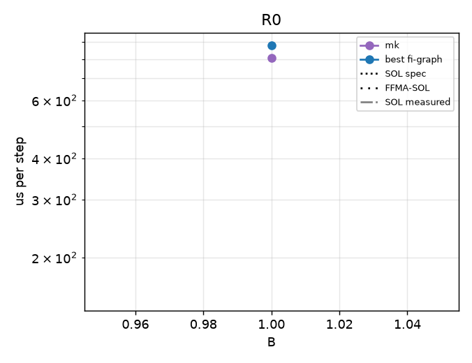
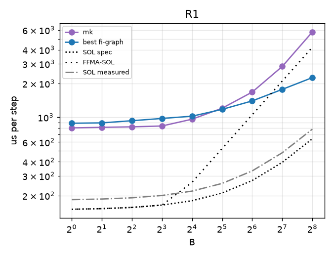
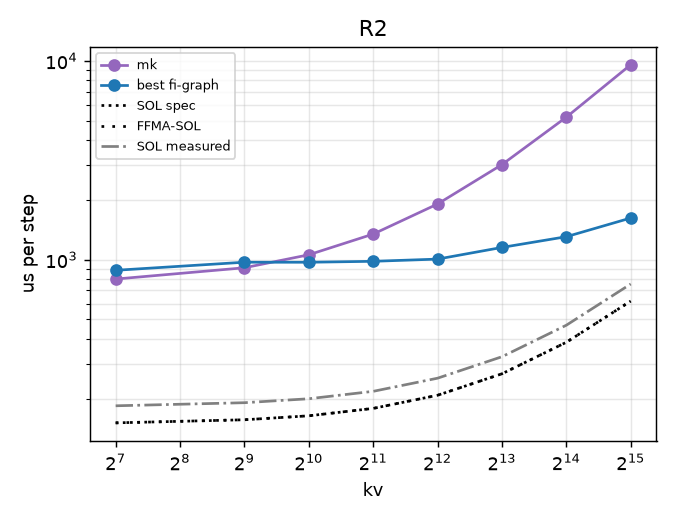
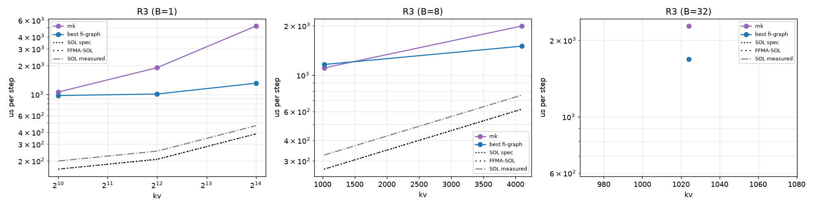
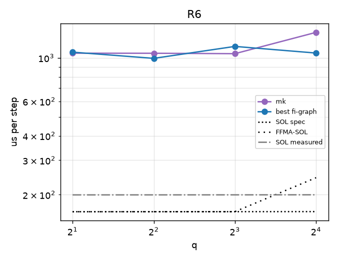

# regimebench report

- Runs: 20261023T184910Z-mk-v1; slurm jobs: 9584 (logs under runs/<run>/ and runs/slurm-<job>.log)
- GPU: NVIDIA B200 (148 SMs), driver 580.178.04, host cayenne
- Versions: torch 2.13.0, flashinfer-python 0.7.0.post1, vllm 0.31.0, triton 3.7.1, nvidia-ml-py 13.615.71; git b83147c854
- SOL spec: 8.0 TB/s, BF16 dense 2.25 PFLOP/s (datasheet-derived, unverified); measured: copy BW 6565 GB/s median, cuBLAS bf16 1658 TFLOP/s, SM clock at probe 1965 MHz
- All times are microseconds per step (steady = back-to-back launches). hv2-repeat is a timing proxy (N repeated b1 decodes), not a correct forward; shown only in R0/R1, where its b1/kv128 work matches the step (elsewhere it skips KV work and can fall below SOL).
- FFMA-SOL = max(T_bw, flops / (148 SMs x 128 lanes x 2 x probed SM clock)); a ceiling for an FP32-FFMA design like hv2g, not for a tensor-core one (hypothesis-grade model, not a measurement).
- Run 20261023T184910Z-mk-v1 (slurm job 9584, SM clock at probe 1965 MHz): regimes R0, R1, R2, R3, R6
- Cross-regime comparisons are across jobs (and possibly GPUs); ratios within a point are interleaved in one job and are the reliable comparison.

## Executive summary

| regime | points | hv2g wins | geomean hv2g/best | crossover (best baseline first beats hv2g) | median %SOL hv2g | median %SOL best |
|---|---|---|---|---|---|---|
| R0 | 1 | 0/0 | - | none | - | 17.1 |
| R1 | 9 | 0/0 | - | none | - | 17.6 |
| R2 | 8 | 0/0 | - | none | - | 19.4 |
| R3 | 6 | 0/0 | - | B=1: none; B=8: none; B=32: none | - | 26.2 |
| R6 | 4 | 0/0 | - | none | - | 15.4 |

## Megakernel arms vs best baseline

| point | SOL us | best baseline us | vllm us | mk us | mk/best |
|---|---|---|---|---|---|
| R0-b1-kv128 | 150.9 | 880.6 | - | 804.8 | 0.91 |
| R1-b1-kv128 | 150.9 | 883.0 | - | 803.0 | 0.91 |
| R1-b2-kv128 | 152.9 | 889.9 | - | 811.8 | 0.91 |
| R1-b4-kv128 | 156.7 | 930.2 | - | 820.4 | 0.88 |
| R1-b8-kv128 | 164.4 | 974.5 | - | 834.7 | 0.86 |
| R1-b16-kv128 | 179.8 | 1020.5 | - | 959.5 | 0.94 |
| R1-b32-kv128 | 210.6 | 1174.1 | - | 1202.1 | 1.02 |
| R1-b64-kv128 | 272.2 | 1396.6 | - | 1674.3 | 1.20 |
| R1-b128-kv128 | 395.5 | 1770.9 | - | 2834.8 | 1.60 |
| R1-b256-kv128 | 641.9 | 2253.9 | - | 5753.6 | 2.55 |
| R2-b1-kv128 | 150.9 | 883.9 | - | 798.7 | 0.90 |
| R2-b1-kv512 | 156.4 | 970.6 | - | 910.3 | 0.94 |
| R2-b1-kv1024 | 163.8 | 970.2 | - | 1058.1 | 1.09 |
| R2-b1-kv2048 | 178.5 | 980.9 | - | 1345.0 | 1.37 |
| R2-b1-kv4096 | 207.8 | 1006.4 | - | 1905.3 | 1.89 |
| R2-b1-kv8192 | 266.5 | 1152.2 | - | 3008.0 | 2.61 |
| R2-b1-kv16384 | 384.0 | 1304.7 | - | 5211.7 | 3.99 |
| R2-b1-kv32768 | 618.9 | 1619.9 | - | 9568.8 | 5.91 |
| R3-b1-kv1024 | 163.8 | 970.0 | - | 1057.0 | 1.09 |
| R3-b1-kv4096 | 207.8 | 1007.0 | - | 1903.4 | 1.89 |
| R3-b1-kv16384 | 384.0 | 1307.3 | - | 5207.0 | 3.98 |
| R3-b8-kv1024 | 267.2 | 1160.9 | - | 1106.6 | 0.95 |
| R3-b8-kv4096 | 619.5 | 1501.0 | - | 1991.1 | 1.33 |
| R3-b32-kv1024 | 621.7 | 1686.0 | - | 2275.5 | 1.35 |
| R6-b1-kv1024-q2 | 163.8 | 1069.7 | - | 1056.7 | 0.99 |
| R6-b1-kv1024-q4 | 163.8 | 994.4 | - | 1055.7 | 1.06 |
| R6-b1-kv1024-q8 | 163.9 | 1144.4 | - | 1050.7 | 0.92 |
| R6-b1-kv1024-q16 | 164.0 | 1058.4 | - | 1349.8 | 1.28 |

## R0

| point | SOL us (bound) | FFMA-SOL us | hv2g us | hv2g mtn us | hv2-repeat us (proxy) | best baseline us (variant) | vllm wall / gpu us | hv2g/best | %SOL hv2g | %FFMA-SOL hv2g | %SOL best |
|---|---|---|---|---|---|---|---|---|---|---|---|
| R0-b1-kv128 | 150.9 (memory) | 150.9 | - | - | - | 880.6 (graph-pdl-best) | - | - | - | - | 17.1 |

## R1

| point | SOL us (bound) | FFMA-SOL us | hv2g us | hv2g mtn us | hv2-repeat us (proxy) | best baseline us (variant) | vllm wall / gpu us | hv2g/best | %SOL hv2g | %FFMA-SOL hv2g | %SOL best |
|---|---|---|---|---|---|---|---|---|---|---|---|
| R1-b1-kv128 | 150.9 (memory) | 150.9 | - | - | - | 883.0 (graph-pdl-best) | - | - | - | - | 17.1 |
| R1-b2-kv128 | 152.9 (memory) | 152.9 | - | - | - | 889.9 (graph-pdl-best) | - | - | - | - | 17.2 |
| R1-b4-kv128 | 156.7 (memory) | 156.7 | - | - | - | 930.2 (graph-pdl-best) | - | - | - | - | 16.8 |
| R1-b8-kv128 | 164.4 (memory) | 164.4 | - | - | - | 974.5 (graph-pdl-best) | - | - | - | - | 16.9 |
| R1-b16-kv128 | 179.8 (memory) | 262.5 | - | - | - | 1020.5 (graph-pdl-best) | - | - | - | - | 17.6 |
| R1-b32-kv128 | 210.6 (memory) | 525.0 | - | - | - | 1174.1 (graph-pdl-best) | - | - | - | - | 17.9 |
| R1-b64-kv128 | 272.2 (memory) | 1050.1 | - | - | - | 1396.6 (graph-pdl-best) | - | - | - | - | 19.5 |
| R1-b128-kv128 | 395.5 (memory) | 2100.2 | - | - | - | 1770.9 (graph-pdl-cublas) | - | - | - | - | 22.3 |
| R1-b256-kv128 | 641.9 (memory) | 4200.4 | - | - | - | 2253.9 (graph-pdl-best) | - | - | - | - | 28.5 |

## R2

| point | SOL us (bound) | FFMA-SOL us | hv2g us | hv2g mtn us | hv2-repeat us (proxy) | best baseline us (variant) | vllm wall / gpu us | hv2g/best | %SOL hv2g | %FFMA-SOL hv2g | %SOL best |
|---|---|---|---|---|---|---|---|---|---|---|---|
| R2-b1-kv128 | 150.9 (memory) | 150.9 | - | - | n/a | 883.9 (graph-pdl-best) | - | - | - | - | 17.1 |
| R2-b1-kv512 | 156.4 (memory) | 156.4 | - | - | n/a | 970.6 (graph-pdl-best) | - | - | - | - | 16.1 |
| R2-b1-kv1024 | 163.8 (memory) | 163.8 | - | - | n/a | 970.2 (graph-pdl-best) | - | - | - | - | 16.9 |
| R2-b1-kv2048 | 178.5 (memory) | 178.5 | - | - | n/a | 980.9 (graph-pdl-best) | - | - | - | - | 18.2 |
| R2-b1-kv4096 | 207.8 (memory) | 207.8 | - | - | n/a | 1006.4 (graph-pdl-best) | - | - | - | - | 20.7 |
| R2-b1-kv8192 | 266.5 (memory) | 266.5 | - | - | n/a | 1152.2 (graph-pdl-best) | - | - | - | - | 23.1 |
| R2-b1-kv16384 | 384.0 (memory) | 384.0 | - | - | n/a | 1304.7 (graph-pdl-best) | - | - | - | - | 29.4 |
| R2-b1-kv32768 | 618.9 (memory) | 618.9 | - | - | n/a | 1619.9 (graph-pdl-best) | - | - | - | - | 38.2 |

## R3

| point | SOL us (bound) | FFMA-SOL us | hv2g us | hv2g mtn us | hv2-repeat us (proxy) | best baseline us (variant) | vllm wall / gpu us | hv2g/best | %SOL hv2g | %FFMA-SOL hv2g | %SOL best |
|---|---|---|---|---|---|---|---|---|---|---|---|
| R3-b1-kv1024 | 163.8 (memory) | 163.8 | - | - | n/a | 970.0 (graph-pdl-best) | - | - | - | - | 16.9 |
| R3-b1-kv4096 | 207.8 (memory) | 207.8 | - | - | n/a | 1007.0 (graph-pdl-best) | - | - | - | - | 20.6 |
| R3-b1-kv16384 | 384.0 (memory) | 384.0 | - | - | n/a | 1307.3 (graph-pdl-best) | - | - | - | - | 29.4 |
| R3-b8-kv1024 | 267.2 (memory) | 267.2 | - | - | n/a | 1160.9 (graph-pdl-best) | - | - | - | - | 23.0 |
| R3-b8-kv4096 | 619.5 (memory) | 619.5 | - | - | n/a | 1501.0 (graph-pdl-best) | - | - | - | - | 41.3 |
| R3-b32-kv1024 | 621.7 (memory) | 621.7 | - | - | n/a | 1686.0 (graph-pdl-best) | - | - | - | - | 36.9 |

## R6

| point | SOL us (bound) | FFMA-SOL us | hv2g us | hv2g mtn us | hv2-repeat us (proxy) | best baseline us (variant) | vllm wall / gpu us | hv2g/best | %SOL hv2g | %FFMA-SOL hv2g | %SOL best |
|---|---|---|---|---|---|---|---|---|---|---|---|
| R6-b1-kv1024-q2 | 163.8 (memory) | 163.8 | - | - | n/a | 1069.7 (graph-pdl-best) | - | - | - | - | 15.3 |
| R6-b1-kv1024-q4 | 163.8 (memory) | 163.8 | - | - | n/a | 994.4 (graph-pdl-best) | - | - | - | - | 16.5 |
| R6-b1-kv1024-q8 | 163.9 (memory) | 163.9 | - | - | n/a | 1144.4 (graph-pdl-best) | - | - | - | - | 14.3 |
| R6-b1-kv1024-q16 | 164.0 (memory) | 244.4 | - | - | n/a | 1058.4 (graph-pdl-best) | - | - | - | - | 15.5 |

## Winner variants and backends

| point | best fi-graph variant | attn backend | gemm | PDL cover | best vllm variant |
|---|---|---|---|---|---|
| R0-b1-kv128 | graph-pdl-best | decode/cute-dsl/tc=True | {'qkv': 'cute-dsl', 'o': 'cute-dsl', 'gu': 'cute-dsl', 'down': 'cute-dsl', 'lm_head': 'cute-dsl'} | 254/312 | - |
| R1-b1-kv128 | graph-pdl-best | decode/cute-dsl/tc=True | {'qkv': 'cute-dsl', 'o': 'cute-dsl', 'gu': 'cute-dsl', 'down': 'cute-dsl', 'lm_head': 'cute-dsl'} | 254/312 | - |
| R1-b2-kv128 | graph-pdl-best | decode/cute-dsl/tc=True | {'qkv': 'cute-dsl', 'o': 'cute-dsl', 'gu': 'cute-dsl', 'down': 'cute-dsl', 'lm_head': 'cute-dsl'} | 254/312 | - |
| R1-b4-kv128 | graph-pdl-best | decode/cute-dsl/tc=True | {'qkv': 'cute-dsl', 'o': 'cute-dsl', 'gu': 'cute-dsl', 'down': 'cute-dsl', 'lm_head': 'cute-dsl'} | 254/312 | - |
| R1-b8-kv128 | graph-pdl-best | decode/cute-dsl/tc=True | {'qkv': 'cute-dsl', 'o': 'tinygemm', 'gu': 'cute-dsl', 'down': 'tinygemm', 'lm_head': 'cute-dsl'} | 254/312 | - |
| R1-b16-kv128 | graph-pdl-best | decode/cute-dsl/tc=True | {'qkv': 'cute-dsl', 'o': 'cute-dsl', 'gu': 'cute-dsl', 'down': 'cute-dsl', 'lm_head': 'cute-dsl'} | 254/312 | - |
| R1-b32-kv128 | graph-pdl-best | decode/trtllm-gen/tc=True | {'qkv': 'cute-dsl', 'o': 'cute-dsl', 'gu': 'cublas', 'down': 'cute-dsl', 'lm_head': 'cublas'} | 225/312 | - |
| R1-b64-kv128 | graph-pdl-best | decode/trtllm-direct | {'qkv': 'cudnn', 'o': 'tgv', 'gu': 'cudnn', 'down': 'tgv', 'lm_head': 'cudnn'} | 197/312 | - |
| R1-b128-kv128 | graph-pdl-cublas | decode/trtllm-gen/tc=True | {'qkv': 'cublas', 'o': 'cublas', 'gu': 'cublas', 'down': 'cublas', 'lm_head': 'cublas'} | 141/312 | - |
| R1-b256-kv128 | graph-pdl-best | decode/auto/tc=False | {'qkv': 'cublas', 'o': 'cute-dsl', 'gu': 'cudnn', 'down': 'cublas', 'lm_head': 'cute-dsl'} | 141/312 | - |
| R2-b1-kv128 | graph-pdl-best | decode/cute-dsl/tc=True | {'qkv': 'cute-dsl', 'o': 'cute-dsl', 'gu': 'cute-dsl', 'down': 'cute-dsl', 'lm_head': 'cute-dsl'} | 254/312 | - |
| R2-b1-kv512 | graph-pdl-best | decode/trtllm-direct | {'qkv': 'cute-dsl', 'o': 'cute-dsl', 'gu': 'cute-dsl', 'down': 'cute-dsl', 'lm_head': 'cute-dsl'} | 254/312 | - |
| R2-b1-kv1024 | graph-pdl-best | decode/trtllm-direct | {'qkv': 'cute-dsl', 'o': 'cute-dsl', 'gu': 'cute-dsl', 'down': 'cute-dsl', 'lm_head': 'cute-dsl'} | 254/312 | - |
| R2-b1-kv2048 | graph-pdl-best | decode/trtllm-direct | {'qkv': 'cute-dsl', 'o': 'cute-dsl', 'gu': 'cute-dsl', 'down': 'cute-dsl', 'lm_head': 'cute-dsl'} | 254/312 | - |
| R2-b1-kv4096 | graph-pdl-best | decode/trtllm-direct | {'qkv': 'cute-dsl', 'o': 'cute-dsl', 'gu': 'cute-dsl', 'down': 'cute-dsl', 'lm_head': 'cute-dsl'} | 254/312 | - |
| R2-b1-kv8192 | graph-pdl-best | decode/trtllm-gen/tc=True | {'qkv': 'cute-dsl', 'o': 'cute-dsl', 'gu': 'cute-dsl', 'down': 'cute-dsl', 'lm_head': 'cute-dsl'} | 254/312 | - |
| R2-b1-kv16384 | graph-pdl-best | decode/trtllm-gen/tc=True | {'qkv': 'cute-dsl', 'o': 'cute-dsl', 'gu': 'cute-dsl', 'down': 'cute-dsl', 'lm_head': 'cute-dsl'} | 254/312 | - |
| R2-b1-kv32768 | graph-pdl-best | decode/trtllm-gen/tc=True | {'qkv': 'cute-dsl', 'o': 'cute-dsl', 'gu': 'cute-dsl', 'down': 'cute-dsl', 'lm_head': 'cute-dsl'} | 254/312 | - |
| R3-b1-kv1024 | graph-pdl-best | decode/trtllm-direct | {'qkv': 'cute-dsl', 'o': 'cute-dsl', 'gu': 'cute-dsl', 'down': 'cute-dsl', 'lm_head': 'cute-dsl'} | 254/312 | - |
| R3-b1-kv4096 | graph-pdl-best | decode/trtllm-gen/tc=True | {'qkv': 'cute-dsl', 'o': 'cute-dsl', 'gu': 'cute-dsl', 'down': 'cute-dsl', 'lm_head': 'cute-dsl'} | 254/312 | - |
| R3-b1-kv16384 | graph-pdl-best | decode/trtllm-gen/tc=True | {'qkv': 'cute-dsl', 'o': 'cute-dsl', 'gu': 'cute-dsl', 'down': 'cute-dsl', 'lm_head': 'cute-dsl'} | 254/312 | - |
| R3-b8-kv1024 | graph-pdl-best | decode/trtllm-direct | {'qkv': 'cute-dsl', 'o': 'tinygemm', 'gu': 'cute-dsl', 'down': 'tinygemm', 'lm_head': 'cute-dsl'} | 254/312 | - |
| R3-b8-kv4096 | graph-pdl-best | decode/trtllm-direct | {'qkv': 'cute-dsl', 'o': 'tinygemm', 'gu': 'cute-dsl', 'down': 'tinygemm', 'lm_head': 'cute-dsl'} | 254/312 | - |
| R3-b32-kv1024 | graph-pdl-best | decode/cute-dsl/tc=True | {'qkv': 'cute-dsl', 'o': 'cute-dsl', 'gu': 'cublas', 'down': 'cute-dsl', 'lm_head': 'cublas'} | 225/312 | - |
| R6-b1-kv1024-q2 | graph-pdl-best | prefill/fa2 | {'qkv': 'cute-dsl', 'o': 'cute-dsl', 'gu': 'cute-dsl', 'down': 'cute-dsl', 'lm_head': 'cute-dsl'} | 254/313 | - |
| R6-b1-kv1024-q4 | graph-pdl-best | prefill/fa2 | {'qkv': 'cute-dsl', 'o': 'cute-dsl', 'gu': 'cute-dsl', 'down': 'cute-dsl', 'lm_head': 'cute-dsl'} | 254/313 | - |
| R6-b1-kv1024-q8 | graph-pdl-best | prefill/fa2 | {'qkv': 'cute-dsl', 'o': 'tinygemm', 'gu': 'cute-dsl', 'down': 'tinygemm', 'lm_head': 'cute-dsl'} | 254/313 | - |
| R6-b1-kv1024-q16 | graph-pdl-best | prefill/fa2 | {'qkv': 'cute-dsl', 'o': 'cute-dsl', 'gu': 'cute-dsl', 'down': 'cute-dsl', 'lm_head': 'cute-dsl'} | 254/313 | - |

## Accuracy (FP32 oracle band, pass = rel-L2 <= 2x BF16 reference's own)

| point | arm:variant | seeds | worst x band (logits/k/v) | next_token match | verdict |
|---|---|---|---|---|---|
| R0-b1-kv128 | fi-graph:eager-pdl-best | 3 | 0.96/0.85/0.85 | 1.00 | pass |
| R0-b1-kv128 | fi-graph:graph-nopdl-best | 3 | 0.96/0.85/0.85 | 1.00 | pass |
| R0-b1-kv128 | fi-graph:graph-nopdl-cublas | 3 | 0.90/0.82/0.82 | 1.00 | pass |
| R0-b1-kv128 | fi-graph:graph-pdl-best | 3 | 0.96/0.85/0.85 | 1.00 | pass |
| R0-b1-kv128 | fi-graph:graph-pdl-cublas | 3 | 0.90/0.82/0.82 | 1.00 | pass |
| R0-b1-kv128 | mk:auto | 3 | 0.60/0.57/0.57 | 1.00 | pass |
| R0-b1-kv128 | mk:auto-direct | 3 | 0.60/0.57/0.57 | 1.00 | pass |
| R1-b64-kv128 | fi-graph:graph-nopdl-best | 3 | 0.80/0.78/0.78 | 0.89 | pass |
| R1-b64-kv128 | fi-graph:graph-nopdl-cublas | 3 | 0.80/0.78/0.78 | 0.89 | pass |
| R1-b64-kv128 | fi-graph:graph-pdl-best | 3 | 0.80/0.78/0.78 | 0.89 | pass |
| R1-b64-kv128 | fi-graph:graph-pdl-cublas | 3 | 0.80/0.78/0.78 | 0.89 | pass |
| R1-b64-kv128 | mk:auto | 3 | 0.49/0.50/0.50 | 0.95 | pass |
| R1-b64-kv128 | mk:auto-direct | 3 | 0.49/0.50/0.50 | 0.92 | pass |
| R1-b8-kv128 | fi-graph:graph-nopdl-best | 3 | 0.82/0.81/0.81 | 1.00 | pass |
| R1-b8-kv128 | fi-graph:graph-nopdl-cublas | 3 | 0.80/0.80/0.80 | 1.00 | pass |
| R1-b8-kv128 | fi-graph:graph-pdl-best | 3 | 0.82/0.81/0.81 | 1.00 | pass |
| R1-b8-kv128 | fi-graph:graph-pdl-cublas | 3 | 0.80/0.80/0.80 | 1.00 | pass |
| R1-b8-kv128 | mk:auto | 3 | 0.50/0.52/0.52 | 0.88 | pass |
| R1-b8-kv128 | mk:auto-direct | 3 | 0.50/0.52/0.52 | 0.88 | pass |
| R2-b1-kv1024 | fi-graph:graph-nopdl-best | 3 | 0.78/0.77/0.77 | 1.00 | pass |
| R2-b1-kv1024 | fi-graph:graph-nopdl-cublas | 3 | 0.80/0.80/0.79 | 1.00 | pass |
| R2-b1-kv1024 | fi-graph:graph-pdl-best | 3 | 0.78/0.77/0.77 | 1.00 | pass |
| R2-b1-kv1024 | fi-graph:graph-pdl-cublas | 3 | 0.80/0.80/0.79 | 1.00 | pass |
| R2-b1-kv1024 | mk:auto | 3 | 0.44/0.44/0.44 | 1.00 | pass |
| R2-b1-kv1024 | mk:auto-direct | 3 | 0.41/0.43/0.43 | 1.00 | pass |
| R2-b1-kv8192 | fi-graph:graph-nopdl-best | 3 | 0.88/0.86/0.87 | 1.00 | pass |
| R2-b1-kv8192 | fi-graph:graph-nopdl-cublas | 3 | 0.87/0.84/0.85 | 1.00 | pass |
| R2-b1-kv8192 | fi-graph:graph-pdl-best | 3 | 0.88/0.86/0.87 | 1.00 | pass |
| R2-b1-kv8192 | fi-graph:graph-pdl-cublas | 3 | 0.87/0.84/0.85 | 1.00 | pass |
| R2-b1-kv8192 | mk:auto | 3 | 0.50/0.49/0.49 | 1.00 | pass |
| R2-b1-kv8192 | mk:auto-direct | 3 | 0.49/0.48/0.49 | 1.00 | pass |
| R3-b8-kv4096 | fi-graph:graph-nopdl-best | 3 | 0.85/0.83/0.84 | 0.88 | pass |
| R3-b8-kv4096 | fi-graph:graph-nopdl-cublas | 3 | 0.85/0.83/0.84 | 0.75 | pass |
| R3-b8-kv4096 | fi-graph:graph-pdl-best | 3 | 0.85/0.83/0.84 | 0.88 | pass |
| R3-b8-kv4096 | fi-graph:graph-pdl-cublas | 3 | 0.85/0.83/0.84 | 0.75 | pass |
| R3-b8-kv4096 | mk:auto | 3 | 0.48/0.48/0.48 | 0.88 | pass |
| R3-b8-kv4096 | mk:auto-direct | 3 | 0.49/0.48/0.48 | 0.88 | pass |
| R6-b1-kv1024-q16 | fi-graph:graph-nopdl-best | 3 | 1.01/0.80/0.80 | 1.00 | pass |
| R6-b1-kv1024-q16 | fi-graph:graph-nopdl-cublas | 3 | 1.02/0.79/0.79 | 0.00 | pass |
| R6-b1-kv1024-q16 | fi-graph:graph-pdl-best | 3 | 1.01/0.80/0.80 | 1.00 | pass |
| R6-b1-kv1024-q16 | fi-graph:graph-pdl-cublas | 3 | 1.02/0.79/0.79 | 0.00 | pass |
| R6-b1-kv1024-q16 | mk:auto | 3 | 0.58/0.46/0.46 | 1.00 | pass |
| R6-b1-kv1024-q16 | mk:auto-direct | 3 | 0.58/0.45/0.46 | 1.00 | pass |
| R6-b1-kv1024-q4 | fi-graph:graph-nopdl-best | 3 | 0.93/0.83/0.83 | 1.00 | pass |
| R6-b1-kv1024-q4 | fi-graph:graph-nopdl-cublas | 3 | 0.89/0.81/0.81 | 1.00 | pass |
| R6-b1-kv1024-q4 | fi-graph:graph-pdl-best | 3 | 0.93/0.83/0.83 | 1.00 | pass |
| R6-b1-kv1024-q4 | fi-graph:graph-pdl-cublas | 3 | 0.89/0.81/0.81 | 1.00 | pass |
| R6-b1-kv1024-q4 | mk:auto | 3 | 0.44/0.44/0.45 | 1.00 | pass |
| R6-b1-kv1024-q4 | mk:auto-direct | 3 | 0.42/0.44/0.44 | 1.00 | pass |

## Skips and errors

- SKIP fi-graph:eager-pdl-best @ R1-b1-kv128: eager variant is only measured at R0
- SKIP fi-graph:eager-pdl-best @ R1-b2-kv128: eager variant is only measured at R0
- SKIP fi-graph:eager-pdl-best @ R1-b4-kv128: eager variant is only measured at R0
- SKIP fi-graph:eager-pdl-best @ R1-b8-kv128: eager variant is only measured at R0
- SKIP fi-graph:eager-pdl-best @ R1-b16-kv128: eager variant is only measured at R0
- SKIP fi-graph:eager-pdl-best @ R1-b32-kv128: eager variant is only measured at R0
- SKIP fi-graph:eager-pdl-best @ R1-b64-kv128: eager variant is only measured at R0
- SKIP fi-graph:eager-pdl-best @ R1-b128-kv128: eager variant is only measured at R0
- SKIP fi-graph:eager-pdl-best @ R1-b256-kv128: eager variant is only measured at R0
- SKIP fi-graph:eager-pdl-best @ R2-b1-kv128: eager variant is only measured at R0
- SKIP fi-graph:eager-pdl-best @ R2-b1-kv512: eager variant is only measured at R0
- SKIP fi-graph:eager-pdl-best @ R2-b1-kv1024: eager variant is only measured at R0
- SKIP fi-graph:eager-pdl-best @ R2-b1-kv2048: eager variant is only measured at R0
- SKIP fi-graph:eager-pdl-best @ R2-b1-kv4096: eager variant is only measured at R0
- SKIP fi-graph:eager-pdl-best @ R2-b1-kv8192: eager variant is only measured at R0
- SKIP fi-graph:eager-pdl-best @ R2-b1-kv16384: eager variant is only measured at R0
- SKIP fi-graph:eager-pdl-best @ R2-b1-kv32768: eager variant is only measured at R0
- SKIP fi-graph:eager-pdl-best @ R3-b1-kv1024: eager variant is only measured at R0
- SKIP fi-graph:eager-pdl-best @ R3-b1-kv4096: eager variant is only measured at R0
- SKIP fi-graph:eager-pdl-best @ R3-b1-kv16384: eager variant is only measured at R0
- SKIP fi-graph:eager-pdl-best @ R3-b8-kv1024: eager variant is only measured at R0
- SKIP fi-graph:eager-pdl-best @ R3-b8-kv4096: eager variant is only measured at R0
- SKIP fi-graph:eager-pdl-best @ R3-b32-kv1024: eager variant is only measured at R0
- SKIP fi-graph:eager-pdl-best @ R6-b1-kv1024-q2: eager variant is only measured at R0
- SKIP fi-graph:eager-pdl-best @ R6-b1-kv1024-q4: eager variant is only measured at R0
- SKIP fi-graph:eager-pdl-best @ R6-b1-kv1024-q8: eager variant is only measured at R0
- SKIP fi-graph:eager-pdl-best @ R6-b1-kv1024-q16: eager variant is only measured at R0
