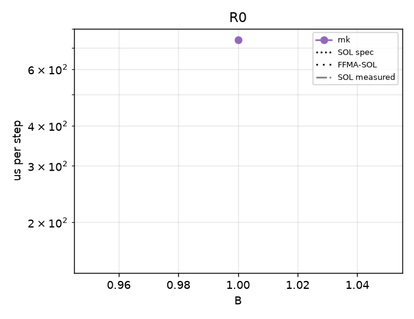
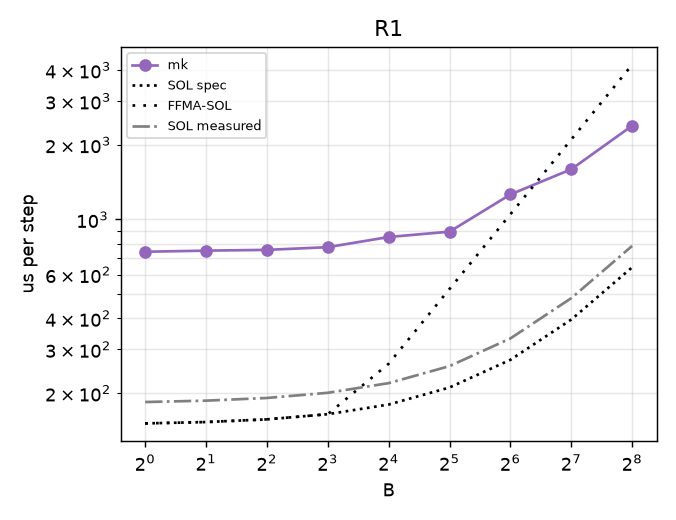
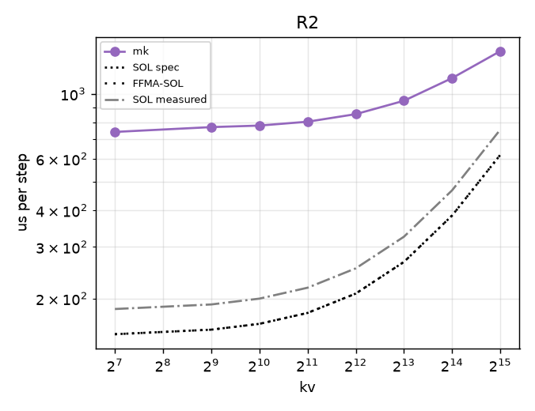
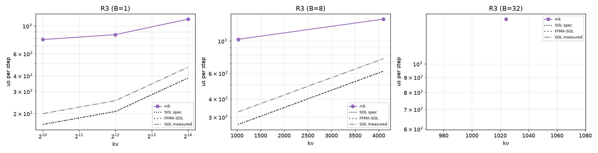
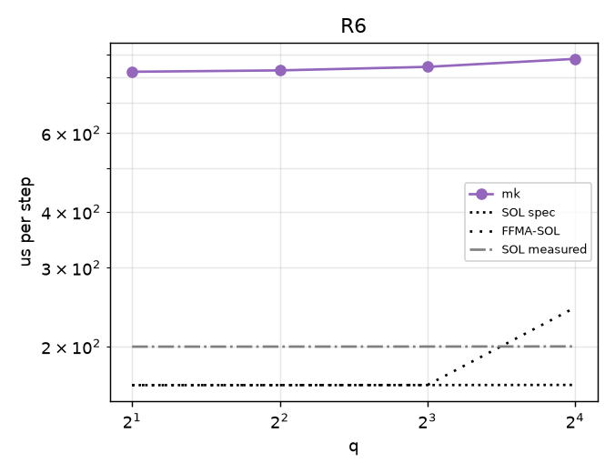

# regimebench report

- Runs: 20261024T025741Z-mk-v14; slurm jobs: 9779 (logs under runs/<run>/ and runs/slurm-<job>.log)
- GPU: NVIDIA B200 (148 SMs), driver 580.178.04, host cayenne
- Versions: torch 2.13.0, flashinfer-python 0.7.0.post1, vllm 0.31.0, triton 3.7.1, nvidia-ml-py 13.615.71; git e941bb22d2
- SOL spec: 8.0 TB/s, BF16 dense 2.25 PFLOP/s (datasheet-derived, unverified); measured: copy BW 6561 GB/s median, cuBLAS bf16 1653 TFLOP/s, SM clock at probe 1965 MHz
- All times are microseconds per step (steady = back-to-back launches). hv2-repeat is a timing proxy (N repeated b1 decodes), not a correct forward; shown only in R0/R1, where its b1/kv128 work matches the step (elsewhere it skips KV work and can fall below SOL).
- FFMA-SOL = max(T_bw, flops / (148 SMs x 128 lanes x 2 x probed SM clock)); a ceiling for an FP32-FFMA design like hv2g, not for a tensor-core one (hypothesis-grade model, not a measurement).
- Run 20261024T025741Z-mk-v14 (slurm job 9779, SM clock at probe 1965 MHz): regimes R0, R1, R2, R3, R6
- Cross-regime comparisons are across jobs (and possibly GPUs); ratios within a point are interleaved in one job and are the reliable comparison.

## Executive summary

| regime | points | hv2g wins | geomean hv2g/best | crossover (best baseline first beats hv2g) | median %SOL hv2g | median %SOL best |
|---|---|---|---|---|---|---|
| R0 | 1 | 0/0 | - | none | - | - |
| R1 | 9 | 0/0 | - | none | - | - |
| R2 | 8 | 0/0 | - | none | - | - |
| R3 | 6 | 0/0 | - | B=1: none; B=8: none; B=32: none | - | - |
| R6 | 4 | 0/0 | - | none | - | - |

## Megakernel arms vs best baseline

| point | SOL us | best baseline us | vllm us | mk us | mk/best |
|---|---|---|---|---|---|
| R0-b1-kv128 | 150.9 | - | - | 740.5 | - |
| R1-b1-kv128 | 150.9 | - | - | 741.5 | - |
| R1-b2-kv128 | 152.9 | - | - | 749.1 | - |
| R1-b4-kv128 | 156.7 | - | - | 754.5 | - |
| R1-b8-kv128 | 164.4 | - | - | 773.6 | - |
| R1-b16-kv128 | 179.8 | - | - | 850.1 | - |
| R1-b32-kv128 | 210.6 | - | - | 893.3 | - |
| R1-b64-kv128 | 272.2 | - | - | 1261.2 | - |
| R1-b128-kv128 | 395.5 | - | - | 1593.4 | - |
| R1-b256-kv128 | 641.9 | - | - | 2385.6 | - |
| R2-b1-kv128 | 150.9 | - | - | 741.0 | - |
| R2-b1-kv512 | 156.4 | - | - | 769.6 | - |
| R2-b1-kv1024 | 163.8 | - | - | 778.9 | - |
| R2-b1-kv2048 | 178.5 | - | - | 803.0 | - |
| R2-b1-kv4096 | 207.8 | - | - | 852.3 | - |
| R2-b1-kv8192 | 266.5 | - | - | 946.8 | - |
| R2-b1-kv16384 | 384.0 | - | - | 1131.8 | - |
| R2-b1-kv32768 | 618.9 | - | - | 1398.8 | - |
| R3-b1-kv1024 | 163.8 | - | - | 778.3 | - |
| R3-b1-kv4096 | 207.8 | - | - | 852.4 | - |
| R3-b1-kv16384 | 384.0 | - | - | 1132.0 | - |
| R3-b8-kv1024 | 267.2 | - | - | 1027.3 | - |
| R3-b8-kv4096 | 619.5 | - | - | 1412.6 | - |
| R3-b32-kv1024 | 621.7 | - | - | 1420.5 | - |
| R6-b1-kv1024-q2 | 163.8 | - | - | 823.0 | - |
| R6-b1-kv1024-q4 | 163.8 | - | - | 828.8 | - |
| R6-b1-kv1024-q8 | 163.9 | - | - | 844.1 | - |
| R6-b1-kv1024-q16 | 164.0 | - | - | 879.5 | - |

## R0

| point | SOL us (bound) | FFMA-SOL us | hv2g us | hv2g mtn us | hv2-repeat us (proxy) | best baseline us (variant) | vllm wall / gpu us | hv2g/best | %SOL hv2g | %FFMA-SOL hv2g | %SOL best |
|---|---|---|---|---|---|---|---|---|---|---|---|
| R0-b1-kv128 | 150.9 (memory) | 150.9 | - | - | - | - | - | - | - | - | - |

## R1

| point | SOL us (bound) | FFMA-SOL us | hv2g us | hv2g mtn us | hv2-repeat us (proxy) | best baseline us (variant) | vllm wall / gpu us | hv2g/best | %SOL hv2g | %FFMA-SOL hv2g | %SOL best |
|---|---|---|---|---|---|---|---|---|---|---|---|
| R1-b1-kv128 | 150.9 (memory) | 150.9 | - | - | - | - | - | - | - | - | - |
| R1-b2-kv128 | 152.9 (memory) | 152.9 | - | - | - | - | - | - | - | - | - |
| R1-b4-kv128 | 156.7 (memory) | 156.7 | - | - | - | - | - | - | - | - | - |
| R1-b8-kv128 | 164.4 (memory) | 164.4 | - | - | - | - | - | - | - | - | - |
| R1-b16-kv128 | 179.8 (memory) | 262.5 | - | - | - | - | - | - | - | - | - |
| R1-b32-kv128 | 210.6 (memory) | 525.0 | - | - | - | - | - | - | - | - | - |
| R1-b64-kv128 | 272.2 (memory) | 1050.1 | - | - | - | - | - | - | - | - | - |
| R1-b128-kv128 | 395.5 (memory) | 2100.2 | - | - | - | - | - | - | - | - | - |
| R1-b256-kv128 | 641.9 (memory) | 4200.4 | - | - | - | - | - | - | - | - | - |

## R2

| point | SOL us (bound) | FFMA-SOL us | hv2g us | hv2g mtn us | hv2-repeat us (proxy) | best baseline us (variant) | vllm wall / gpu us | hv2g/best | %SOL hv2g | %FFMA-SOL hv2g | %SOL best |
|---|---|---|---|---|---|---|---|---|---|---|---|
| R2-b1-kv128 | 150.9 (memory) | 150.9 | - | - | n/a | - | - | - | - | - | - |
| R2-b1-kv512 | 156.4 (memory) | 156.4 | - | - | n/a | - | - | - | - | - | - |
| R2-b1-kv1024 | 163.8 (memory) | 163.8 | - | - | n/a | - | - | - | - | - | - |
| R2-b1-kv2048 | 178.5 (memory) | 178.5 | - | - | n/a | - | - | - | - | - | - |
| R2-b1-kv4096 | 207.8 (memory) | 207.8 | - | - | n/a | - | - | - | - | - | - |
| R2-b1-kv8192 | 266.5 (memory) | 266.5 | - | - | n/a | - | - | - | - | - | - |
| R2-b1-kv16384 | 384.0 (memory) | 384.0 | - | - | n/a | - | - | - | - | - | - |
| R2-b1-kv32768 | 618.9 (memory) | 618.9 | - | - | n/a | - | - | - | - | - | - |

## R3

| point | SOL us (bound) | FFMA-SOL us | hv2g us | hv2g mtn us | hv2-repeat us (proxy) | best baseline us (variant) | vllm wall / gpu us | hv2g/best | %SOL hv2g | %FFMA-SOL hv2g | %SOL best |
|---|---|---|---|---|---|---|---|---|---|---|---|
| R3-b1-kv1024 | 163.8 (memory) | 163.8 | - | - | n/a | - | - | - | - | - | - |
| R3-b1-kv4096 | 207.8 (memory) | 207.8 | - | - | n/a | - | - | - | - | - | - |
| R3-b1-kv16384 | 384.0 (memory) | 384.0 | - | - | n/a | - | - | - | - | - | - |
| R3-b8-kv1024 | 267.2 (memory) | 267.2 | - | - | n/a | - | - | - | - | - | - |
| R3-b8-kv4096 | 619.5 (memory) | 619.5 | - | - | n/a | - | - | - | - | - | - |
| R3-b32-kv1024 | 621.7 (memory) | 621.7 | - | - | n/a | - | - | - | - | - | - |

## R6

| point | SOL us (bound) | FFMA-SOL us | hv2g us | hv2g mtn us | hv2-repeat us (proxy) | best baseline us (variant) | vllm wall / gpu us | hv2g/best | %SOL hv2g | %FFMA-SOL hv2g | %SOL best |
|---|---|---|---|---|---|---|---|---|---|---|---|
| R6-b1-kv1024-q2 | 163.8 (memory) | 163.8 | - | - | n/a | - | - | - | - | - | - |
| R6-b1-kv1024-q4 | 163.8 (memory) | 163.8 | - | - | n/a | - | - | - | - | - | - |
| R6-b1-kv1024-q8 | 163.9 (memory) | 163.9 | - | - | n/a | - | - | - | - | - | - |
| R6-b1-kv1024-q16 | 164.0 (memory) | 244.4 | - | - | n/a | - | - | - | - | - | - |

## Winner variants and backends

| point | best fi-graph variant | attn backend | gemm | PDL cover | best vllm variant |
|---|---|---|---|---|---|
| R0-b1-kv128 | - | - | - | - | - |
| R1-b1-kv128 | - | - | - | - | - |
| R1-b2-kv128 | - | - | - | - | - |
| R1-b4-kv128 | - | - | - | - | - |
| R1-b8-kv128 | - | - | - | - | - |
| R1-b16-kv128 | - | - | - | - | - |
| R1-b32-kv128 | - | - | - | - | - |
| R1-b64-kv128 | - | - | - | - | - |
| R1-b128-kv128 | - | - | - | - | - |
| R1-b256-kv128 | - | - | - | - | - |
| R2-b1-kv128 | - | - | - | - | - |
| R2-b1-kv512 | - | - | - | - | - |
| R2-b1-kv1024 | - | - | - | - | - |
| R2-b1-kv2048 | - | - | - | - | - |
| R2-b1-kv4096 | - | - | - | - | - |
| R2-b1-kv8192 | - | - | - | - | - |
| R2-b1-kv16384 | - | - | - | - | - |
| R2-b1-kv32768 | - | - | - | - | - |
| R3-b1-kv1024 | - | - | - | - | - |
| R3-b1-kv4096 | - | - | - | - | - |
| R3-b1-kv16384 | - | - | - | - | - |
| R3-b8-kv1024 | - | - | - | - | - |
| R3-b8-kv4096 | - | - | - | - | - |
| R3-b32-kv1024 | - | - | - | - | - |
| R6-b1-kv1024-q2 | - | - | - | - | - |
| R6-b1-kv1024-q4 | - | - | - | - | - |
| R6-b1-kv1024-q8 | - | - | - | - | - |
| R6-b1-kv1024-q16 | - | - | - | - | - |

## Accuracy (FP32 oracle band, pass = rel-L2 <= 2x BF16 reference's own)

| point | arm:variant | seeds | worst x band (logits/k/v) | next_token match | verdict |
|---|---|---|---|---|---|
| R0-b1-kv128 | mk:auto | 3 | 0.59/0.57/0.57 | 1.00 | pass |
| R0-b1-kv128 | mk:auto-direct | 3 | 0.60/0.57/0.58 | 1.00 | pass |
| R1-b64-kv128 | mk:auto | 3 | 0.49/0.50/0.50 | 0.95 | pass |
| R1-b64-kv128 | mk:auto-direct | 3 | 0.49/0.50/0.50 | 0.95 | pass |
| R1-b8-kv128 | mk:auto | 3 | 0.50/0.51/0.52 | 0.88 | pass |
| R1-b8-kv128 | mk:auto-direct | 3 | 0.50/0.52/0.52 | 0.75 | pass |
| R2-b1-kv1024 | mk:auto | 3 | 0.42/0.43/0.42 | 1.00 | pass |
| R2-b1-kv1024 | mk:auto-direct | 3 | 0.42/0.43/0.43 | 1.00 | pass |
| R2-b1-kv8192 | mk:auto | 3 | 0.49/0.48/0.49 | 1.00 | pass |
| R2-b1-kv8192 | mk:auto-direct | 3 | 0.50/0.49/0.49 | 1.00 | pass |
| R3-b8-kv4096 | mk:auto | 3 | 0.47/0.47/0.48 | 0.88 | pass |
| R3-b8-kv4096 | mk:auto-direct | 3 | 0.46/0.47/0.47 | 0.88 | pass |
| R6-b1-kv1024-q16 | mk:auto | 3 | 0.53/0.45/0.45 | 1.00 | pass |
| R6-b1-kv1024-q16 | mk:auto-direct | 3 | 0.51/0.45/0.45 | 1.00 | pass |
| R6-b1-kv1024-q4 | mk:auto | 3 | 0.46/0.45/0.45 | 1.00 | pass |
| R6-b1-kv1024-q4 | mk:auto-direct | 3 | 0.47/0.44/0.44 | 1.00 | pass |

## Skips and errors

_none_
