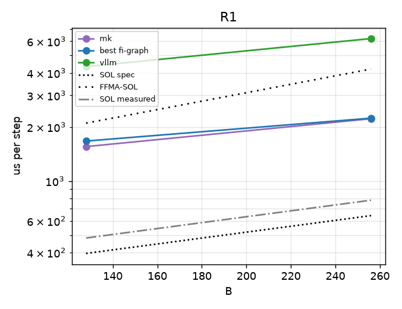

# regimebench report

- Runs: 20261024T035120Z-mk-v16-sota; slurm jobs: 9799 (logs under runs/<run>/ and runs/slurm-<job>.log)
- GPU: NVIDIA B200 (148 SMs), driver 580.178.04, host cayenne
- Versions: torch 2.13.0, flashinfer-python 0.7.0.post1, vllm 0.31.0, triton 3.7.1, nvidia-ml-py 13.615.71; git c69fc8b46b
- SOL spec: 8.0 TB/s, BF16 dense 2.25 PFLOP/s (datasheet-derived, unverified); measured: copy BW 6566 GB/s median, cuBLAS bf16 1662 TFLOP/s, SM clock at probe 1965 MHz
- All times are microseconds per step (steady = back-to-back launches). hv2-repeat is a timing proxy (N repeated b1 decodes), not a correct forward; shown only in R0/R1, where its b1/kv128 work matches the step (elsewhere it skips KV work and can fall below SOL).
- FFMA-SOL = max(T_bw, flops / (148 SMs x 128 lanes x 2 x probed SM clock)); a ceiling for an FP32-FFMA design like hv2g, not for a tensor-core one (hypothesis-grade model, not a measurement).
- Run 20261024T035120Z-mk-v16-sota (slurm job 9799, SM clock at probe 1965 MHz): regimes R1
- Cross-regime comparisons are across jobs (and possibly GPUs); ratios within a point are interleaved in one job and are the reliable comparison.

## Executive summary

| regime | points | hv2g wins | geomean hv2g/best | crossover (best baseline first beats hv2g) | median %SOL hv2g | median %SOL best |
|---|---|---|---|---|---|---|
| R1 | 2 | 0/0 | - | none | - | 26.2 |

## Megakernel arms vs best baseline

| point | SOL us | best baseline us | vllm us | mk us | mk/best |
|---|---|---|---|---|---|
| R1-b128-kv128 | 395.5 | 1669.4 | 4332.6 | 1554.9 | 0.93 |
| R1-b256-kv128 | 641.9 | 2238.4 | 6209.8 | 2222.7 | 0.99 |

## R1

| point | SOL us (bound) | FFMA-SOL us | hv2g us | hv2g mtn us | hv2-repeat us (proxy) | best baseline us (variant) | vllm wall / gpu us | hv2g/best | %SOL hv2g | %FFMA-SOL hv2g | %SOL best |
|---|---|---|---|---|---|---|---|---|---|---|---|
| R1-b128-kv128 | 395.5 (memory) | 2100.2 | - | - | - | 1669.4 (graph-nopdl-cublas) | 4332.6 / 2375.5 (nopdl) | - | - | - | 23.7 |
| R1-b256-kv128 | 641.9 (memory) | 4200.4 | - | - | - | 2238.4 (graph-pdl-best) | 6209.8 / 2996.6 (pdl) | - | - | - | 28.7 |

## Winner variants and backends

| point | best fi-graph variant | attn backend | gemm | PDL cover | best vllm variant |
|---|---|---|---|---|---|
| R1-b128-kv128 | graph-nopdl-cublas | decode/trtllm-direct | {'qkv': 'cublas', 'o': 'cublas', 'gu': 'cublas', 'down': 'cublas', 'lm_head': 'cublas'} | 0/312 | nopdl |
| R1-b256-kv128 | graph-pdl-best | decode/fa2/tc=False | {'qkv': 'cublas', 'o': 'cublas', 'gu': 'cublas', 'down': 'cublas', 'lm_head': 'cute-dsl'} | 141/312 | pdl |

## Accuracy (FP32 oracle band, pass = rel-L2 <= 2x BF16 reference's own)

_no accuracy records_

## Skips and errors

- SKIP fi-graph:eager-pdl-best @ R1-b128-kv128: eager variant is only measured at R0
- SKIP fi-graph:eager-pdl-best @ R1-b256-kv128: eager variant is only measured at R0
