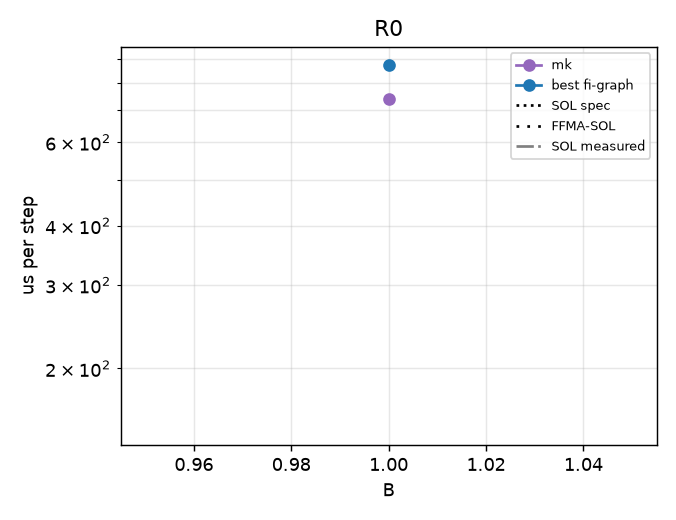
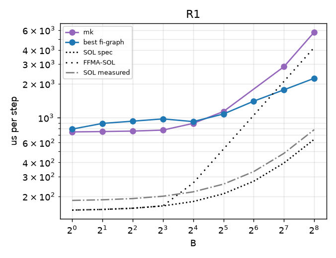
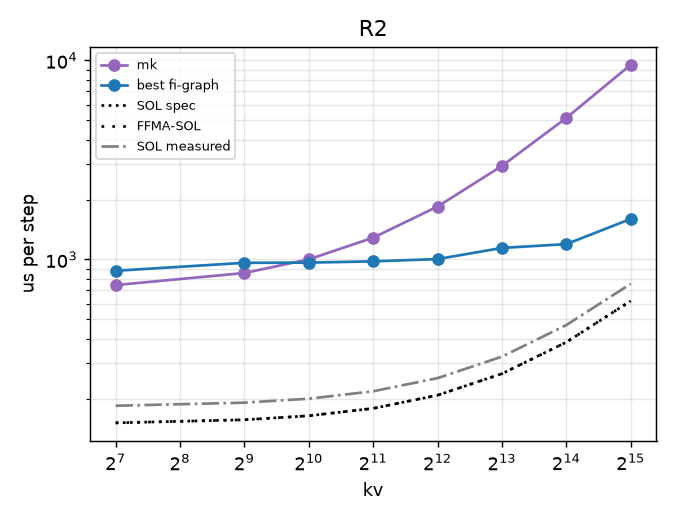
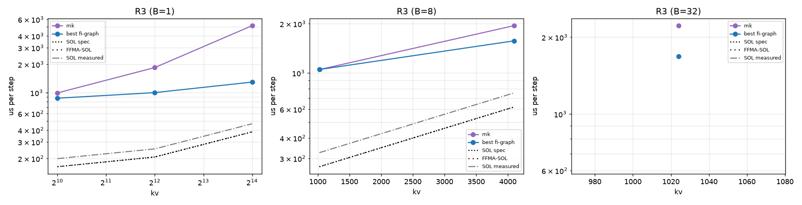
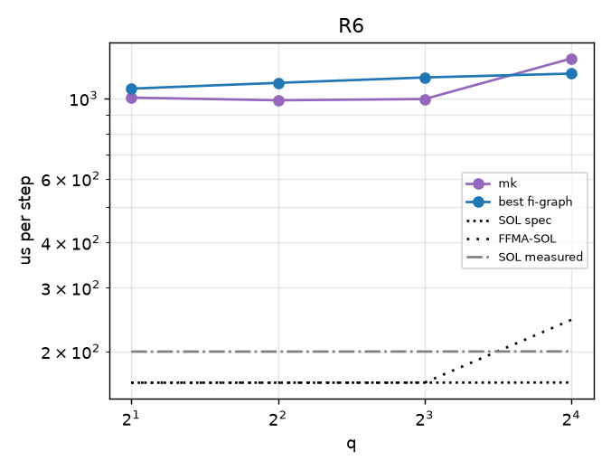

# regimebench report

- Runs: 20261023T190234Z-mk-v2; slurm jobs: 9589 (logs under runs/<run>/ and runs/slurm-<job>.log)
- GPU: NVIDIA B200 (148 SMs), driver 580.178.04, host cayenne
- Versions: torch 2.13.0, flashinfer-python 0.7.0.post1, vllm 0.31.0, triton 3.7.1, nvidia-ml-py 13.615.71; git 7f7aad1557
- SOL spec: 8.0 TB/s, BF16 dense 2.25 PFLOP/s (datasheet-derived, unverified); measured: copy BW 6564 GB/s median, cuBLAS bf16 1648 TFLOP/s, SM clock at probe 1965 MHz
- All times are microseconds per step (steady = back-to-back launches). hv2-repeat is a timing proxy (N repeated b1 decodes), not a correct forward; shown only in R0/R1, where its b1/kv128 work matches the step (elsewhere it skips KV work and can fall below SOL).
- FFMA-SOL = max(T_bw, flops / (148 SMs x 128 lanes x 2 x probed SM clock)); a ceiling for an FP32-FFMA design like hv2g, not for a tensor-core one (hypothesis-grade model, not a measurement).
- Run 20261023T190234Z-mk-v2 (slurm job 9589, SM clock at probe 1965 MHz): regimes R0, R1, R2, R3, R6
- Cross-regime comparisons are across jobs (and possibly GPUs); ratios within a point are interleaved in one job and are the reliable comparison.

## Executive summary

| regime | points | hv2g wins | geomean hv2g/best | crossover (best baseline first beats hv2g) | median %SOL hv2g | median %SOL best |
|---|---|---|---|---|---|---|
| R0 | 1 | 0/0 | - | none | - | 17.3 |
| R1 | 9 | 0/0 | - | none | - | 19.4 |
| R2 | 8 | 0/0 | - | none | - | 19.5 |
| R3 | 6 | 0/0 | - | B=1: none; B=8: none; B=32: none | - | 27.5 |
| R6 | 4 | 0/0 | - | none | - | 14.6 |

## Megakernel arms vs best baseline

| point | SOL us | best baseline us | vllm us | mk us | mk/best |
|---|---|---|---|---|---|
| R0-b1-kv128 | 150.9 | 873.2 | - | 741.0 | 0.85 |
| R1-b1-kv128 | 150.9 | 790.9 | - | 747.1 | 0.94 |
| R1-b2-kv128 | 152.9 | 889.2 | - | 752.6 | 0.85 |
| R1-b4-kv128 | 156.7 | 930.5 | - | 760.0 | 0.82 |
| R1-b8-kv128 | 164.4 | 975.3 | - | 775.3 | 0.79 |
| R1-b16-kv128 | 179.8 | 922.6 | - | 889.6 | 0.96 |
| R1-b32-kv128 | 210.6 | 1077.8 | - | 1134.0 | 1.05 |
| R1-b64-kv128 | 272.2 | 1400.7 | - | - | - |
| R1-b128-kv128 | 395.5 | 1768.1 | - | 2837.6 | 1.60 |
| R1-b256-kv128 | 641.9 | 2237.1 | - | 5756.2 | 2.57 |
| R2-b1-kv128 | 150.9 | 877.1 | - | 743.4 | 0.85 |
| R2-b1-kv512 | 156.4 | 961.5 | - | 854.6 | 0.89 |
| R2-b1-kv1024 | 163.8 | 963.9 | - | 1001.2 | 1.04 |
| R2-b1-kv2048 | 178.5 | 977.8 | - | 1286.4 | 1.32 |
| R2-b1-kv4096 | 207.8 | 1004.1 | - | 1844.5 | 1.84 |
| R2-b1-kv8192 | 266.5 | 1142.6 | - | 2951.1 | 2.58 |
| R2-b1-kv16384 | 384.0 | 1193.6 | - | 5142.7 | 4.31 |
| R2-b1-kv32768 | 618.9 | 1598.3 | - | 9518.1 | 5.95 |
| R3-b1-kv1024 | 163.8 | 873.7 | - | 995.3 | 1.14 |
| R3-b1-kv4096 | 207.8 | 1002.4 | - | 1849.4 | 1.84 |
| R3-b1-kv16384 | 384.0 | 1295.7 | - | 5147.0 | 3.97 |
| R3-b8-kv1024 | 267.2 | 1050.2 | - | 1049.2 | 1.00 |
| R3-b8-kv4096 | 619.5 | 1571.9 | - | 1947.0 | 1.24 |
| R3-b32-kv1024 | 621.7 | 1680.5 | - | 2219.9 | 1.32 |
| R6-b1-kv1024-q2 | 163.8 | 1063.5 | - | 1004.4 | 0.94 |
| R6-b1-kv1024-q4 | 163.8 | 1103.2 | - | 987.5 | 0.90 |
| R6-b1-kv1024-q8 | 163.9 | 1141.8 | - | 995.5 | 0.87 |
| R6-b1-kv1024-q16 | 164.0 | 1170.3 | - | 1288.2 | 1.10 |

## R0

| point | SOL us (bound) | FFMA-SOL us | hv2g us | hv2g mtn us | hv2-repeat us (proxy) | best baseline us (variant) | vllm wall / gpu us | hv2g/best | %SOL hv2g | %FFMA-SOL hv2g | %SOL best |
|---|---|---|---|---|---|---|---|---|---|---|---|
| R0-b1-kv128 | 150.9 (memory) | 150.9 | - | - | - | 873.2 (graph-pdl-best) | - | - | - | - | 17.3 |

## R1

| point | SOL us (bound) | FFMA-SOL us | hv2g us | hv2g mtn us | hv2-repeat us (proxy) | best baseline us (variant) | vllm wall / gpu us | hv2g/best | %SOL hv2g | %FFMA-SOL hv2g | %SOL best |
|---|---|---|---|---|---|---|---|---|---|---|---|
| R1-b1-kv128 | 150.9 (memory) | 150.9 | - | - | - | 790.9 (graph-pdl-best) | - | - | - | - | 19.1 |
| R1-b2-kv128 | 152.9 (memory) | 152.9 | - | - | - | 889.2 (graph-pdl-best) | - | - | - | - | 17.2 |
| R1-b4-kv128 | 156.7 (memory) | 156.7 | - | - | - | 930.5 (graph-pdl-best) | - | - | - | - | 16.8 |
| R1-b8-kv128 | 164.4 (memory) | 164.4 | - | - | - | 975.3 (graph-pdl-best) | - | - | - | - | 16.9 |
| R1-b16-kv128 | 179.8 (memory) | 262.5 | - | - | - | 922.6 (graph-pdl-best) | - | - | - | - | 19.5 |
| R1-b32-kv128 | 210.6 (memory) | 525.0 | - | - | - | 1077.8 (graph-pdl-best) | - | - | - | - | 19.5 |
| R1-b64-kv128 | 272.2 (memory) | 1050.1 | - | - | - | 1400.7 (graph-pdl-best) | - | - | - | - | 19.4 |
| R1-b128-kv128 | 395.5 (memory) | 2100.2 | - | - | - | 1768.1 (graph-pdl-best) | - | - | - | - | 22.4 |
| R1-b256-kv128 | 641.9 (memory) | 4200.4 | - | - | - | 2237.1 (graph-pdl-best) | - | - | - | - | 28.7 |

## R2

| point | SOL us (bound) | FFMA-SOL us | hv2g us | hv2g mtn us | hv2-repeat us (proxy) | best baseline us (variant) | vllm wall / gpu us | hv2g/best | %SOL hv2g | %FFMA-SOL hv2g | %SOL best |
|---|---|---|---|---|---|---|---|---|---|---|---|
| R2-b1-kv128 | 150.9 (memory) | 150.9 | - | - | n/a | 877.1 (graph-pdl-best) | - | - | - | - | 17.2 |
| R2-b1-kv512 | 156.4 (memory) | 156.4 | - | - | n/a | 961.5 (graph-pdl-best) | - | - | - | - | 16.3 |
| R2-b1-kv1024 | 163.8 (memory) | 163.8 | - | - | n/a | 963.9 (graph-pdl-best) | - | - | - | - | 17.0 |
| R2-b1-kv2048 | 178.5 (memory) | 178.5 | - | - | n/a | 977.8 (graph-pdl-best) | - | - | - | - | 18.3 |
| R2-b1-kv4096 | 207.8 (memory) | 207.8 | - | - | n/a | 1004.1 (graph-pdl-best) | - | - | - | - | 20.7 |
| R2-b1-kv8192 | 266.5 (memory) | 266.5 | - | - | n/a | 1142.6 (graph-pdl-best) | - | - | - | - | 23.3 |
| R2-b1-kv16384 | 384.0 (memory) | 384.0 | - | - | n/a | 1193.6 (graph-pdl-best) | - | - | - | - | 32.2 |
| R2-b1-kv32768 | 618.9 (memory) | 618.9 | - | - | n/a | 1598.3 (graph-pdl-best) | - | - | - | - | 38.7 |

## R3

| point | SOL us (bound) | FFMA-SOL us | hv2g us | hv2g mtn us | hv2-repeat us (proxy) | best baseline us (variant) | vllm wall / gpu us | hv2g/best | %SOL hv2g | %FFMA-SOL hv2g | %SOL best |
|---|---|---|---|---|---|---|---|---|---|---|---|
| R3-b1-kv1024 | 163.8 (memory) | 163.8 | - | - | n/a | 873.7 (graph-pdl-best) | - | - | - | - | 18.7 |
| R3-b1-kv4096 | 207.8 (memory) | 207.8 | - | - | n/a | 1002.4 (graph-pdl-best) | - | - | - | - | 20.7 |
| R3-b1-kv16384 | 384.0 (memory) | 384.0 | - | - | n/a | 1295.7 (graph-pdl-best) | - | - | - | - | 29.6 |
| R3-b8-kv1024 | 267.2 (memory) | 267.2 | - | - | n/a | 1050.2 (graph-pdl-best) | - | - | - | - | 25.4 |
| R3-b8-kv4096 | 619.5 (memory) | 619.5 | - | - | n/a | 1571.9 (graph-pdl-best) | - | - | - | - | 39.4 |
| R3-b32-kv1024 | 621.7 (memory) | 621.7 | - | - | n/a | 1680.5 (graph-pdl-best) | - | - | - | - | 37.0 |

## R6

| point | SOL us (bound) | FFMA-SOL us | hv2g us | hv2g mtn us | hv2-repeat us (proxy) | best baseline us (variant) | vllm wall / gpu us | hv2g/best | %SOL hv2g | %FFMA-SOL hv2g | %SOL best |
|---|---|---|---|---|---|---|---|---|---|---|---|
| R6-b1-kv1024-q2 | 163.8 (memory) | 163.8 | - | - | n/a | 1063.5 (graph-pdl-best) | - | - | - | - | 15.4 |
| R6-b1-kv1024-q4 | 163.8 (memory) | 163.8 | - | - | n/a | 1103.2 (graph-pdl-best) | - | - | - | - | 14.8 |
| R6-b1-kv1024-q8 | 163.9 (memory) | 163.9 | - | - | n/a | 1141.8 (graph-pdl-best) | - | - | - | - | 14.4 |
| R6-b1-kv1024-q16 | 164.0 (memory) | 244.4 | - | - | n/a | 1170.3 (graph-pdl-best) | - | - | - | - | 14.0 |

## Winner variants and backends

| point | best fi-graph variant | attn backend | gemm | PDL cover | best vllm variant |
|---|---|---|---|---|---|
| R0-b1-kv128 | graph-pdl-best | decode/cute-dsl/tc=True | {'qkv': 'cute-dsl', 'o': 'cute-dsl', 'gu': 'cute-dsl', 'down': 'cute-dsl', 'lm_head': 'cute-dsl'} | 254/312 | - |
| R1-b1-kv128 | graph-pdl-best | decode/cute-dsl/tc=True | {'qkv': 'cute-dsl', 'o': 'cute-dsl', 'gu': 'cute-dsl', 'down': 'cute-dsl', 'lm_head': 'cute-dsl'} | 254/312 | - |
| R1-b2-kv128 | graph-pdl-best | decode/cute-dsl/tc=True | {'qkv': 'cute-dsl', 'o': 'cute-dsl', 'gu': 'cute-dsl', 'down': 'cute-dsl', 'lm_head': 'cute-dsl'} | 254/312 | - |
| R1-b4-kv128 | graph-pdl-best | decode/cute-dsl/tc=True | {'qkv': 'cute-dsl', 'o': 'cute-dsl', 'gu': 'cute-dsl', 'down': 'cute-dsl', 'lm_head': 'cute-dsl'} | 254/312 | - |
| R1-b8-kv128 | graph-pdl-best | decode/cute-dsl/tc=True | {'qkv': 'cute-dsl', 'o': 'tinygemm', 'gu': 'cute-dsl', 'down': 'tinygemm', 'lm_head': 'cute-dsl'} | 254/312 | - |
| R1-b16-kv128 | graph-pdl-best | decode/cute-dsl/tc=True | {'qkv': 'cute-dsl', 'o': 'cute-dsl', 'gu': 'cute-dsl', 'down': 'cute-dsl', 'lm_head': 'cute-dsl'} | 254/312 | - |
| R1-b32-kv128 | graph-pdl-best | decode/trtllm-direct | {'qkv': 'cute-dsl', 'o': 'cute-dsl', 'gu': 'cublas', 'down': 'cute-dsl', 'lm_head': 'cudnn'} | 225/312 | - |
| R1-b64-kv128 | graph-pdl-best | decode/trtllm-direct | {'qkv': 'cudnn', 'o': 'tgv', 'gu': 'cublas', 'down': 'tgv', 'lm_head': 'cublas'} | 197/312 | - |
| R1-b128-kv128 | graph-pdl-best | decode/trtllm-gen/tc=True | {'qkv': 'cudnn', 'o': 'cublas', 'gu': 'cudnn', 'down': 'cublas', 'lm_head': 'cudnn'} | 141/312 | - |
| R1-b256-kv128 | graph-pdl-best | decode/auto/tc=False | {'qkv': 'cublas', 'o': 'cudnn', 'gu': 'cublas', 'down': 'cudnn', 'lm_head': 'cute-dsl'} | 141/312 | - |
| R2-b1-kv128 | graph-pdl-best | decode/cute-dsl/tc=True | {'qkv': 'cute-dsl', 'o': 'cute-dsl', 'gu': 'cute-dsl', 'down': 'cute-dsl', 'lm_head': 'cute-dsl'} | 254/312 | - |
| R2-b1-kv512 | graph-pdl-best | decode/trtllm-direct | {'qkv': 'cute-dsl', 'o': 'cute-dsl', 'gu': 'cute-dsl', 'down': 'cute-dsl', 'lm_head': 'cute-dsl'} | 254/312 | - |
| R2-b1-kv1024 | graph-pdl-best | decode/trtllm-direct | {'qkv': 'cute-dsl', 'o': 'cute-dsl', 'gu': 'cute-dsl', 'down': 'cute-dsl', 'lm_head': 'cute-dsl'} | 254/312 | - |
| R2-b1-kv2048 | graph-pdl-best | decode/trtllm-direct | {'qkv': 'cute-dsl', 'o': 'cute-dsl', 'gu': 'cute-dsl', 'down': 'cute-dsl', 'lm_head': 'cute-dsl'} | 254/312 | - |
| R2-b1-kv4096 | graph-pdl-best | decode/trtllm-gen/tc=True | {'qkv': 'cute-dsl', 'o': 'cute-dsl', 'gu': 'cute-dsl', 'down': 'cute-dsl', 'lm_head': 'cute-dsl'} | 254/312 | - |
| R2-b1-kv8192 | graph-pdl-best | decode/cute-dsl/tc=True | {'qkv': 'cute-dsl', 'o': 'cute-dsl', 'gu': 'cute-dsl', 'down': 'cute-dsl', 'lm_head': 'cute-dsl'} | 254/312 | - |
| R2-b1-kv16384 | graph-pdl-best | decode/cute-dsl/tc=True | {'qkv': 'cute-dsl', 'o': 'cute-dsl', 'gu': 'cute-dsl', 'down': 'cute-dsl', 'lm_head': 'cute-dsl'} | 254/312 | - |
| R2-b1-kv32768 | graph-pdl-best | decode/cute-dsl/tc=True | {'qkv': 'cute-dsl', 'o': 'cute-dsl', 'gu': 'cute-dsl', 'down': 'cute-dsl', 'lm_head': 'cute-dsl'} | 254/312 | - |
| R3-b1-kv1024 | graph-pdl-best | decode/trtllm-direct | {'qkv': 'cute-dsl', 'o': 'cute-dsl', 'gu': 'cute-dsl', 'down': 'cute-dsl', 'lm_head': 'cute-dsl'} | 254/312 | - |
| R3-b1-kv4096 | graph-pdl-best | decode/trtllm-direct | {'qkv': 'cute-dsl', 'o': 'cute-dsl', 'gu': 'cute-dsl', 'down': 'cute-dsl', 'lm_head': 'cute-dsl'} | 254/312 | - |
| R3-b1-kv16384 | graph-pdl-best | decode/trtllm-direct | {'qkv': 'cute-dsl', 'o': 'cute-dsl', 'gu': 'cute-dsl', 'down': 'cute-dsl', 'lm_head': 'cute-dsl'} | 254/312 | - |
| R3-b8-kv1024 | graph-pdl-best | decode/cute-dsl/tc=True | {'qkv': 'cute-dsl', 'o': 'tinygemm', 'gu': 'cute-dsl', 'down': 'tinygemm', 'lm_head': 'cute-dsl'} | 254/312 | - |
| R3-b8-kv4096 | graph-pdl-best | decode/cute-dsl/tc=True | {'qkv': 'cute-dsl', 'o': 'tinygemm', 'gu': 'cute-dsl', 'down': 'tinygemm', 'lm_head': 'cute-dsl'} | 254/312 | - |
| R3-b32-kv1024 | graph-pdl-best | decode/cute-dsl/tc=True | {'qkv': 'cute-dsl', 'o': 'cute-dsl', 'gu': 'cublas', 'down': 'cute-dsl', 'lm_head': 'cudnn'} | 225/312 | - |
| R6-b1-kv1024-q2 | graph-pdl-best | prefill/fa2 | {'qkv': 'cute-dsl', 'o': 'cute-dsl', 'gu': 'cute-dsl', 'down': 'cute-dsl', 'lm_head': 'cute-dsl'} | 254/313 | - |
| R6-b1-kv1024-q4 | graph-pdl-best | prefill/fa2 | {'qkv': 'cute-dsl', 'o': 'cute-dsl', 'gu': 'cute-dsl', 'down': 'cute-dsl', 'lm_head': 'cute-dsl'} | 254/313 | - |
| R6-b1-kv1024-q8 | graph-pdl-best | prefill/fa2 | {'qkv': 'cute-dsl', 'o': 'tinygemm', 'gu': 'cute-dsl', 'down': 'tinygemm', 'lm_head': 'cute-dsl'} | 254/313 | - |
| R6-b1-kv1024-q16 | graph-pdl-best | prefill/fa2 | {'qkv': 'cute-dsl', 'o': 'cute-dsl', 'gu': 'cute-dsl', 'down': 'cute-dsl', 'lm_head': 'cute-dsl'} | 254/313 | - |

## Accuracy (FP32 oracle band, pass = rel-L2 <= 2x BF16 reference's own)

| point | arm:variant | seeds | worst x band (logits/k/v) | next_token match | verdict |
|---|---|---|---|---|---|
| R0-b1-kv128 | fi-graph:eager-pdl-best | 3 | 0.96/0.85/0.85 | 1.00 | pass |
| R0-b1-kv128 | fi-graph:graph-nopdl-best | 3 | 0.96/0.85/0.85 | 1.00 | pass |
| R0-b1-kv128 | fi-graph:graph-nopdl-cublas | 3 | 0.90/0.82/0.82 | 1.00 | pass |
| R0-b1-kv128 | fi-graph:graph-pdl-best | 3 | 0.96/0.85/0.85 | 1.00 | pass |
| R0-b1-kv128 | fi-graph:graph-pdl-cublas | 3 | 0.90/0.82/0.82 | 1.00 | pass |
| R0-b1-kv128 | mk:auto | 3 | 0.59/0.56/0.57 | 1.00 | pass |
| R0-b1-kv128 | mk:auto-direct | 3 | 0.60/0.56/0.57 | 1.00 | pass |
| R1-b64-kv128 | fi-graph:graph-nopdl-best | 3 | 0.80/0.78/0.78 | 0.89 | pass |
| R1-b64-kv128 | fi-graph:graph-nopdl-cublas | 3 | 0.80/0.78/0.78 | 0.89 | pass |
| R1-b64-kv128 | fi-graph:graph-pdl-best | 3 | 0.80/0.78/0.78 | 0.89 | pass |
| R1-b64-kv128 | fi-graph:graph-pdl-cublas | 3 | 0.80/0.78/0.78 | 0.89 | pass |
| R1-b8-kv128 | fi-graph:graph-nopdl-best | 3 | 0.82/0.81/0.81 | 1.00 | pass |
| R1-b8-kv128 | fi-graph:graph-nopdl-cublas | 3 | 0.80/0.80/0.80 | 1.00 | pass |
| R1-b8-kv128 | fi-graph:graph-pdl-best | 3 | 0.82/0.81/0.81 | 1.00 | pass |
| R1-b8-kv128 | fi-graph:graph-pdl-cublas | 3 | 0.80/0.80/0.80 | 1.00 | pass |
| R1-b8-kv128 | mk:auto | 3 | 0.50/0.52/0.52 | 0.88 | pass |
| R1-b8-kv128 | mk:auto-direct | 3 | 0.50/0.52/0.52 | 0.88 | pass |
| R2-b1-kv1024 | fi-graph:graph-nopdl-best | 3 | 0.78/0.77/0.77 | 1.00 | pass |
| R2-b1-kv1024 | fi-graph:graph-nopdl-cublas | 3 | 0.80/0.80/0.79 | 1.00 | pass |
| R2-b1-kv1024 | fi-graph:graph-pdl-best | 3 | 0.78/0.77/0.77 | 1.00 | pass |
| R2-b1-kv1024 | fi-graph:graph-pdl-cublas | 3 | 0.80/0.80/0.79 | 1.00 | pass |
| R2-b1-kv1024 | mk:auto | 3 | 0.41/0.42/0.42 | 1.00 | pass |
| R2-b1-kv1024 | mk:auto-direct | 3 | 0.42/0.43/0.43 | 1.00 | pass |
| R2-b1-kv8192 | fi-graph:graph-nopdl-best | 3 | 0.85/0.81/0.82 | 1.00 | pass |
| R2-b1-kv8192 | fi-graph:graph-nopdl-cublas | 3 | 0.91/0.89/0.90 | 1.00 | pass |
| R2-b1-kv8192 | fi-graph:graph-pdl-best | 3 | 0.85/0.81/0.82 | 1.00 | pass |
| R2-b1-kv8192 | fi-graph:graph-pdl-cublas | 3 | 0.91/0.89/0.90 | 1.00 | pass |
| R2-b1-kv8192 | mk:auto | 3 | 0.49/0.48/0.49 | 1.00 | pass |
| R2-b1-kv8192 | mk:auto-direct | 3 | 0.49/0.48/0.49 | 1.00 | pass |
| R3-b8-kv4096 | fi-graph:graph-nopdl-best | 3 | 0.86/0.85/0.86 | 0.88 | pass |
| R3-b8-kv4096 | fi-graph:graph-nopdl-cublas | 3 | 0.83/0.83/0.83 | 0.88 | pass |
| R3-b8-kv4096 | fi-graph:graph-pdl-best | 3 | 0.86/0.85/0.86 | 0.88 | pass |
| R3-b8-kv4096 | fi-graph:graph-pdl-cublas | 3 | 0.83/0.83/0.83 | 0.88 | pass |
| R3-b8-kv4096 | mk:auto | 3 | 0.49/0.48/0.48 | 0.88 | pass |
| R3-b8-kv4096 | mk:auto-direct | 3 | 0.49/0.48/0.48 | 0.88 | pass |
| R6-b1-kv1024-q16 | fi-graph:graph-nopdl-best | 3 | 1.01/0.80/0.80 | 1.00 | pass |
| R6-b1-kv1024-q16 | fi-graph:graph-nopdl-cublas | 3 | 1.02/0.79/0.79 | 0.00 | pass |
| R6-b1-kv1024-q16 | fi-graph:graph-pdl-best | 3 | 1.01/0.80/0.80 | 1.00 | pass |
| R6-b1-kv1024-q16 | fi-graph:graph-pdl-cublas | 3 | 1.02/0.79/0.79 | 0.00 | pass |
| R6-b1-kv1024-q16 | mk:auto | 3 | 0.59/0.45/0.46 | 1.00 | pass |
| R6-b1-kv1024-q16 | mk:auto-direct | 3 | 0.57/0.45/0.46 | 1.00 | pass |
| R6-b1-kv1024-q4 | fi-graph:graph-nopdl-best | 3 | 0.93/0.83/0.83 | 1.00 | pass |
| R6-b1-kv1024-q4 | fi-graph:graph-nopdl-cublas | 3 | 0.89/0.81/0.81 | 1.00 | pass |
| R6-b1-kv1024-q4 | fi-graph:graph-pdl-best | 3 | 0.93/0.83/0.83 | 1.00 | pass |
| R6-b1-kv1024-q4 | fi-graph:graph-pdl-cublas | 3 | 0.89/0.81/0.81 | 1.00 | pass |
| R6-b1-kv1024-q4 | mk:auto | 3 | 0.41/0.43/0.44 | 1.00 | pass |
| R6-b1-kv1024-q4 | mk:auto-direct | 3 | 0.46/0.42/0.43 | 1.00 | pass |

## Skips and errors

- SKIP fi-graph:eager-pdl-best @ R1-b1-kv128: eager variant is only measured at R0
- SKIP fi-graph:eager-pdl-best @ R1-b2-kv128: eager variant is only measured at R0
- SKIP fi-graph:eager-pdl-best @ R1-b4-kv128: eager variant is only measured at R0
- SKIP fi-graph:eager-pdl-best @ R1-b8-kv128: eager variant is only measured at R0
- SKIP fi-graph:eager-pdl-best @ R1-b16-kv128: eager variant is only measured at R0
- SKIP fi-graph:eager-pdl-best @ R1-b32-kv128: eager variant is only measured at R0
- SKIP fi-graph:eager-pdl-best @ R1-b64-kv128: eager variant is only measured at R0
- SKIP fi-graph:eager-pdl-best @ R1-b128-kv128: eager variant is only measured at R0
- SKIP fi-graph:eager-pdl-best @ R1-b256-kv128: eager variant is only measured at R0
- SKIP fi-graph:eager-pdl-best @ R2-b1-kv128: eager variant is only measured at R0
- SKIP fi-graph:eager-pdl-best @ R2-b1-kv512: eager variant is only measured at R0
- SKIP fi-graph:eager-pdl-best @ R2-b1-kv1024: eager variant is only measured at R0
- SKIP fi-graph:eager-pdl-best @ R2-b1-kv2048: eager variant is only measured at R0
- SKIP fi-graph:eager-pdl-best @ R2-b1-kv4096: eager variant is only measured at R0
- SKIP fi-graph:eager-pdl-best @ R2-b1-kv8192: eager variant is only measured at R0
- SKIP fi-graph:eager-pdl-best @ R2-b1-kv16384: eager variant is only measured at R0
- SKIP fi-graph:eager-pdl-best @ R2-b1-kv32768: eager variant is only measured at R0
- SKIP fi-graph:eager-pdl-best @ R3-b1-kv1024: eager variant is only measured at R0
- SKIP fi-graph:eager-pdl-best @ R3-b1-kv4096: eager variant is only measured at R0
- SKIP fi-graph:eager-pdl-best @ R3-b1-kv16384: eager variant is only measured at R0
- SKIP fi-graph:eager-pdl-best @ R3-b8-kv1024: eager variant is only measured at R0
- SKIP fi-graph:eager-pdl-best @ R3-b8-kv4096: eager variant is only measured at R0
- SKIP fi-graph:eager-pdl-best @ R3-b32-kv1024: eager variant is only measured at R0
- SKIP fi-graph:eager-pdl-best @ R6-b1-kv1024-q2: eager variant is only measured at R0
- SKIP fi-graph:eager-pdl-best @ R6-b1-kv1024-q4: eager variant is only measured at R0
- SKIP fi-graph:eager-pdl-best @ R6-b1-kv1024-q8: eager variant is only measured at R0
- SKIP fi-graph:eager-pdl-best @ R6-b1-kv1024-q16: eager variant is only measured at R0
- ERROR mk:auto @ R1-b64-kv128 [prepare]: RuntimeError('NVRTC compile failed:\nmk.cu(441): error: static assertion failed with "host dyn_smem (build.py) != kernel DYN_SMEM"\n  static_assert(MK_EXPECT_DYN == DYN_SMEM, "host dyn_smem (build.py) != kernel DYN_SMEM");\n  ^\n\nmk.cu(255): warning #177-D: variable "N_BARRIERS" was declared but never referenced\n  constexpr int N_BARRIERS = 1 + 6 * NLAY;      // grid barriers per launch\n                ^\n\nRemark: The warnings can be suppressed with "-diag-suppress <warning-number>"\n\nmk.cu(370): warning #177-D: variable "MK_CG" was declared but never referenced\n  constexpr int MK_CG = 1;   // cta_group of the MMA engine (only 1 is implemented)\n                ^\n\n1 error detected in the compilation of "mk.cu".') | 1 error detected in the compilation of "mk.cu".
- ERROR mk:auto-direct @ R1-b64-kv128 [prepare]: RuntimeError('NVRTC compile failed:\nmk.cu(441): error: static assertion failed with "host dyn_smem (build.py) != kernel DYN_SMEM"\n  static_assert(MK_EXPECT_DYN == DYN_SMEM, "host dyn_smem (build.py) != kernel DYN_SMEM");\n  ^\n\nmk.cu(255): warning #177-D: variable "N_BARRIERS" was declared but never referenced\n  constexpr int N_BARRIERS = 1 + 6 * NLAY;      // grid barriers per launch\n                ^\n\nRemark: The warnings can be suppressed with "-diag-suppress <warning-number>"\n\nmk.cu(370): warning #177-D: variable "MK_CG" was declared but never referenced\n  constexpr int MK_CG = 1;   // cta_group of the MMA engine (only 1 is implemented)\n                ^\n\n1 error detected in the compilation of "mk.cu".') | 1 error detected in the compilation of "mk.cu".
